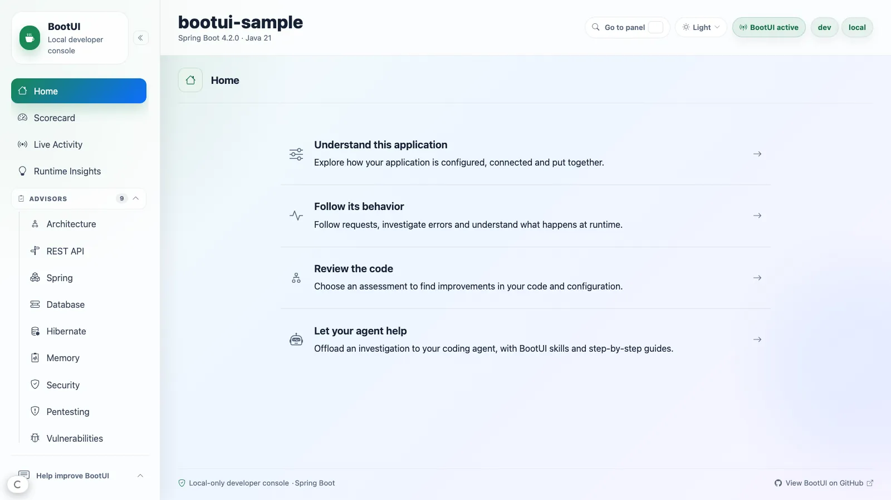

# Features

These groups match the console's own menu. Pick one to read its panels in detail, or use the search box to jump
straight to a panel by name.

| Group | Panels | What it answers |
| ----- | ------ | --------------- |
| [Home](./README.md) | Home · Scorecard · Live Activity · Runtime Insights | Find a panel through the Home guides, compare [Scorecard](./scorecard.md) assessments, follow [Live Activity](./live-activity.md), or inspect [Runtime Insights](./runtime-insights.md). |
| [Advisors](./advisors.md) | Architecture · REST API · Spring · Quarkus · Database · Hibernate · Memory · Security · Pentesting · Vulnerabilities | What is wrong with my app, and how do I fix it? |
| [Runtime](./runtime.md) | Health · HTTP Sessions · Metrics · Live Memory · JVM Tuning · Heap Dump · Threads · Startup Timeline · GraalVM · CRaC | How is the JVM behaving right now? |
| [Configuration](./configuration.md) | Configuration · Profile Diff · Loggers · Beans · Conditions · Mappings | What configuration and wiring is actually effective? |
| [Database](./database.md) | Database Connection Pools · PostgreSQL · MySQL · SQL Trace · Transactions · Hibernate Statistics · Spring Data · Flyway · Liquibase | What is my app doing to the database? |
| [Security](./security.md) | Spring Security · Security Logs | How is access actually enforced? |
| [Services](./services.md) | Scheduled Tasks · REST Client · Fault Tolerance · WebSockets · AI Framework · Cache · Email · Kafka · RabbitMQ · JMS | What is my app talking to? |
| [Diagnostics](./diagnostics.md) | Traces · Log Tail · Exceptions · HTTP Exchanges · HTTP Probe | Why did that request fail? |
| [Instrumentation](./java-agent.md) | Java Agent · Code Paths · Code Inventory · Side Effects | Did my change run? Where does the handler's time go? What did my route start? |
| [Developer tools](./developer-tools.md) | MCP Server · Command Line · Spring DevTools · Dev Services · Copilot · Claude Code · GitHub | What is my toolchain doing locally? |

## Home

The Home guide below is an **unreleased source preview**; see [setup](../SETUP.md#open-the-console).

Home (`#/home`) starts with **Understand this application**, **Follow its behavior**, **Review the code**, and **Let your agent
help**. Choose a guide, then a topic, then a panel. Only one level appears at a time; sliding transitions follow your
direction, and breadcrumbs take you back. Reduced-motion preferences are respected.
The Home icon and title return to the initial four choices.

Panel destinations have a plain title and a right-hand arrow. Unavailable destinations show their status instead;
agent skill and playbook choices first open a local explanation. Its documentation link has a link icon and a
new-tab indicator; only that link leaves BootUI. Each installation command block has a top-right copy button;
if clipboard access is blocked, select its text to copy manually. Opening the explanation or copying commands
never executes them.

Every panel has a place in the three diagnostic guides; useful destinations can appear more than once. Under
**Follow its behavior**, find Threads and Heap Dump in **Memory, CPU or concurrency**, and Startup Timeline in
**Startup or executed code**. Short explanations distinguish live memory usage from the Memory advisor.

**Let your agent help** explains the [BootUI skill and investigation playbooks](../AI-AGENTS.md) locally and routes to
the MCP Server and Command Line panels. Give an agent a goal and agree on what it may run or change; opening this
guide does not enable tools or start an agent.

Choosing a branch only reveals navigation. It does not open panels, collect diagnostics, run health checks or
assessments, or contact external services. Unavailable and disabled destinations explain why; read-only destinations
remain navigable. Framework labels and availability follow the running application's panel manifest.

Home has no refresh widget or polling. Your chosen level survives navigating to a panel and returning.
The [Scorecard](./scorecard.md) stays separate at `#/scorecard`; existing `#/overview` links still redirect there.

## Rules that apply to every panel

**An old tab can recover after a UI rebuild.** When a panel's JavaScript or stylesheet is no longer available, BootUI
keeps the current panel and offers **Reload BootUI**, which fetches the current UI and opens the intended panel,
including its route query and hash. Custom console mounts are preserved.

Reloading discards unsaved input, so BootUI never does it for you. If loading still fails, the alert stays available.
There is no automatic retry, reload loop, or background connection probe, and ordinary panel and API errors keep their
existing handling.

**Unavailable panels are visible, not hidden.** When a panel's backing infrastructure is missing, the sidebar moves it
into a collapsed *Disabled / unavailable* group, and opening it shows the reason at the top of the page. The panels that
need the BootUI agent are the exception: without the agent they stay in the *Instrumentation* group, dimmed, with the reason
as their tooltip, so they can be found before the agent is attached. A panel turned off by configuration always moves to
*Disabled / unavailable*.

The vendor-specific database panels are the exception. PostgreSQL and MySQL appear only when that vendor's JDBC driver
is on the runtime classpath. With the driver present but no matching datasource configured they are listed as
unavailable, as above; with no driver at all they are absent from the sidebar and from `/bootui/api/panels`, and their
API path returns 404.

**Every panel can be turned off.** Use `bootui.panels.<panel-id>.enabled=false`. Panels with browser-triggered actions
also support `bootui.panels.<panel-id>.read-only=true`, and `bootui.read-only=true` makes all of BootUI read-only. See
the [property reference](../PROPERTIES.md) for the complete list.

**Changing server state always asks first.** Restarting a dev service, capturing or deleting a heap dump, writing a
GraalVM or CRaC artifact, running a migration, clearing a cache or trace buffer, and destroying an HTTP session each
open a confirmation dialog naming the affected resource. Read-only scans and reversible toggles never prompt.

::: details How the confirmation dialog behaves
The dialog flags irreversible operations, defaults focus to Cancel, dismisses on Escape or a backdrop click, and honors
`prefers-reduced-motion`.
:::

**BootUI hides itself by default.** Beans, Conditions, Mappings, Loggers, Metrics, Startup Timeline, Scheduled Tasks,
Cache, Spring Security, HTTP Exchanges, and Traces exclude BootUI's own runtime data, so they stay focused on your
application. Set `bootui.monitoring.exclude-self=false` to include BootUI internals while debugging the console.

## Availability per stack

Spring MVC is the reference stack. For per-panel availability on the other two, see
[Framework support](../FRAMEWORK-SUPPORT.md). The running console is always the better answer: every panel that cannot
run says so in the sidebar and explains why when you open it.
