# Advisors

BootUI's advisors run explicit, on-demand, rule-based scans and report severity-ranked findings together with their
coverage limits. Each advisor is read-only and inspects one facet of the application: compiled architecture, the REST
layer, the live Spring context, persistence, JVM memory, and security.

A usable assessment shows the same 0–100 **Known-findings score** in its own panel and on the Scorecard: 100 minus the
weighted finding penalty. That number summarizes retained penalties. It is not a measure of application health or
safety.

### Reading every retained violation

Architecture, Hibernate, Spring (the Quarkus application advisor on Quarkus), REST API, Memory, Security, and Database
keep their reports compact: `violationCount` is the real count, while `sampleViolations` is a preview, normally at most
ten entries per rule.

When a rule has more findings than samples, choose **View violations** to read its first bounded page inline (100 by
default). Larger sets use **Previous** and **Next**; **Back to samples** restores the preview. Opening a panel, receiving
a report, and dismissing a rule never request detail pages. Detail reads work in read-only mode and never rescan.

Only the latest scan's details are retained, up to `bootui.advisors.max-retained-violations` (default **10000**) across
all rules of an advisor. When some counted details are missing, the panel says so through the retained count and a
warning. Raising the limit needs a new scan to take effect. See the
[property reference](../PROPERTIES.md#advisor-violation-retention).

::: details Snapshot and retention

Each report has additive `violationDetails` metadata:

| Field            | Meaning                                                                                     |
| ---------------- | ------------------------------------------------------------------------------------------- |
| `scanId`         | Opaque identity of the latest published scan; `null` before a completed scan.               |
| `total`          | Concrete violations counted across all rules, before dismissal.                             |
| `retained`       | Number of sanitized detail entries retained across those rules.                             |
| `retentionLimit` | Effective per-advisor limit frozen for this scan.                                           |
| `truncated`      | Some counted details are missing from the retained index.                                   |
| `locationNotes`  | Why some [violation locations](#violation-locations) carry no source path; empty otherwise. |

While another scan is running, detail reads still refer to the previous completed snapshot; publishing its replacement
changes the ID. Dismiss and restore change neither the ID nor the retained details. Retention completeness is not
evidence coverage or score eligibility. `truncated` can also mean the source exposed only aggregate detail, as for
Quarkus Security's `QS-AUTHZ-004`; BootUI never fabricates identities to fill that gap.
:::

#### REST, MCP, and CLI retrieval

Read the cached report first, then pass its `violationDetails.scanId` with every page request. An MCP or CLI scan
answers with a [compact summary](../AI-AGENTS.md#compact-answers-from-scans-and-capture-controls) that carries the same
`violationDetails` and at most ten `topFindings`; the REST scan still returns the full report.

```text
GET <api>/<advisor>/rules/<encoded-rule-id>/violations?scanId=<encoded-scan-id>&offset=0&limit=100
```

| Advisor / REST root | MCP tool                               | CLI command               |
| ------------------- | -------------------------------------- | ------------------------- |
| `architecture`      | `get_architecture_rule_violations`     | `architecture violations` |
| `hibernate`         | `get_hibernate_rule_violations`        | `hibernate violations`    |
| `spring`            | `get_spring_rule_violations`           | `spring violations`       |
| `rest-api`          | `get_rest_api_rule_violations`         | `rest-api violations`     |
| `memory`            | `get_memory_rule_violations`           | `memory violations`       |
| `security`          | `get_security_rule_violations`         | `security violations`     |
| `database-advisor`  | `get_database_advisor_rule_violations` | `db violations`           |

`scanId` and the rule ID are required. Offset defaults to zero and limit to 100, capped at 1000. See [MCP](../AI-AGENTS.md)
and [CLI](../CLI.md) for setup.

::: details Examples, page shape, and errors

```bash
# Read only the cached report; this does not run a scan.
curl -s http://localhost:8080/bootui/api/architecture | jq '.violationDetails'
# Substitute the returned scanId, retaining the same value for every page.
curl -sG http://localhost:8080/bootui/api/architecture/rules/ARCH-SPRING-004/violations \
  --data-urlencode 'scanId=<returned-scan-id>' --data-urlencode 'offset=0' --data-urlencode 'limit=100'

bootui architecture violations ARCH-SPRING-004 --scan-id '<returned-scan-id>' --offset 0 --limit 100
```

```json
{
  "name": "get_architecture_rule_violations",
  "arguments": {"id": "ARCH-SPRING-004", "scanId": "<returned-scan-id>", "offset": 0, "limit": 100}
}
```

The page contains `scanId`, `ruleId`, the full `violationCount`, `retainedCount`, `truncated`, sanitized `violations`,
`page: {total, matched, offset, limit, returned, hasMore}`, and `locations`. `page.total` and `page.matched` count
**retained** entries. To continue, set the next offset to `page.offset + page.returned` while `page.hasMore` is true,
keeping the same scan ID, and still check `truncated` on the last page.

Invalid, blank, negative, fractional, or overflowing arguments are rejected. An MCP `-32003` response-byte refusal is an
error, not an empty page: retry the same scan ID and offset with a smaller limit. A missing or replaced snapshot returns
**409**; choose **Refresh cached report** (it never starts a scan), then **View violations** again. A rule id outside the
advisor's catalogue answers `Unknown advisor rule` (REST **404**, CLI-facade **400**). Dismissed findings remain
retrievable by ID. GraalVM/CRaC occurrences, Pentesting, and Vulnerabilities use different report models and are not
covered.
:::

### Violation locations

Architecture, REST API, and Hibernate findings that name exactly one code element also say where it is. Each rule result
carries `sampleLocations` aligned with `sampleViolations`, and each detail page carries `locations` aligned with
`violations`; a `null` entry means that violation has no location. Findings that span several elements (package cycles,
duplicate routes) and findings of other advisors keep no location. Nothing is parsed from the violation text or guessed.

In the panels, each row shows its location with a **Copy location** button, for example
`com.example.OrderService#place (OrderService.java:42)`. The **Open locations in** selector is a per-browser preference,
off (**None**) by default; **VS Code** or **IntelliJ IDEA** turns each location with a source path into an editor link
(`vscode://file/…` or `idea://open?file=…`). BootUI never opens an editor or a file from the server.

::: details Location fields and where they come from

| Field        | Meaning                                                                                                    |
| ------------ | ---------------------------------------------------------------------------------------------------------- |
| `className`  | JVM binary class name, such as `com.example.Outer$Inner` or a Kotlin `OrderUtilsKt` file facade.           |
| `memberName` | Method, constructor (`<init>`), or field name; `null` for the class itself or a compiler-generated member. |
| `kind`       | `CLASS`, `METHOD`, `CONSTRUCTOR`, or `FIELD`.                                                              |
| `sourceFile` | The source file name the class file records; a Kotlin facade or companion names its declaring `.kt` file.  |
| `line`       | A positive line in that file, or `null` when unknown or not verifiable.                                    |
| `sourcePath` | The absolute local source path resolved during the scan, or `null`.                                        |
| `precision`  | `LINE` when a line is known, `MEMBER` when only the member is, otherwise `CLASS`.                          |

- **Architecture** reads locations from ArchUnit's violating objects: the class, the member, and the line.
- **REST API** points at the handler method, exception handler, throwing endpoint, or controller class.
- **Hibernate** points at the entity class, the field or getter behind a mapped attribute, or a repository method. The JPA
  metamodel has no line numbers, so these stay at `MEMBER` or `CLASS` precision.

Source paths are resolved only during an explicit scan, through the Architecture advisor's bounded module and
source-set lookup (see [Generated application code](../ARCHITECTURE-CHECKS.md#generated-application-code)). A class in a
local Maven `target/classes` or Gradle `build/classes` directory maps to exactly one `.java` or `.kt` file. Classes read
from an archive, other layouts, ambiguous matches, and an exhausted lookup budget keep a `null` path, and
`violationDetails.locationNotes` says why. The lookup never follows symbolic links. Source paths describe the
developer's own code, so they are not gated by the value-exposure policy.

A line is shown only when it belongs to the named member in the named file. Lines from Kotlin inlined code, past the end
of the file, or from archive-read Kotlin classes drop to `MEMBER` precision rather than show a wrong one.
:::

### Score eligibility

A report is not automatically eligible for a score. `SCANNED` and `PARTIAL` reports can score when a valid severity
summary accompanies known-severity findings or proven completed applicable checks. `ERROR`, `DISABLED`, and
`NOT_SCANNED` never score, and malformed evidence stays unscored with an explanation. An empty summary, a rule registry
size, or an all-skipped or all-failed report does not establish a clean assessment.

The penalties are fixed: CRITICAL 25, HIGH 10, MEDIUM 3, LOW 1, and INFO or NONE 0, clamped and rounded to 0–100. A
partial 100 means no active penalties in the assessed evidence, not that unchecked work passed.

Advisor panels show **Results available** for usable scored results, with reasons in a collapsed **Scan notes**
disclosure. The Scorecard shows **Scan complete**, **Not scored**, or **Not applicable** (confirmed empty scope) and an
**Open panel** link. Advisor panels use neutral score colors; the Scorecard uses green, amber, and red at the 80 and 50
thresholds. See [Scorecard](scorecard.md).

::: details The evidence object and eligibility rules

The backend's `evidence` object is the sole eligibility authority:

| Field              | Meaning                                                                                                                                                                                                                                                              |
| ------------------ | -------------------------------------------------------------------------------------------------------------------------------------------------------------------------------------------------------------------------------------------------------------------- |
| `usable`           | At least one applicable check completed, or a genuine known-severity finding was observed, before filtering or dismissal. Genuine INFO and NONE findings can establish usability; informational missing-evidence notices and UNKNOWN-only vulnerability data cannot. |
| `coverageComplete` | Applicable evidence is complete. Checks that do not apply are neutral; missing required observations and failures leave coverage incomplete.                                                                                                                         |
| `limitations`      | An immutable, bounded, sanitized list of explanations for incomplete coverage.                                                                                                                                                                                       |

The browser never reconstructs applicability. MySQL and Oracle checks on a PostgreSQL-only application stay neutral
skipped diagnostics. A `SCANNED` report with `usable: false` and `coverageComplete: true` has no score and reads **Not
applicable**, for example an Architecture import that found no classes. Legacy reports without valid evidence stay
unscored.

Known-severity dependency findings establish usability before dismissal. A fully assessed package does too when every
retained advisory has a known severity, or the result is genuinely empty, and both `assessment.queryComplete` and
`assessment.detailAssessmentComplete` are true. UNKNOWN findings stay visible with no penalty, and UNKNOWN-only evidence
stays unscored unless independent usable evidence exists. Dismissed known findings remain evidence while their
penalties are removed. Inventory, query, and detail gaps qualify a score rather than suppressing it. EPSS never decides
eligibility.

The last accepted report stays visible during a new request and when transport fails. A newly received report replaces
it.
:::

### Single-flight scans

Expensive advisor actions are single-flight per scanner: a second tab, a Scorecard card, a REST caller, or an MCP tool
cannot start a scanner while it is active. Duplicate requests fail immediately with the shared `409` busy response, and
the panel keeps the last completed report visible. Different scanners remain independent.

### Dismissing findings

Any finding can be dismissed when it does not apply to your project. **Dismiss** moves the rule into a collapsed
_Dismissed rules_ list and removes it from the finding count, severity bars, and known-findings score, in both the panel
and the Scorecard. Restore it at any time from that list. Dismissal changes penalties, not application safety, observed
evidence, or missing coverage. Controls are disabled while a scan or dismissal is pending, and when the panel is
read-only or unavailable.

::: details Where dismissals are stored

Dismissals are persisted under the `dismissedRules` node of a local `.bootui/boot-ui.yml` file (next to the runtime
overrides file), so they survive restarts and stay consistent between each panel and the Scorecard. The file is
developer-local and intended to be git-ignored. Rule identifiers are globally unique across advisors. Pentesting scan
reports are not persisted: findings and dismissal flags reappear after you explicitly run the first scan.

`bootui.overrides-file` moves both files together, which lets dismissals survive a container image rebuild. See
[Persisting console state across image rebuilds](../setup/environments.md#persisting-console-state-across-image-rebuilds).
:::

### Kotlin applications

The bytecode-driven advisors (Architecture, REST API, Hibernate) are Kotlin-aware without configuration and without
adding `kotlin-stdlib` to your application. Behaviour is identical on all three stacks.

::: details What Kotlin awareness covers

- Compiler-generated members and classes (`$default` bridges, data-class `componentN`/`copy`, `Companion`, `DefaultImpls`,
  `WhenMappings`, `FooKt` file facades) never appear as findings.
- Suspending functions are judged on their declared signature: the `Continuation` parameter is hidden and `kotlin.Unit`
  counts as `void`.
- A `lateinit var` on an entity is not a public-field finding; a `@JvmField var` still is.
- Variants of a `sealed class` exception hierarchy are not renaming findings.
- Suppressing compiler noise never suppresses your code: `$default` calls are followed through, and a self-invocation in a
  lambda stays reported.
- Recommendations offer the Kotlin equivalent, such as `open` or the `kotlin-spring` plugin and constructor `val`
  injection.

See [Architecture checks](../ARCHITECTURE-CHECKS.md), [REST API checks](../REST-API-CHECKS.md), and
[Hibernate checks](../HIBERNATE-CHECKS.md).
:::

## Architecture

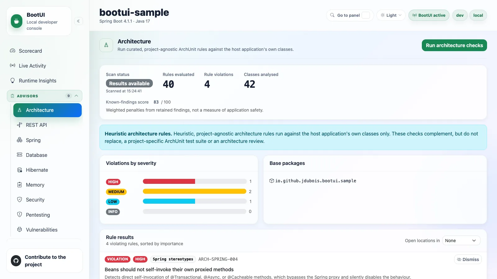

The Architecture panel runs a curated, zero-config [ArchUnit](https://www.archunit.org/) ruleset against the host
application's own compiled classes. It evaluates package cycles, general coding practices, and Spring stereotype and
proxy heuristics (no field injection, correct layering, no self-invocation). See
[ARCHITECTURE-CHECKS.md](../ARCHITECTURE-CHECKS.md) for the full catalogue.

The scan runs on demand and caches its last report. The results list shows only violating rules, sorted by severity and
violation count. Treat it as a starting point that complements a project-specific ArchUnit suite. Coding-practice
checks (`ARCH-CODE-*`) exclude classes positively identified as generated; see
[generated-code scope and limitations](../ARCHITECTURE-CHECKS.md#generated-application-code).

> **Not available in GraalVM native images.** The advisor scans compiled `.class` files via ArchUnit's
> `ClassFileImporter`, which is incompatible with a native executable; the panel moves to the sidebar's
> _Disabled / unavailable_ group and explains why.

::: details On Quarkus

The panel runs the same ruleset and report contract. The `java.util.logging` check is skipped, standard-annotation field
injection is reported at LOW, and Spring-only annotation rules find nothing. The Spring self-invocation rule is skipped
because Arc supports intercepted self-invocation.

Quarkus has no `@SpringBootApplication` to read, so base packages are discovered at **build time** from the Jandex
index. Discovery is single-module; the `bootui.internal.base-packages` key (comma-separated) overrides it.
:::

## REST API

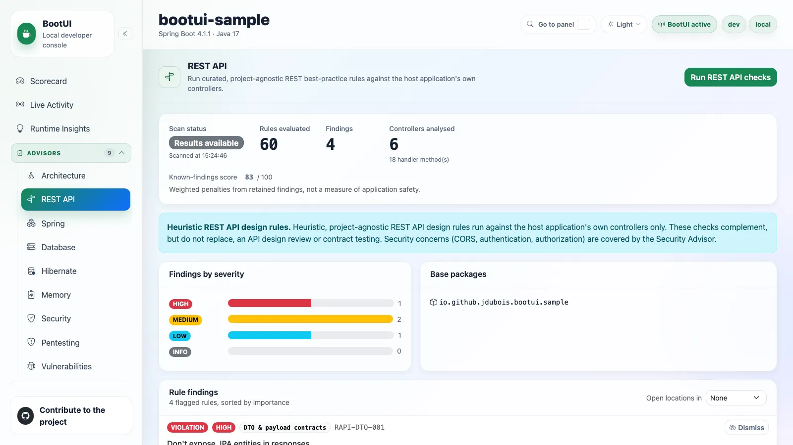

The REST API panel runs a curated, zero-config ruleset against the host application's web layer: `@RestController` /
`@Controller` handlers on Spring, or JAX-RS resources on Quarkus. It derives a read-only model (methods, paths,
parameters, return types, validation, declared throws) and evaluates 60 stable rule definitions across eight categories,
of which 53 can emit a finding: routing, naming, status codes, validation, DTO contracts, pagination, versioning, and
error handling and documentation. The `RAPI-DOC-*` rules run only when Swagger or MicroProfile OpenAPI annotations are
present. Security concerns belong to the Security panel.

The scan runs on demand and caches its last report; the list shows only flagged rules. See
[REST API checks](../REST-API-CHECKS.md) for the full catalogue.

### Declared error contract

The panel also shows the application's **declared error contract**: every `@ControllerAdvice` /
`@RestControllerAdvice` / `@ExceptionHandler` on Spring, and every Jakarta REST `ExceptionMapper` and Quarkus REST
`@ServerExceptionMapper` on Quarkus. Each row names the handled exception type, the declaring method, the scope, the
resolved precedence, the declared HTTP status, the response-body category, and the media types.

This is a pure declaration read: no handler is invoked and no request is synthesized, so anything the declarations
cannot prove is reported as unresolved. Only the application's own declarations are listed. When a retained
Exceptions-panel failure maps to exactly one declared handler, that panel links to the declaration here.

::: details Cases reported as unresolved

- An advice that implements `Ordered` chooses its position at runtime, so its whole precedence group is ambiguous.
- A Spring handler without `@ResponseBody` renders a view, so its body category is unresolved.
- On Quarkus only `@Provider`-annotated `ExceptionMapper`s are listed.
  :::

> **Not available in GraalVM native images.** The advisor scans compiled `.class` files via ArchUnit's
> `ClassFileImporter`, which is incompatible with a native executable; the panel moves to the sidebar's
> _Disabled / unavailable_ group and explains why.

## Spring

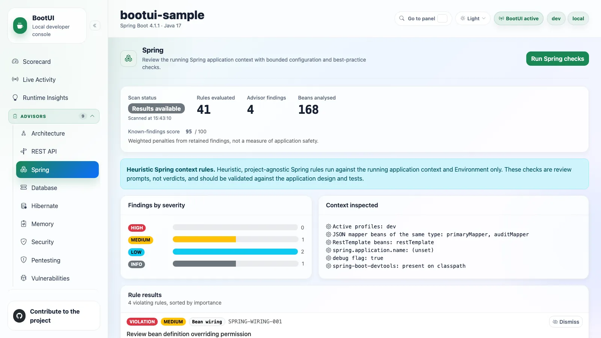

The Spring panel runs an explicit, read-only scan of the running Spring application context and `Environment`. It takes
a bounded snapshot of selected bean groups and feature flags, then evaluates a curated ruleset across bean wiring,
configuration hygiene, profiles, performance and concurrency (including virtual threads), web settings, data and
persistence, Actuator exposure, and reactive (WebFlux-only) checks. See [SPRING-CHECKS.md](../SPRING-CHECKS.md).

It focuses on "started but suboptimal" states and complements the Architecture panel by inspecting the live, wired
context. It never mutates the context, intercepts traffic, or surfaces secrets. On MVC, Open Session in View is reported
as present, confirmed absent, or unknown from actual registration metadata. This advisor is **relabelled per
framework**: **Spring** on Spring Boot, **Quarkus** on Quarkus, with the same menu slot and `/bootui/api/spring`
contract.

## Quarkus

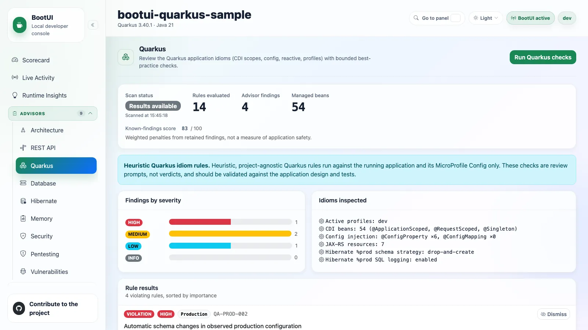

On the Quarkus adapter the framework-application advisor is relabelled **Quarkus** and runs a Quarkus-native ruleset
against the running application and its MicroProfile `Config`:

- Resolved CDI/Arc scopes: public fields on normal-scoped beans and public state on singleton beans and REST resources.
- Production configuration evidence: schema actions, SQL and bind-parameter logging, explicit in-memory storage.
- Managed REST-client timers, HTTP compression, and request-draining configuration.
- Conditional synchronized virtual-thread pinning on JDK 21-23.

Missing annotations or production overrides are not defects by themselves, and incomplete evidence is reported
explicitly rather than treated as clean. See [QUARKUS-ADVISOR-CHECKS.md](../QUARKUS-ADVISOR-CHECKS.md).

## Database

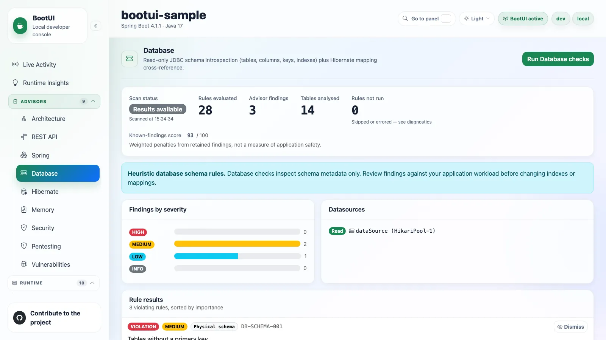

The Database panel introspects the physical schema of every discovered application `DataSource` through plain JDBC
`DatabaseMetaData` (tables, columns, keys, indexes) and evaluates a fixed, on-demand ruleset of deterministic structural
checks. It never executes DDL and never queries application data. See
[DATABASE-ADVISOR-CHECKS.md](../DATABASE-ADVISOR-CHECKS.md).

Each scan runs under fixed bounds (at most 300 tables, 300 columns and 100 indexes per table, a 20-second budget, a
5-second timeout per catalog statement) and reports what it could not do. Unreadable datasources, truncated scans, and
skipped or errored rules appear as statuses and diagnostics, never as passing checks. Credentials in JDBC URLs and
driver errors are redacted.

| Status     | Meaning                                     |
| ---------- | ------------------------------------------- |
| `SCANNED`  | Everything was read completely              |
| `PARTIAL`  | Something was not read                      |
| `ERROR`    | Discovery failed or no schema could be read |
| `DISABLED` | Successful discovery found no datasource    |

For **PostgreSQL**, **MySQL**, **MariaDB**, and **Oracle** (19c+), dialect-specific catalog checks run in addition to the
generic ones. Every other database (H2, SQL Server, and so on) still runs the full generic ruleset. When a Hibernate
metamodel is available, the panel also cross-references the physical schema against mapped JPA entities, and skips that
half with a stated reason otherwise.

::: details The generic structural checks

- A missing primary key, excluding framework-generated one-row identifier tables.
- A physical foreign key without a known leading-column access path, as a contextual review.
- Exact ordinary-index definition overlap, not merely a shorter leading prefix.
- A foreign-key column whose type disagrees with the column it references.
- A redundant unique index duplicating the primary key.
- Duplicate foreign-key constraints.
- A narrow auto-generated primary key.
- A MySQL invisible, MariaDB ignored, or Oracle invisible index that writes still maintain.
  :::

::: details What each dialect adds

**PostgreSQL:**

- Invalid or broken indexes.
- A sequence nearing exhaustion, measured against the smaller of its own maximum and its owning column's capacity.
- Constraints currently not validated.
- A table publishing updates or deletes with no usable replica identity.
- An `UNLOGGED` table or leaf partition.

**MySQL/MariaDB:**

- Tables on a non-transactional storage engine.
- The legacy three-byte `utf8mb3` character set.
- An `AUTO_INCREMENT` counter nearing its column type's capacity.

**Oracle:**

- Unusable indexes, including per-partition status.
- Disabled or unvalidated constraints.
- A non-cycling sequence or identity generator nearing exhaustion.

The dialect comes from `DatabaseMetaData.getDatabaseProductName()`, the version string, and the JDBC URL; MariaDB is
detected as its own dialect even through the MySQL driver, and an "Oracle" product name is confirmed against
`v$version` before Oracle checks run. Oracle reads use only `ALL_*` views and `SYS_CONTEXT`, with no `ojdbc`
dependency in BootUI. Partitioned tables are reported once on the parent.
:::

::: details What the Hibernate cross-reference checks

- An explicit association without a matching physical foreign-key constraint, excluding `NO_CONSTRAINT`.
- An explicit declared table or column name not observed in the scoped metadata.
- Supported nondefault nullability mismatches, not guessed Java-to-JDBC type mappings.
- A declared `@Column(length=...)` longer than a bounded physical string column.
- A positive `@Column(precision=..., scale=...)` wider than a bounded physical `DECIMAL`/`NUMERIC` column.
- A mapped unique constraint with no physical index that enforces it.
- An explicitly named `@Id` with `GenerationType.IDENTITY` whose PostgreSQL/MySQL/MariaDB column reports no
  auto-increment, identity, default, or generated value.

Only entities with an explicit `@Table(name = ...)` are cross-referenced. These are declaration-versus-observation
reviews, not validation of the effective runtime mapping, since the advisor reads only the standard JPA metamodel and
does not resolve the physical naming strategy. A mapped name matching tables in several datasources is treated as
ambiguous. The panel proposes no query-based optimizations, execution-plan analysis, or index suggestions from usage.
:::

::: details On Quarkus

The panel is identical, over the same report contract. `DataSource` beans are discovered through `@Any Instance<DataSource>`
and de-duplicated by the physical pool behind BootUI's SQL Trace wrapper. Datasource names come from the Agroal
`@DataSource("...")` qualifier, read reflectively so no `io.agroal` type is linked; otherwise they fall back to
positional names (`default`, `datasource-2`). The Hibernate cross-reference needs `quarkus-hibernate-orm`.
:::

## Hibernate

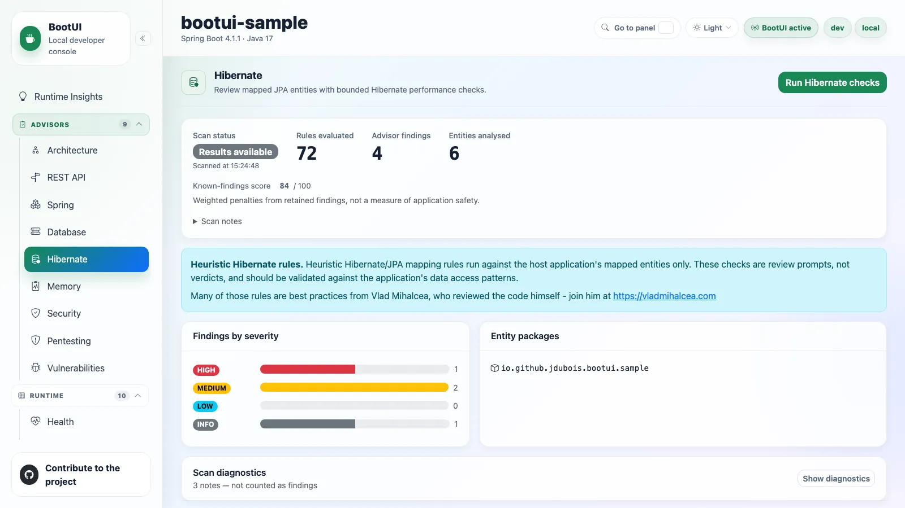

The Hibernate panel runs an explicit, read-only scan against the JPA `EntityManagerFactory` metamodel when Hibernate ORM
is present. It reviews mapped entities, persistence-unit observations, and Spring Data JPA repository metadata for
common performance and mapping risks: eager fetching, problematic identifier generators, collection fetch pagination,
unsafe cascades, cache misconfiguration, and risky `ddl-auto` values. It never intercepts queries, invokes
repositories, executes SQL, or modifies mappings. See [HIBERNATE-CHECKS.md](../HIBERNATE-CHECKS.md).

The catalog has 72 active rules. Unavailable observations and rule failures yield `PARTIAL` while keeping valid
findings, and the report's `diagnostics` (**Scan diagnostics** in the panel) names every failed or incompletely evaluated
rule. A finding whose rule was only partly evaluated carries a `coverageNote`. An empty findings list is not proof that
every mapping or query was verified.

::: details On Quarkus

The panel runs the same 72-rule registry when `quarkus-hibernate-orm` is present, discovering entities from the live
`EntityManagerFactory` across all persistence units. Spring Data query rules skip when repository metadata is
unavailable. Differences:

- **Effective factory settings are unit-scoped.** Named units do not inherit the first factory's values.
- **Bytecode enhancement is always enabled**, so known-absent-enhancement findings do not fire.
- **Panache active-record entities** are handled specially (see below).

| Spring / native Hibernate key                            | Quarkus equivalent                                                           |
| -------------------------------------------------------- | ---------------------------------------------------------------------------- |
| `ddl-auto` / `hbm2ddl.auto`                              | `quarkus.hibernate-orm.schema-management.strategy` (\*)                      |
| `show-sql`                                               | `quarkus.hibernate-orm.log.sql`                                              |
| `format_sql`                                             | `quarkus.hibernate-orm.log.format-sql`                                       |
| `batch_size`                                             | `quarkus.hibernate-orm.jdbc.statement-batch-size`                            |
| `default_batch_fetch_size`                               | `quarkus.hibernate-orm.fetch.batch-size`                                     |
| `jdbc.time_zone`                                         | `quarkus.hibernate-orm.jdbc.timezone`                                        |
| `generate_statistics`                                    | `quarkus.hibernate-orm.statistics`                                           |
| `query.in_clause_parameter_padding`                      | `quarkus.hibernate-orm.query.in-clause-parameter-padding`                    |
| `query.fail_on_pagination_over_collection_fetch`         | `quarkus.hibernate-orm.query.fail-on-pagination-over-collection-fetch`       |
| `cache.use_query_cache` / `cache.use_second_level_cache` | `quarkus.hibernate-orm.second-level-caching-enabled` (single unified toggle) |

(\*) In Quarkus 3.33.3.1, an explicitly configured deprecated `quarkus.hibernate-orm.database.generation` takes
precedence. Quarkus/Jakarta `create` is create-only, while Hibernate `hbm2ddl.auto=create` is destructive; the advisor
preserves that difference.

With verified Panache transformation, the public-persistent-field finding does not fire, and the `id` field of Panache's base entity is ignored by the `@GeneratedValue` check.
:::

## Memory

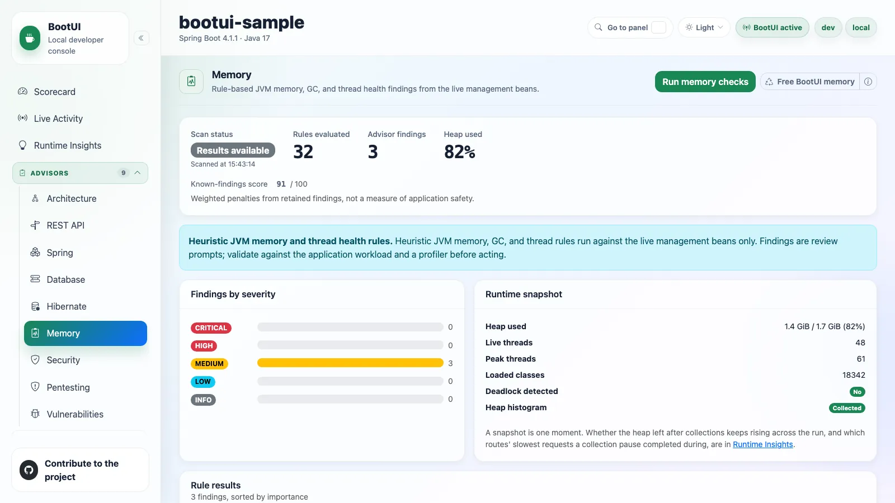

The Memory panel runs an explicit, read-only scan over the live JVM management beans: heap and memory pools, garbage
collection, threads, loaded classes, and an optional class histogram. It reports severity-ranked findings such as heap
pressure, metaspace saturation, native-footprint risk inside a container, lifetime GC overhead, thread deadlocks, and
collection bloat. It complements the Live Memory and Threads panels by diagnosing the data they expose. The scan is on
demand and caches the last report. See [MEMORY-CHECKS.md](../MEMORY-CHECKS.md). The shared
[Free BootUI memory](runtime.md#free-bootui-memory) header action drops BootUI's own buffers and requests a GC before
you re-run the checks.

## Security

The Security panel runs an explicit, read-only scan of the application's security configuration to flag hardening gaps
across authentication, authorization, CSRF, sessions, transport and headers, CORS, method security, actuator exposure,
OAuth2 resource-server validation, and configuration hygiene. It never intercepts live traffic, exposes credentials,
keys, or session identifiers, or modifies the configuration. The same panel and `/bootui/api/security` contract support
all three stacks.

### Spring Boot (Spring Security)

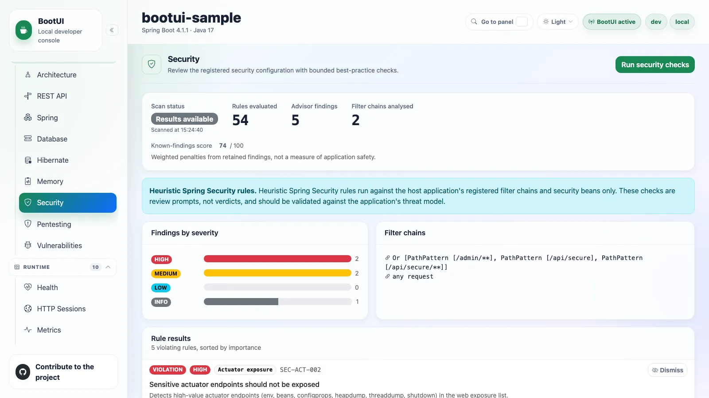

On Spring Boot it analyses Spring Security when present: already-created `SecurityFilterChain` configuration and
supported metadata, without executing authorization managers, custom matchers, or credential providers. Unsupported
evidence stays incomplete rather than becoming a verdict. See [SECURITY-CHECKS.md](../SECURITY-CHECKS.md).

### Spring WebFlux

On WebFlux it evaluates a dedicated 26-rule `SEC-RXF-*` catalogue over `SecurityWebFilterChain` beans, reactive
CORS/OAuth2 beans, and security-relevant configuration, excluding BootUI's own permit-all chain.

::: details On Quarkus

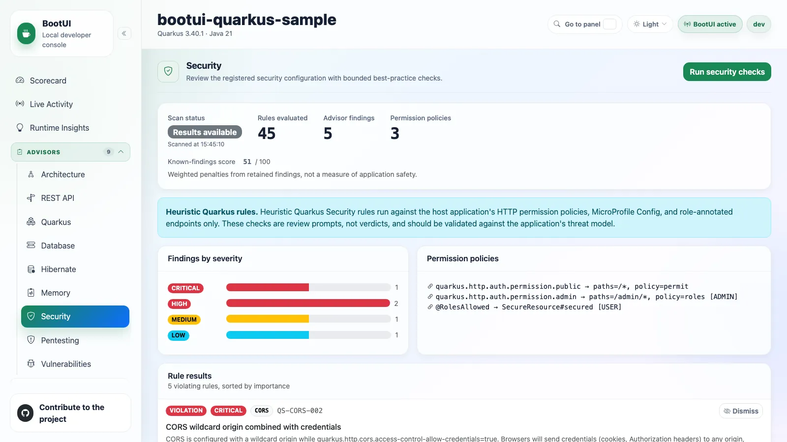

On Quarkus it runs a Quarkus-native ruleset over the HTTP permission policies, MicroProfile `Config`, and annotated
endpoints: Elytron/OIDC authentication, `quarkus.http.auth.permission.*` authorization, TLS and transport policy,
forwarded-header proxy trust, CORS (including the wildcard-origin-with-credentials trap), response headers, and
`@RolesAllowed`, `@PermissionsAllowed`, and `@AuthorizationPolicy`. The UI relabels metrics ("Permission policies" in
place of "Filter chains"). See [QUARKUS-CHECKS.md](../QUARKUS-CHECKS.md).
:::

## Pentesting

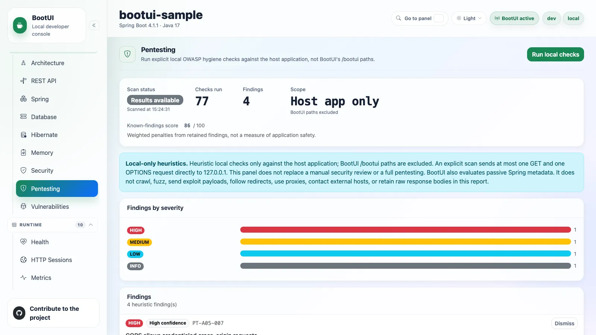

The Pentesting panel runs explicit, local-only OWASP Top 10 2025 hygiene checks against the host application, not
BootUI's `/bootui` routes. A scan combines bounded framework metadata with at most one `GET` and one `OPTIONS` request to
literal `127.0.0.1` under the application context path; the client never follows redirects or uses proxies. Checks cover
browser-document headers, CORS, cookie flags, verbose errors, Spring Security wiring, actuator exposure, and common
Spring Boot hardening gaps. Quarkus CORS, OIDC, and TLS are reviewed by the Security panel instead.

It never crawls endpoints, sends SQL/XSS/destructive payloads, contacts external hosts, or includes raw response bodies,
cookie values, credentials, or full issuer URLs. Findings are heuristic review prompts, not proof of exploitability.

The 77 active checks each carry a stable `PT-*` identifier, OWASP 2025 category, evidence source, and recommendation.
The panel shows **Findings by severity**. Failed or bounded-away evidence produces a `PARTIAL` scan. See
[PENTEST-CHECKS.md](../PENTEST-CHECKS.md). Pentesting supports the shared [dismiss/restore workflow](#dismissing-findings)
by exact `PT-*` ID; dismissal does not dismiss an equivalent Security advisor finding.

::: details Per-stack coverage

- **Spring MVC** is the complete reference collector.
- **Spring WebFlux** contributes Spring configuration and OAuth metadata, but reports MVC mapping and servlet-filter
  evidence unavailable. Its reactive Security advisor owns `SecurityWebFilterChain` route policy.
- **Quarkus** runs the same scanner and supplies its port, root path, CORS, OIDC, and HTTP-listener TLS configuration,
  while marking Spring endpoint metadata unavailable. Local HTTP does not assess proxy-edge HTTPS.

Unsupported checks never become a false clean result.
:::

## Vulnerabilities

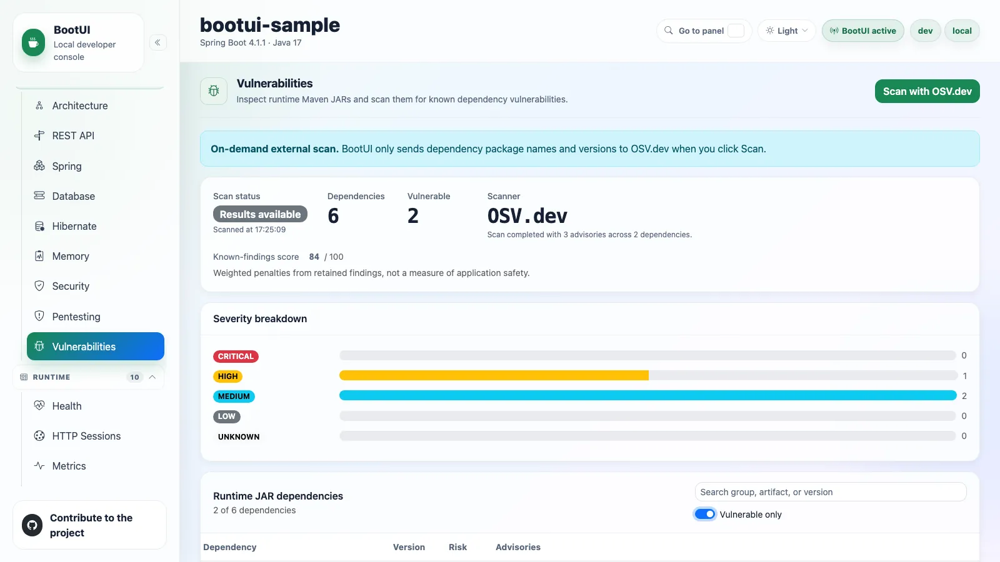

The Vulnerabilities panel shows the locally discovered dependency inventory and explicit [OSV.dev](https://osv.dev/)
lookup results, to identify known-vulnerable dependencies in the running project. Findings are ordered by severity
(dismissed findings sink to the bottom), then alphabetically. OSV is contacted only on the user-initiated scan.
`bootui.vulnerabilities.osv-enabled=false` disables scanning and `bootui.vulnerabilities.epss-enabled=false` disables
EPSS enrichment, on both adapters.

The [Vulnerabilities checks catalogue](../VULNERABILITIES-CHECKS.md) documents the interpretation rules and sources. A
completed lookup is not proof of application safety or complete runtime discovery. Panel and Scorecard share the
[evidence-based eligibility](#score-eligibility).

An agent's `vulnerabilities_scan` answers with a [summary](../AI-AGENTS.md#compact-answers-from-scans-and-capture-controls)
of at most ten vulnerable dependencies. `get_vulnerabilities_report` lists `limit` dependencies (10 by default), each
with at most 5 advisories without details; an exact `group:artifact` query lists all of one dependency's advisories, and
an exact advisory id or alias returns that advisory whole.

### Severity scoring

Severity is derived from OSV's `severity[]` entries: BootUI computes `CVSS_V4` and `CVSS_V3` vectors, preferring v4 when
both are valid, and never treats a bare number as CVSS. CVSS `0.0` is `NONE`. An advisory with neither a parseable score
nor a `database_specific` label renders as `UNKNOWN`. A malicious-package advisory (OSV `MAL-` ID) is always `CRITICAL`:
removing the dependency, not upgrading it, remediates it.

::: details How a CVSS score is selected and parsed

BootUI matches the exact `Maven` ecosystem and `groupId:artifact`, and evaluates the installed version against explicit
versions and supported Maven `ECOSYSTEM` ranges. Applicability is matched, not matched, or unresolved; unsupported or
malformed evidence never becomes an unaffected verdict. A positive OSV query keeps the finding as `PARTIAL` even when
detail association is unsupported or contradictory.

It takes the highest valid v4 score across applicable package assessments, and only when none is valid the highest valid
v3 Base score. Top-level severity is a fallback only when no applicable package severity is supplied. A recognized
`database_specific.severity` label remains a compatibility fallback, otherwise `UNKNOWN`. `MODERATE` maps to `MEDIUM`.

v3.0/v3.1 vectors follow the [FIRST CVSS v3.1 specification](https://www.first.org/cvss/v3.1/specification-document)
(Base metrics only). v4.0 vectors are scored with a port of FIRST's
[reference calculator](https://github.com/FIRSTdotorg/cvss-v4-calculator); a supplied Threat metric such as `E:U` yields
the CVSS-BT score, and supplemental metrics never change the score. Invalid segments, unknown metrics, and duplicates
are rejected. CVSS v2 is not calculated.
:::

### OSV querying and robustness

Withdrawn advisories are excluded. A failed advisory-detail fetch does not abort the scan: it is counted, the scan
degrades to `PARTIAL`, and every advisory that did fetch is kept.

::: details Pagination, batching, and result validation

The scanner follows OSV's `next_page_token` on `/v1/querybatch`, bounded by 20 page rounds per chunk (degrading to
`PARTIAL` at the bound). The package list, already bounded by `bootui.vulnerabilities.max-packages`, is split into
batches of at most 1,000 queries, OSV's hard limit. Detail fetches run with bounded concurrency (up to 10) and a
configured advisory-detail cap. Request timeouts are not a whole-scan deadline.

Responses are validated, and malformed results fail visibly instead of reading as a clean scan. A later failure preserves earlier pages as `PARTIAL`; failure before any valid page is `ERROR`, with the local inventory retained.
:::

### EPSS enrichment

Each advisory whose id or `aliases` include a `CVE-*` id is enriched with [EPSS](https://www.first.org/epss/) data from
FIRST.org's free API: the modeled probability of exploitation in the next 30 days and its percentile. It renders as a
secondary badge next to the severity badge (for example "2.3% EPSS"), using the highest available per-CVE probability.
This is a prioritization heuristic, not a combined exploit likelihood. A failed or unreachable EPSS request never fails
the scan or discards OSV results.

### Fix availability

Each advisory carries `fixedVersions` and `fixAvailable`. A candidate must be a `fixed` event closing a supported Maven
interval containing the installed version, be newer under Maven `ComparableVersion` ordering, and be unaffected across
all matching entries. Git/SEMVER ranges and `last_affected`/`limit` boundaries supply no upgrades. A false signal or
empty list means no target was established, not that the dependency is safe or that no upstream fix exists. Candidates
are upgrade evidence, not guarantees of publication or compatibility; BootUI does not install them.

### Dismissing a vulnerability

A vulnerability can be **dismissed** like any other finding (see [Dismissing findings](#dismissing-findings)). Because it
is scoped to one dependency, the key is `<vulnerability id>::<package name>` (for example
`GHSA-xxxx-xxxx-xxxx::org.example:sample`). Dismissing a finding for one dependency never hides the same advisory on
another, and a dismissal survives a patch-version bump of the still-vulnerable dependency. Dismissed vulnerabilities stay
visible (dimmed, with a _Restore_ button) and leave the vulnerable counts. Controls are disabled when read-only.

::: details How Spring discovers dependencies

The Spring adapter resolves coordinates from three sources, in decreasing authority:

1. **The embedded CycloneDX SBOM** (`META-INF/sbom/application.cdx.json` or `META-INF/sbom/bom.json`). Maven PURLs carry
   the `groupId` no manifest header carries. A component declared not shipped (`scope: "excluded"`, or the
   `cdx:maven:package:test=true` property) is left out unless the archive census finds its JAR.
2. **`META-INF/maven/*/*/pom.properties`** descriptors on the classpath, including inside a repackaged archive's nested
   JARs.
3. **`java.class.path` entries**, read through the Maven repository layout or an adjacent POM. A group id is derived from
   a path only when a literal `repository` directory makes it unambiguous. Inside a repackaged fat JAR this source is
   dead.

Unreadable resources, a malformed SBOM, and unreadable archives are logged and skipped rather than failing the
inventory.
:::

### Runtime reach

With the [BootUI agent](java-agent.md)'s `inventory` sensor recording this run, the dependency table gains a **Runtime
reach** column and filter: whether each dependency's jar loaded classes in this JVM, and whether a class an advisory
names did. It is a prioritization hint that never changes a finding's severity, score, counts, or Scorecard penalty.
Without the agent, or while the Code Inventory panel is disabled, the column is absent and the table says why.

| Reach                  | Meaning                                                                                                                                                                  |
| ---------------------- | ------------------------------------------------------------------------------------------------------------------------------------------------------------------------ |
| **Named class loaded** | A class the advisory names loaded from this dependency's own jar. This means "a class the advisory mentions loaded", never "the vulnerable code ran".                    |
| **Loaded**             | Classes of the jar loaded in this run, with the route of the request that first loaded one (while HTTP Exchanges is visible).                                            |
| **Not loaded yet**     | No class of the jar loaded in this JVM, and the evidence could have shown it. It may still load later.                                                                   |
| **Unknown**            | The evidence cannot tell, with the reason: the recorder is not running, the jar was not found or holds no classes, it is shaded, or the agent never records its classes. |

::: details How reach is decided

The agent keeps, per jar, a bounded set of class-name hashes (8,192 per jar, 65,536 in all; past that, a class the
advisory names reads as unknown, never as not loaded), for JDK types only, so no class loader is pinned. Dependencies are
matched to jars as the Code Inventory panel matches them. Names come from the advisory's structured OSV fields, else
from fully qualified class names in its summary and details, marked _from the advisory text_; text names are looked for
only in the dependency's own jar, so their absence says nothing.

:::

### Coverage

A coordinate-based inventory can only scan what it can name, so the panel also reports what it couldn't. BootUI takes a
census of the application's real archives (`BOOT-INF/lib/` or `WEB-INF/lib/` entries, or JARs on `java.class.path` and
application-classloader URLs) and attributes each to a resolved coordinate. The `java -Djarmode=tools -jar app.jar
extract --layers --launcher` layout is supported on Spring MVC and WebFlux. The census does not recursively search
directories, extract nested JAR contents, or contact remote URLs.

| `coverage.status` | Meaning                                                                                                                                                           |
| ----------------- | ----------------------------------------------------------------------------------------------------------------------------------------------------------------- |
| `COMPLETE`        | The provider reports every enumerated archive identified or first-party; this is not independent verification of the runtime inventory.                           |
| `INCOMPLETE`      | Some archives were neither; they are counted and named, and the panel warns that they were not scanned.                                                           |
| `UNAVAILABLE`     | Neither the classpath nor the application classloader exposes enumerable archives (for example under a native image), so coverage is unknown rather than claimed. |

When coverage is incomplete, the panel shows an "Unidentified JARs" metric and a warning with a collapsible list of
archive names and a pointer to adding the CycloneDX plugin. Packages beyond `bootui.vulnerabilities.max-packages`
(default `500`) are counted in `scan.packagesSkipped` and shown as a warning.

::: details First-party module JARs and `spring-boot-jarmode-tools`

Two kinds of archive are never in an SBOM yet are not a coverage gap, so Spring MVC and WebFlux inspect an unidentified
archive (manifest and entry names only) before reporting it:

- **First-party module JARs.** An archive with at least one class, all of them in the application's base packages, is
  counted in `coverage.archivesFirstParty` and named in `coverage.firstPartyArchives` (at most 200). It is not scanned.
  The check fails closed: a single class outside the base packages, a resource-only archive, `META-INF/maven/`
  descriptors, a bundled `.jar`/`.war`/`.zip`, or no detectable base package keeps it unidentified. When the Spring Boot
  `layers.idx` defines an `application` layer, only archives in that layer can be first-party.
- **`spring-boot-jarmode-tools`.** Added by Spring Boot's build plugins at packaging time, so it is absent from the SBOM.
  When its file name, manifest title and version agree and every class is under
  `org/springframework/boot/jarmode/tools/`, it is identified as `org.springframework.boot:spring-boot-jarmode-tools`
  and scanned.

With both, a multi-module application built with an SBOM reports `COMPLETE` coverage.
:::

::: details On Quarkus

The panel is identical and uses the same report contract and workflows. The one difference is dependency discovery: the
inventory is captured at **build time** from the resolved runtime dependency model and needs no SBOM. Coverage is
`COMPLETE` only when that model was captured and decoded whole; a missing or blank model, a malformed entry, or an
unencodable coordinate reports `UNAVAILABLE`, keeping every readable dependency.
:::

### Known limitations

- **Discovery can overclaim coverage.** Spring de-duplicates archive basenames and matches filenames without group
  identity, so case or classifier ambiguity can overstate identification.
- **Without an SBOM, some JARs cannot be identified.** No JAR manifest header carries a `groupId`, so artifacts published
  without a Maven descriptor (Spring Framework, Spring Boot, `tomcat-embed-*`, `hibernate-core`, and others) cannot be
  resolved. They appear through coverage as unidentified.
- **Shaded/uber JARs are invisible.** The inventory is coordinate-based, so a library relocated inside a shaded JAR is
  not seen.
- **No direct-vs-transitive provenance.** "Introduced through" is not tracked on either adapter.
- **Evidence is bounded, not exhaustive.** Distinct advisory IDs can count the same CVE more than once, and a whole-scan
  deadline is not implemented. Browser version sorting is lexical for same-package rows.
