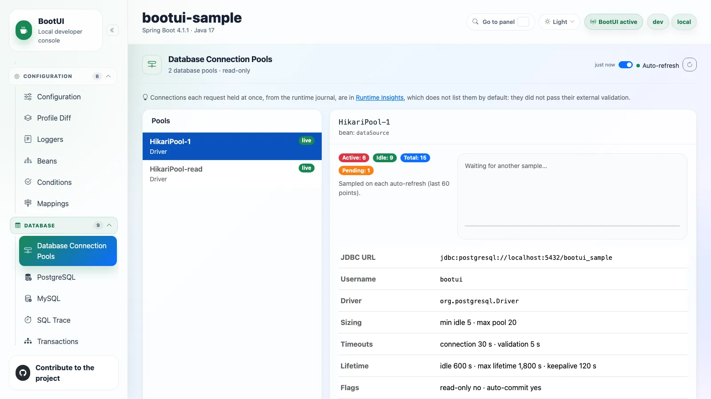
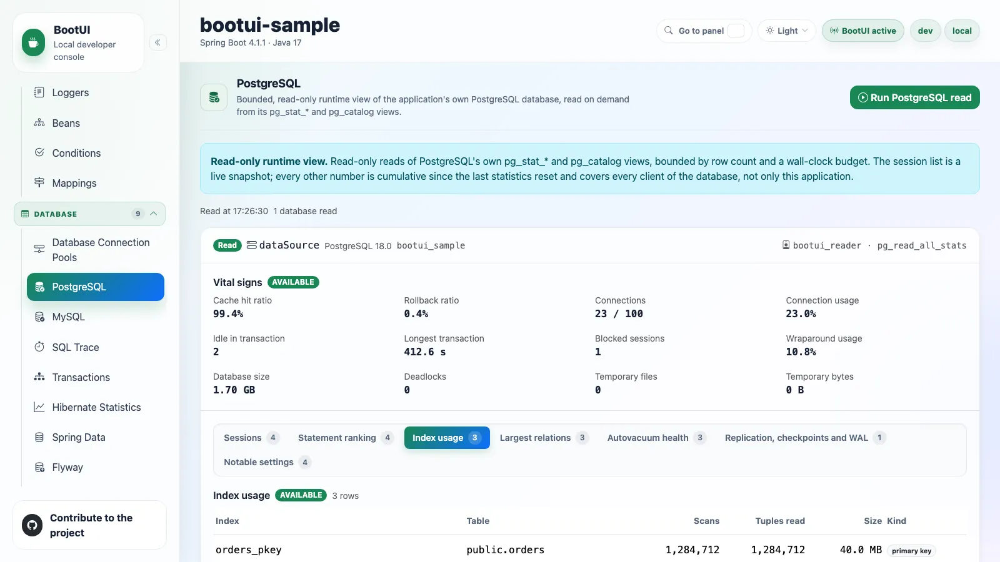
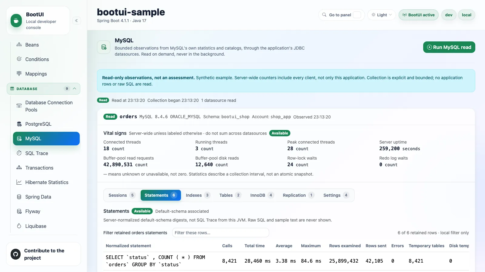
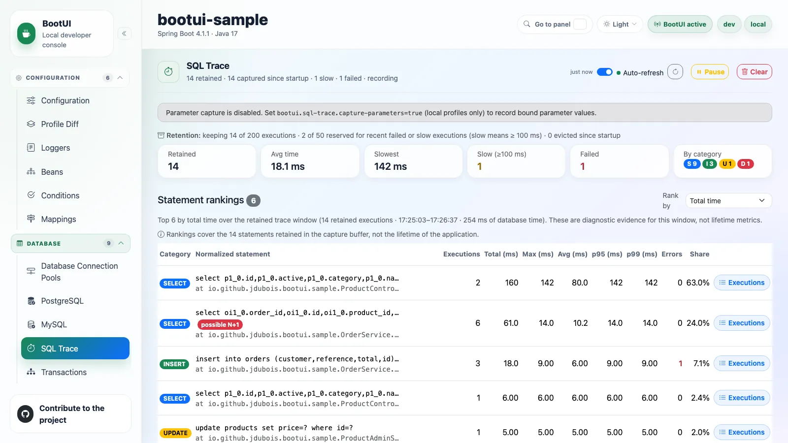
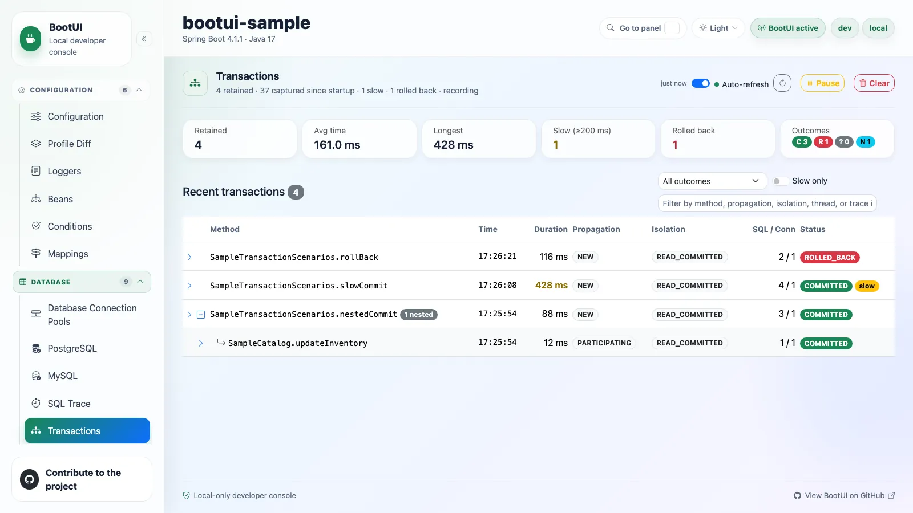
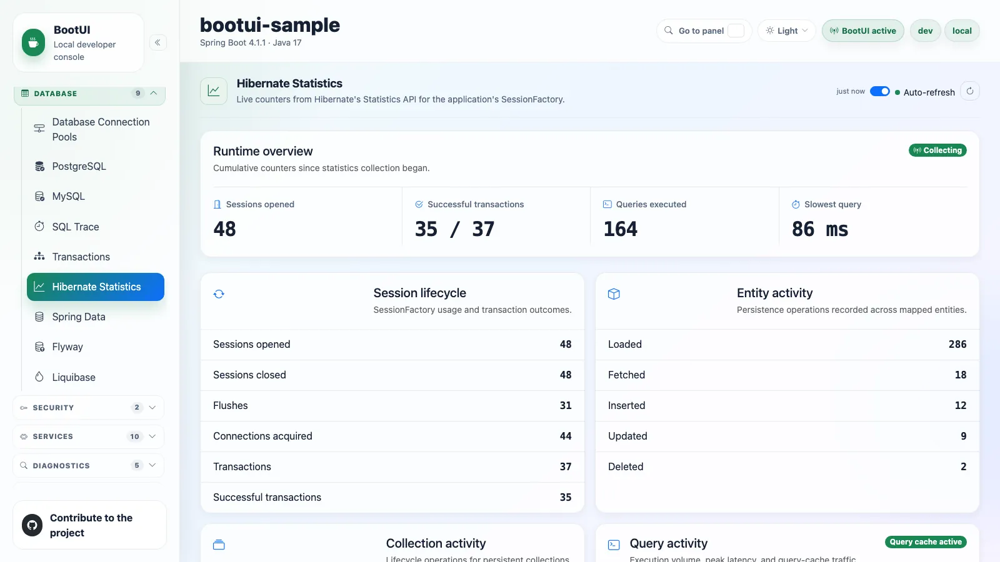
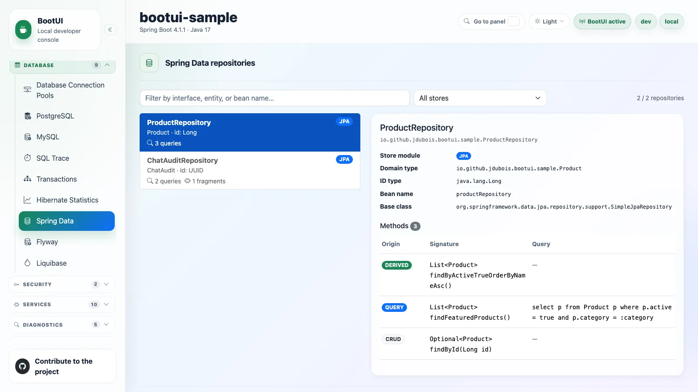
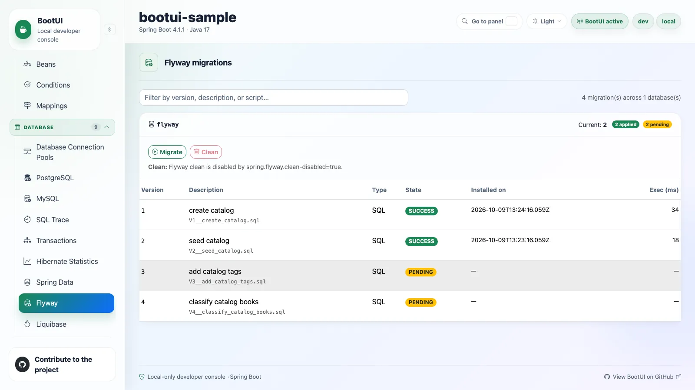
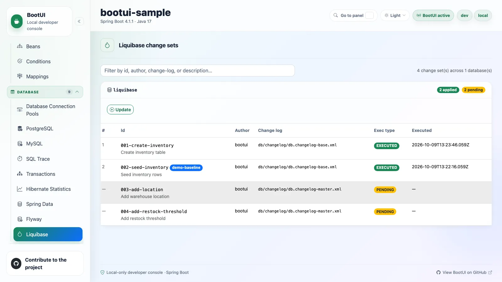

# Database

These panels read the database your application is already connected to. The rule-based scans live in the
[Database and Hibernate advisors](advisors.md).

## Database Connection Pools



The Database Connection Pools panel inspects supported JDBC pool beans. It is read-only: it never executes SQL,
borrows a connection, or resizes a pool, and it fails closed when no supported pool is present.

For each pool it shows the identity and library, the masked JDBC URL and username, the driver, the minimum and maximum
sizing, and the timeout and lifetime settings. Closed and uninitialized pools carry an unavailable reason. A live chart
polls bounded snapshots of active, idle, total, and pending connections every two seconds.

The connections each request held at once are in [Runtime Insights](runtime-insights.md) (`connections-per-request`);
this panel links to them.

::: details On Quarkus: served over Agroal

The panel is served over **Agroal** instead of HikariCP and looks the same. Pool metrics require
`quarkus.datasource.jdbc.metrics.enabled=true`; with metrics disabled the configuration still renders but the live
snapshot is marked unavailable. **Pool library** reads `Agroal`. Settings Agroal does not expose (validation timeout,
keepalive interval, read-only flag) render as "—"; a maximum lifetime of `0` means no limit.

:::

## PostgreSQL



The PostgreSQL panel reports what PostgreSQL itself says about the database your application is connected to. It
reports the server's own numbers and leaves the judgement to you: there is no rule catalogue, severity, or score.

Each datasource is one card. Its vital signs stay in view while the other sections are tabs, and each tab carries its
row count, or a skipped or failed marker with a reason, so a missing extension never looks like an empty table.

Reads are explicit. Opening the panel shows the last report; PostgreSQL is queried when you choose **Run PostgreSQL
read**. A second read adds a short list of what changed since the previous one, kept in memory only.

| Section | What it shows |
| --- | --- |
| Vital signs | Cache hit ratio, rollbacks, connections, transaction-id age, database size, and deadlocks. |
| Sessions | A live snapshot of `pg_stat_activity`: state, wait event, blocking pids, transaction age, and statement. |
| Statement ranking | The top normalized statements from `pg_stat_statements`, ranked by total execution time. |
| Index usage | Which indexes the server actually reads. |
| Largest relations | Relation size and access shape, including sequential and index access. |
| Autovacuum health | Dead tuples, last (auto)vacuum and analyze, and a "due" estimate. |
| Replication, checkpoints and WAL | Connected replicas with state and lag, plus checkpoint and WAL activity. |
| Notable settings | A curated allow-list of operational settings. |

Apart from Sessions, every section is cumulative since the last statistics reset. The panel is available on all three
stacks when a PostgreSQL datasource is configured; rendering the sidebar contacts no database. Use a read-only role
that belongs to `pg_monitor` where you can.

::: details How it relates to the Database advisor and SQL Trace

- **Database advisor** checks physical schema structure from metadata and vendor catalogs.
- **SQL Trace** shows statements this JVM recently issued.
- **PostgreSQL** reads PostgreSQL's own cumulative `pg_stat_*` and `pg_catalog` views, which include work from every
  client of the database.

:::

::: details Safety and bounds

The panel runs one read-only transaction per datasource, pinning `statement_timeout` to 5 seconds, `lock_timeout` to
2 seconds, and the read budget to 15 seconds. Every statistics query runs in its own savepoint, so one error does not
abort the others.

BootUI refuses a connection already in manual-commit mode (for example
`spring.datasource.hikari.auto-commit=false`) before issuing SQL, and never commits or rolls back that connection.

List sections are capped per datasource. These keys and defaults are the same on all three stacks:

```properties
bootui.postgresql.max-sessions=100
bootui.postgresql.max-statements=100
bootui.postgresql.max-indexes=500
bootui.postgresql.max-tables=200
bootui.postgresql.max-vacuum-tables=200
bootui.postgresql.max-replicas=10
bootui.postgresql.max-settings=40
```

Values must be positive integers below `2147483647`; zero does not mean unlimited, and invalid values are rejected.
Restart after changing a limit. See the [property reference](../PROPERTIES.md#postgresql).

`truncated` means a row cap was reached; exhausting the time budget produces an explicit section reason and keeps the
rows already read. A top-100 statement ranking is an expected cap and shows one informational note, not a warning.
The API, MCP, and CLI report `PARTIAL` with `truncated=true` and list capped sections in `limitations`.

The change baseline is never written to disk, and a section that could not be read keeps its earlier value. The
**Notable settings** list excludes `statement_timeout`, `lock_timeout`, and `idle_in_transaction_session_timeout`,
because BootUI overrides them for its own read.

Values follow the global exposure policy. Session and statement text is redacted, masked, and truncated: under `MASKED`
or `METADATA_ONLY`, string literals and dollar-quoted bodies are replaced, and session and replica client addresses are
masked under `METADATA_ONLY`. Error messages from failed reads are redacted the same way.

:::

::: details Permissions and missing visibility

Without `pg_monitor`, PostgreSQL silently restricts its views:

| View | Restriction | Consequence |
| ---- | ----------- | ----------- |
| `pg_stat_activity` | Removes rows of backends the role does not own | The session list shrinks to BootUI's own connections |
| `pg_stat_statements` | Replaces text with `<insufficient privilege>` | Statement ranking loses its statements |
| `pg_stat_replication` | Empties state, sync state, and lag | The replica count stays right; the rest degrades |

BootUI probes `pg_read_all_stats` membership and marks the affected sections partially read. Statement ranking also
requires the `pg_stat_statements` extension. On a standby, the replica list and primary-relative lag are not read
(`replication.replicasAvailable=false`). A datasource that declares no readable URL keeps the panel available whenever
the PostgreSQL driver is on the classpath; a non-PostgreSQL datasource is then skipped with a diagnostic.

The autovacuum "due" estimate uses the settings the server would apply to each relation, including per-table
`reloptions`. It models only the dead-tuple trigger and reads `pg_stat_user_tables`, which the section states.

:::

::: details Try it with the sample application

The Spring MVC sample has a
[`docker-postgresql` profile](https://github.com/jdubois/boot-ui/tree/main/bootui-spring-sample-app#run-it-with-docker-and-postgresql)
that preloads `pg_stat_statements`. Run `bootui-spring-sample-app/run-local-postgresql.sh` for a lightweight
PostgreSQL-and-Redis stack.

:::

## MySQL



The MySQL panel is the operational sibling of the PostgreSQL panel. It reports what the connected server says, from
MySQL's own Performance Schema and Information Schema. That complements the Database advisor's schema checks and SQL
Trace's view of the statements this JVM issued.

Each datasource is one card, with vital signs in view and the other sections as tabs. A section that could not be read
names its reason, so incomplete evidence never reads as an idle server. There are no grades, severities, or
recommendations.

Reads are explicit. Opening the panel shows the last in-memory report; MySQL is queried when you choose **Run MySQL
read**.

| Section | What it shows |
| --- | --- |
| Vital signs | Server-wide uptime, connections, buffer-pool and lock/log counters. |
| Sessions and blocking | Sessions with state age and optional transaction age, plus row-lock relationships and metadata waits. |
| Statement ranking | Normalized digests ranked by total execution time, with calls, durations, rows examined and sent, and errors. |
| Index handler operations | Which indexes the server actually uses, for the selected schema. |
| Table estimates | Engine, estimated rows and storage, and table I/O. |
| InnoDB | Allow-listed buffer, log-wait, lock, deadlock, and history-list evidence. |
| Replication | Receiver and applier channel state, coordinator errors, and worker summaries. |
| Settings | A fixed safe allow-list of global settings. |

Every value carries its scope (server-wide, selected schema, or default-schema-associated), and unknown values stay
unknown instead of being shown as zero. The panel works on all three stacks with JDBC datasources, including named
ones; R2DBC-only applications are unavailable.

::: tip Tested compatibility
**Oracle MySQL 8.4 LTS and 9.7 LTS** are the tested server lines, with Connector/J 9.7.0 and HikariCP on Spring and
Connector/J 9.6.0 and Agroal on Quarkus. Other Oracle MySQL versions are read with an informational "not a tested
server line" diagnostic. Other flavors, such as Percona Server, are skipped.
:::

::: warning MariaDB is read but not supported
A MariaDB server reached through MySQL Connector/J (`jdbc:mysql://...`) is read on a best-effort basis: the datasource
carries an **Unsupported** badge and no automated test covers it. MariaDB Connector/J (`jdbc:mariadb:`) is not offered
the panel. On MariaDB, replication receiver state is unknown, no counter comparison is computed, and reads are usually
**Partial** until `performance_schema_instrument='wait/lock/metadata/sql/mdl=ON'` is set. MariaDB before 11.1 fails
closed because its read-only session guards cannot be established.
:::

::: details Try it with the sample application

The Spring MVC sample has a
[`docker-mysql` profile](https://github.com/jdubois/boot-ui/tree/main/bootui-spring-sample-app#run-it-with-docker-and-mysql)
that enables statement instrumentation and provisions the diagnostic grants. Run
`bootui-spring-sample-app/run-local-mysql.sh` for a lightweight MySQL-and-Redis stack.

:::

::: details Read and report contract

| Surface | Cached evidence, no connection or SQL | Explicit collection |
| --- | --- | --- |
| REST | `GET /bootui/api/mysql` | `POST /bootui/api/mysql/read` |
| MCP | `get_mysql_report` | `mysql_read` |
| CLI | `bootui db mysql report` | `bootui db mysql read` |

Over MCP and the CLI, the explicit read answers with a
[summary](../AI-AGENTS.md#compact-answers-from-scans-and-capture-controls) and the cached report returns the rows.
Neither operation accepts SQL, a schema selector, or a server address; collection uses the application's existing
datasources and credentials.

Global `bootui.read-only` or `bootui.panels.mysql.read-only` blocks the explicit read because it initiates external
work; cached reads remain allowed. Disabling `bootui.panels.mysql.enabled` blocks both. An overlapping read is
refused, not queued.

Reports are `NOT_READ`, `READ`, `PARTIAL`, `ERROR`, or `DISABLED`. `READ` means applicable sections completed within
their scope, not that the database is healthy. A section is `AVAILABLE`, `SKIPPED`, or `FAILED`, with a reason when
evidence is incomplete. The cache holds sanitized data; changing the exposure policy invalidates it and requires a new
explicit read.

:::

::: details Scope and precision

- **Server** evidence can include other applications; do not add server counters from multiple pools on one instance.
- **Selected schema** sections are skipped when no schema is selected; BootUI never enumerates every database.
- **Default-schema-associated** sessions and digests are not an inventory of every statement touching that schema.
- Unknown values are `null`, not zero. Large counters, byte sizes, and identifiers are exact decimal strings in JSON;
  do not coerce them through a JavaScript `Number`.
- The first read has no invented rates. Comparisons need a compatible datasource, server identity, and counter
  provenance; a restart or server change invalidates the baseline. Nothing is persisted to disk.
- Statement ranking has normalized digests only, never raw SQL. Index handler statistics are not query counts, and
  "no recorded reads" is not advice to drop an index. Table estimates can be cached; BootUI never runs `COUNT(*)`.
  Replication evidence has no end-to-end lag.

:::

::: details Safety and bounds

The execution bounds are a 15-second cooperative total read budget, a 5-second server SELECT limit
(`MAX_EXECUTION_TIME`, or `SET STATEMENT max_statement_time` on MariaDB), a 2-second metadata-lock wait limit, and 400
characters of displayed statement text. The borrowed connection also gets a JDBC network timeout of at most 7 seconds.
BootUI uses neither `Statement.setQueryTimeout` nor `Statement.cancel`, avoiding Connector/J's auxiliary
`KILL QUERY` connections. These are not hard end-to-end deadlines; connection-acquisition waits are controlled by the
application pool.

If `performance_schema.global_status` is unreadable, BootUI falls back to `SHOW GLOBAL STATUS` filtered to 17 fixed
safe names.

The seven startup row caps, identical across the three JDBC adapters, are:

```properties
bootui.mysql.max-sessions=100
bootui.mysql.max-statements=100
bootui.mysql.max-indexes=500
bootui.mysql.max-tables=200
bootui.mysql.max-lock-waits=100
bootui.mysql.max-replication-channels=10
bootui.mysql.max-settings=40
```

Each applies per datasource. Values must be positive integers below `2147483647`; invalid values fail startup, and zero
is not unlimited. Restart after changing a cap. See the [property reference](../PROPERTIES.md#mysql).

`truncated=true` means a BootUI row cap omitted results, not a failed query. The UI shows row caps as neutral
**Limited** labels; permission problems, timeouts, and unavailable instrumentation remain warnings or errors.

Collection sets `transaction_read_only=1`, starts `START TRANSACTION READ ONLY`, and verifies the server setting; it
avoids `Connection.setReadOnly`. Manual-commit connections are refused before any SQL. Afterward, BootUI rolls back
only its own transaction and restores the auto-commit, session settings, and network timeout. If restoration and abort
both fail, the handle is quarantined and further collection is disabled until the pool and BootUI restart.

No application rows, `LOCK_DATA` key values, `QUERY_SAMPLE_TEXT`, `PROCESSLIST_INFO`, or `TRX_QUERY` are selected.
Only normalized digest text is exposed, after masking, credential redaction, the exposure policy, and length bounds;
metadata-only mode withholds statement text and sensitive addresses. Raw JDBC URLs, arbitrary server errors,
replication secrets, and variable dumps are excluded in every mode. There are no kill controls, SQL console, query
plans, DDL, or controls to change server configuration.

:::

::: details Availability and permissions

Sidebar discovery reads local declarations only, never a database; the explicit read verifies the connected server and
reports unsupported targets. Routing datasources describe the actual connected server. On Quarkus, use
`quarkus-jdbc-mysql` and a JDBC datasource; a reactive client alone does not qualify.

Use the application's existing account and grant only the visibility the operator approves. There is no single
`pg_monitor` equivalent, and BootUI never enables instruments or resets statistics. Do not grant `SUPER` or all of
`performance_schema.*` just to make the panel complete.

| Optional visibility | What to authorize |
| --- | --- |
| Status and settings | `performance_schema.global_status` is usually readable without a grant; otherwise the fixed `SHOW GLOBAL STATUS` fallback is used. Settings use fixed `@@global` expressions. |
| Session state | `SELECT` on `performance_schema.threads`. This exposes other users' thread rows without `PROCESS`, so it is a real permission decision. |
| Blocking | `SELECT` on `performance_schema.data_lock_waits`, `data_locks`, and `metadata_locks`. On MariaDB, `PROCESS` for `information_schema.INNODB_LOCK_WAITS`, `INNODB_LOCKS`, and `INNODB_TRX`. |
| Statement ranking | `SELECT` on `performance_schema.events_statements_summary_by_digest`, with digest collection and timing enabled. |
| Table and index activity | `SELECT` on `performance_schema.table_io_waits_summary_by_table` and `table_io_waits_summary_by_index_usage`, with matching object instrumentation. |
| Instrumentation explanation | `SELECT` on `performance_schema.setup_consumers`, `setup_instruments`, and `setup_objects`. Denied probes leave state unknown, not enabled. |
| Replication | `SELECT` on the `replication_connection_status` and `replication_applier_status*` tables in `performance_schema`. |
| Additional InnoDB detail | Optional global `PROCESS` for `information_schema.innodb_trx` and `innodb_metrics`. |

Uninstrumented or unknown objects keep their catalog metadata, but affected activity counters are withheld and
explained per section, never shown as zero. An empty metadata-lock list with disabled instrumentation cannot establish
absence.

:::

::: details When evidence is missing

| Situation | Interpretation and next step |
| --- | --- |
| No supported JDBC datasource | Check the driver and datasource declarations. Do not create another monitoring pool. |
| Permission denied | Readable sections are kept. Review the named source with the operator and the role active on this connection. |
| Performance Schema, digests, or timing disabled | Missing evidence is not an idle workload. BootUI never enables anything. |
| Manual-commit pool default | Collection is refused to protect application transactions; do not change transaction settings to silence it. |
| Timeout or acquisition wait | Check section reasons and the pool and network timeouts. A timeout is not truncation. |
| Row cap only | Read the retained top-N window. Raising a cap needs a restart and a new read. |

:::

## SQL Trace



The SQL Trace panel shows the SQL statements your application recently executed. Each row expands to the full
statement, bound parameters, statement type, connection id, executing thread, call site, and error.

Executions are kept in a bounded buffer, most recent first, with aggregate stats: total, average, and maximum time,
slow-query and failure counts, per-category counters, and evictions. A slow-query threshold highlights expensive
statements. Local-only **Pause**, **Resume**, and **Clear** actions stop recording or empty the retained window. Pausing
stops only this panel's buffer: the [runtime journal](live-activity.md#runtime-journal) keeps recording. Over MCP and
the CLI, the controls answer with a
[compact acknowledgement](../AI-AGENTS.md#compact-answers-from-scans-and-capture-controls).

A share of the buffer, 25% by default (`bootui.sql-trace.reserved-share-percent`), is reserved for the most recent
failed and slow executions, so a burst of fast queries evicts routine executions first; see
[Failure-preserving retention](diagnostics.md#failure-preserving-retention).

Statements are timed in nanoseconds and recorded in microseconds (`durationMicros`), and every aggregate is reported in
fractional milliseconds, so sub-millisecond statements still rank.

Repeated `SELECT`s that look like an N+1 access pattern are flagged once they reach
`bootui.sql-trace.n-plus-one-threshold`. A flagged group lists the distinct call sites (class, method, line), so you can
go straight to the repository or service method causing the repetition.

::: details How capture works

BootUI wraps each `DataSource` bean with a JDK dynamic proxy and records the SQL text, statement type, category
(`SELECT`, `INSERT`, `UPDATE`, `DELETE`, `DDL`, `OTHER`), duration, affected rows, batch size, connection, executing
thread and its kind (`WORKER`, `VIRTUAL_THREAD`, `EVENT_LOOP`, `REACTOR_SCHEDULER`, `OTHER`), the call site when enabled,
and any failure. On Spring MVC and Quarkus, each statement also records the request phase it ran in: `FILTERS`,
`HANDLER`, or `RESPONSE` (where lazy loading surfaces). Spring WebFlux records no phase.

A Spring `DataSource` wrapper is never replaced; when it owns the only reference to a pool (for example
`LazyConnectionDataSourceProxy`), the pool inside is traced in place. Wrapping **fails open**: a `DataSource` that
cannot be proxied is left untouched. On the JVM the proxy also advertises the vendor interfaces of the original bean,
such as Oracle UCP's `PoolDataSource`, so by-type injection keeps working.

:::

### Rankings

Above the execution list, the panel ranks the retained window twice. Both tables deep-link into the filtered list below.

**Statement rankings** aggregate executions by normalized statement: literals and bind markers collapse to `?` and
`IN (…)` lists fold, so equivalent executions group together without exposing a bound value. Rank by cumulative
duration, slowest execution, count, average, error count, p95, or p99; each row also shows p50, p95, p99 and its share
of retained database time. **Most frequent statements** is the fallback when rankings are unavailable and keeps
literal values.

**Database time by request route** attributes executions back to the requests that issued them, with requests,
executions, distinct statements, errors, and share of database time per route; each row expands to that route's top
statements.

::: details How route grouping resolves a template

Grouping uses the framework's route template (`GET /api/sample/orders/{id}`) when available, otherwise matches the
path against the application's declared route mappings, and falls back to a masked path (identifier-looking segments
become `{value}`, query string discarded). Matching a declaration is strict, and ambiguous declarations produce no
template, because masking alone cannot tell `/api/users/alice` from a fixed route segment.

:::

### Attribution is evidence, not lifetime metrics

Rankings describe only the statements still in the buffer, and the panel states that window inline: retained
statements, buffer size, evictions, and the age of the oldest execution. A window that has evicted executions can
over-represent failed and slow ones.

Attribution is conservative. It correlates a statement to a request by trace id first, then by serving thread (JVM
only), then by time window, each requiring a single unambiguous candidate. Executions that cannot be placed, or that
matched several requests equally, go into explicit **Unattributed** and **Ambiguous** buckets.

On Spring WebFlux and Quarkus only trace-id and time-window correlation are used. On WebFlux, request evidence needs the
OpenTelemetry integration; without it route attribution is reported unavailable while rankings still work.

### Privacy and configuration

Parameter bindings are not captured by default. When enabled, they are suppressed under metadata-only exposure and
routed through BootUI's masking rules, with an inline warning when shown in clear text. Call sites are code metadata,
not bound values, so `bootui.sql-trace.capture-call-site` (default `true`) is not privacy-gated.

The panel fails closed when no `DataSource` bean is wrapped. Tracing, the initial recording state, parameter and
call-site capture, buffer size, the slow-query and N+1 thresholds, and truncation limits are configurable under
`bootui.sql-trace.*`. The panel refreshes over Server-Sent Events from `/bootui/api/sql-trace/stream`; the push
carries no data, so masking and exposure rules still apply through the regular endpoint.

::: tip GraalVM native images are supported
BootUI registers the tracing proxies as native-image proxy metadata, so SQL Trace works in a native executable. If a
proxy cannot be created, the `DataSource` is left untraced rather than breaking startup.
:::

::: details On Quarkus: JDBC executions and ORM preparations

Capture comes from two feeders: an `@Alternative` Agroal `DataSource` wrapping the default pool for manual JDBC, and a
`@PersistenceUnitExtension` Hibernate `StatementInspector` for ORM SQL of the default persistence unit (named units
are not traced), because Hibernate resolves its pool from Agroal's own registry.

The inspector observes preparation only. Those rows stay visible with a report warning, but their compatibility fields
(`durationMicros: 0`, `success: true`) do not establish an execution or outcome, so they are excluded from statistics,
rankings, N+1 badges, and confirmed event-loop blocking. Both feeders are wired in dev and test only, and the inspector
never captures bound parameter values.

:::

## Transactions



The Transactions panel shows the `@Transactional` boundaries your application recently ran: begin, commit, and
rollback events, captured by BootUI's own listener wiring.

Transactions are kept in a bounded buffer, most recently completed first, with aggregate stats: total, average, and
maximum duration, slow and connection-held counts, commit, rollback, and unknown outcomes, and nested count. The panel
renders a parent and child tree, and each row expands to its thread, trace id, read-only flag, and any error. Slow and
connection-hold thresholds flag transactions worth a closer look. Local-only **Pause**, **Resume**, and **Clear**
actions stop recording or empty the buffer; pausing stops only this panel's buffer, and the
[runtime journal](live-activity.md#runtime-journal) keeps recording.

Transaction metadata (method names, propagation, isolation, threads, trace ids) is not sensitive, so it is not masked.
The panel reports unavailable with a reason when no configurable transaction manager exists. Capture, the initial
recording state, buffer size, and thresholds are configurable under `bootui.transactions.*`, and the panel refreshes
over Server-Sent Events from `/bootui/api/transactions/stream`.

This panel is not applicable on Quarkus: Narayana's JTA exposes no comparable per-boundary listener hook, so the
endpoint reports unavailable with that reason rather than forcing false parity.

::: details How capture works and what each transaction records

On Spring MVC and WebFlux, BootUI contributes a `TransactionExecutionListener` (Spring Framework 6.1+) through Spring
Boot's transaction-manager customization. It composes with your own listeners; managers that do not implement the
configurable listener SPI stay unobserved. On WebFlux this covers blocking managers used on a Reactor `boundedElastic`
worker and a `ReactiveTransactionManager` such as R2DBC's, recorded without a thread-bound parent or isolation
([WebFlux support](../WEBFLUX-SUPPORT.md)). SQL and connection counts describe JDBC work on the begin thread, so zero
counts do not prove that no database work occurred.

Each transaction records the boundary name (typically `ClassName.methodName`), a best-effort `propagation`
(`NEW` or `PARTICIPATING`), the isolation level, the outcome (`COMMITTED`, `ROLLED_BACK`, or `UNKNOWN`), timestamps and
duration, the enclosing transaction id, the thread, and the trace id. Each entry is correlated by thread and time window
to SQL Trace executions, showing how many statements and connections it touched.

When the opt-in MCP Server is enabled on Spring MVC or WebFlux, `get_transactions` exposes the same bounded report.

:::

## Hibernate Statistics



The Hibernate Statistics panel is a live, read-only view of Hibernate's own `org.hibernate.stat.Statistics` for the
application's `SessionFactory`. It is a runtime monitor, separate from the Hibernate advisor's static checks.

The snapshot covers session and transaction counts, entity and collection load, fetch, insert, update, delete counts,
query execution counts with the slowest query, and, when enabled, query-cache and second-level-cache hit, miss, and put
counters with per-region breakdowns.

When statistics collection is off, the panel offers **Enable for this runtime**, which calls
`Statistics#setStatisticsEnabled(true)` without rewriting your configuration. The persistent alternatives are
`hibernate.generate_statistics=true` and `quarkus.hibernate-orm.statistics=true` (the HIB-CONFIG-007 recommendation of
the [Hibernate advisor](../HIBERNATE-CHECKS.md)). That toggle is the only mutation and follows the localhost,
cross-site-write, and read-only policy; there is no reset action. The panel is identical on Quarkus.

::: details Known limitations

Only the first resolved `EntityManagerFactory` is inspected, so a multi-persistence-unit application sees one unit.
There is no per-entity or per-query drill-down beyond what `Statistics` exposes. `bootui.monitoring.exclude-self` does
not apply, because these are process-global counters.

:::

## Spring Data



The Spring Data panel lists the application's Spring Data repositories with their interfaces, domain types, ID types,
and query methods. It shows an empty state when Spring Data is absent or no repositories are registered.

## Flyway



The Flyway panel shows the schema migrations of each `Flyway` bean: per database, the current schema version with the
applied and pending migrations (version, description, type, script, state, installed-by, installed-on, execution time,
checksum). Multiple and named datasources appear independently.

`migrate` and `clean` are confirmation-gated actions for trusted local sessions, blocked by `bootui.read-only=true` or
`bootui.panels.flyway.read-only=true`. `clean` additionally requires `spring.flyway.clean-disabled=false`.

Quarkus reads the active `FlywayContainer` beans (default or `@FlywayDataSource`-named) and offers the same actions,
with `clean` honoring `quarkus.flyway.clean-disabled`. Without the `quarkus-flyway` extension, the panel says to add it.

::: details Spring Modulith module-aware migrations

When module-aware Flyway migrations are active, the panel shows the root and module-specific history tables separately.
Those entries are read-only in BootUI. This is Spring-specific and not reported on Quarkus.

:::

## Liquibase



The Liquibase panel shows the change sets of each discovered Liquibase database: every `SpringLiquibase` bean on
Spring Boot, and every active `LiquibaseFactory` on Quarkus, including `@LiquibaseDataSource`-named datasources.

It lists the applied and pending change sets per database with their id, author, change-log, description, execution
type, date and order executed, checksum, tag, deployment id, contexts, and labels.

`update` is a confirmation-gated action that applies pending change sets, blocked by `bootui.read-only=true` or
`bootui.panels.liquibase.read-only=true` on both frameworks. The panel fails closed per database when its history
cannot be read, and shows an empty state when Liquibase is absent.
