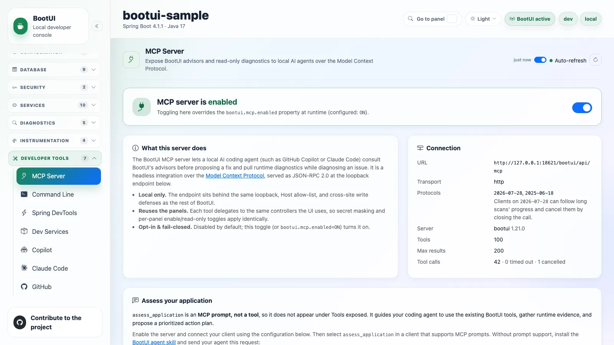
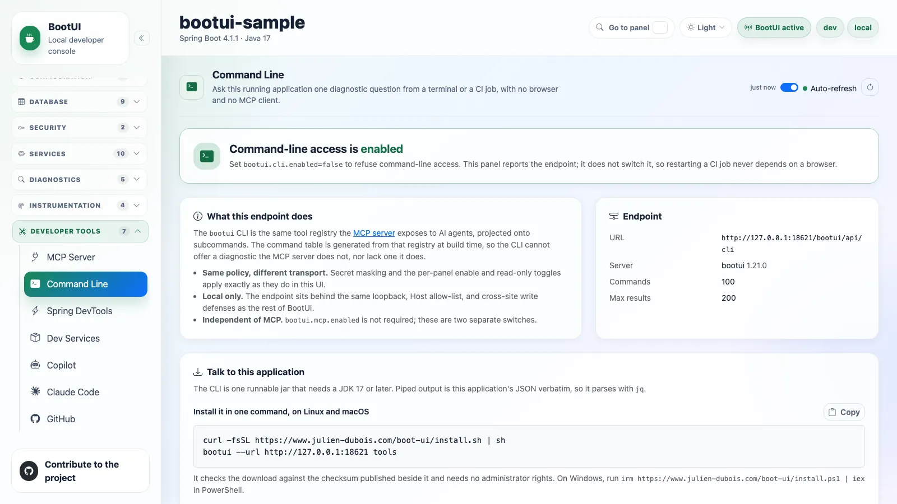
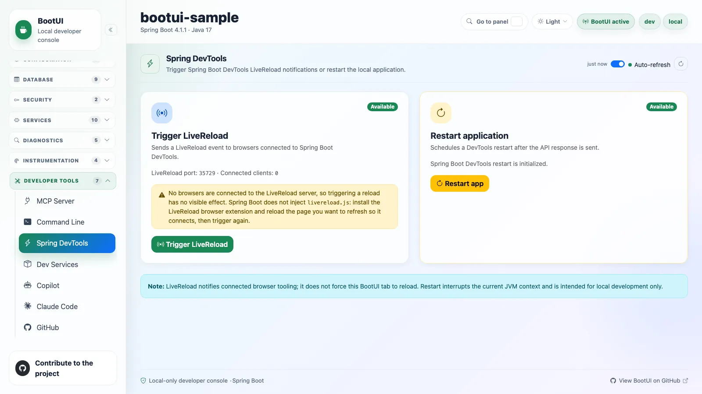
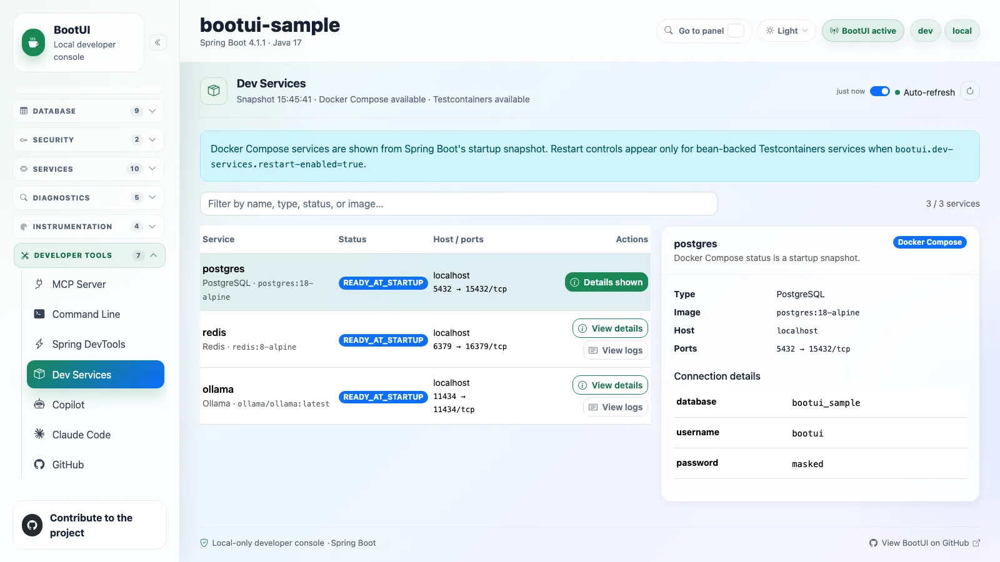
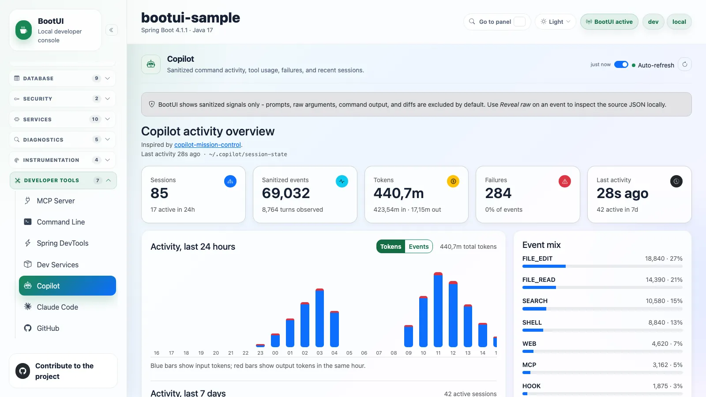
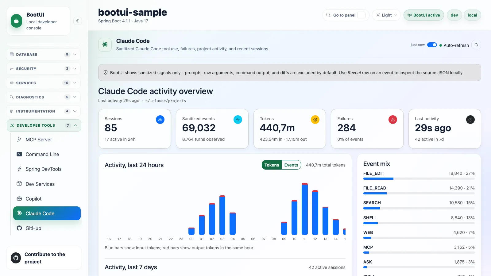
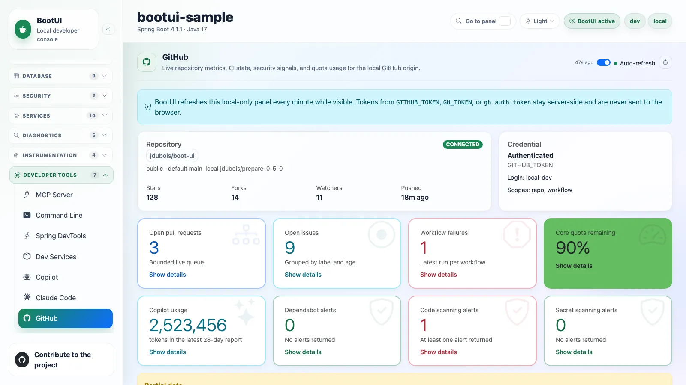

# Developer tools

## MCP Server



BootUI can expose its advisors and read-only diagnostics to local AI coding agents, such as GitHub Copilot or Claude
Code, through an opt-in [Model Context Protocol](https://modelcontextprotocol.io) server. An agent can then consult the
advisors before proposing a fix, and pull runtime diagnostics while investigating an issue.

The server is a JSON-RPC 2.0 endpoint at `POST /bootui/api/mcp`. Status and the advertised tool list are available from
`GET /bootui/api/mcp-server`. It is disabled by default and, like the rest of the BootUI API, is reachable only over
loopback unless non-loopback access is explicitly enabled, which requires authentication.

Enable it with `bootui.mcp.enabled=ON`, or use the toggle at the top of the panel. The toggle overrides the configured
property for the lifetime of the running application, and the panel shows when the live state is an override.

### Connecting a client

Point your client at the loopback HTTP endpoint of the running application:

```json
{
  "servers": {
    "bootui": {
      "type": "http",
      "url": "http://127.0.0.1:8080/bootui/api/mcp"
    }
  }
}
```

The panel shows the transport, the protocol revisions served (MCP 2026-07-28 and 2025-06-18), the
`bootui.mcp.max-results` cap, call counters, and a ready-to-use configuration for this running application, with one tab
per client: **VS Code** (a `servers` block in `.vscode/mcp.json`), **Claude Code** (a `claude mcp add --transport http`
command), **Cursor** (an `mcpServers` entry keyed on `url` in `~/.cursor/mcp.json`), and **Other clients**. Claude Code
users can skip this with the [BootUI plugin](../AI-AGENTS.md#install-the-bootui-claude-code-plugin).

A loopback agent needs no credentials, and neither do sources trusted through `bootui.trusted-proxies` or
`bootui.trust-container-gateway`. When `bootui.allow-non-localhost=true` permits an otherwise untrusted source, every
MCP call answers `401` until it sends BootUI's token in the `Authorization` header. Tick **Agent connects from another
host or container** to add that header to every snippet. The panel never prints the token: it is the value of
`bootui.authentication.token`, and when that is blank BootUI generates one at each start and logs it once.

### Available tools

Tools reuse the existing services and captured evidence, with the same masking and panel policy as the REST API. Many
reads are intentionally compact; see [compact answers](../AI-AGENTS.md#compact-answers-from-scans-and-capture-controls).
Tools whose backing panel is absent are not advertised, so the live panel is the authoritative catalog for your stack.

- **Advisor scans, cached reports, and per-rule violations** for each advisor, such as `architecture_scan`,
  `get_architecture_report`, and `get_architecture_rule_violations`. `vulnerabilities_scan` also calls OSV.dev.
- **Runtime Insights reads**: `get_runtime_insights`, `get_runtime_insight`, `get_runtime_impact`, and
  `get_runtime_run_comparison`. See [Runtime Insights](runtime-insights.md).
- **Diagnostics reads**: `get_live_activity`, `get_request_profile`, `get_exceptions`, `get_exception_detail`,
  `get_security_logs`, `get_sql_traces`, `get_traces`, `get_log_tail`, `get_http_exchanges`, `get_http_routes`, and
  `get_rest_client_traces`.
- **Runtime and integration reads** for most other panels, such as `get_overview`, `get_health`, `get_config`,
  `get_beans`, `get_metrics`, `get_threads`, and `get_github_dashboard`.
- **Java agent reads**: `get_code_inventory`, `get_code_paths`, `get_side_effects`, `get_agent_status`, and
  `get_method_probe`.
- **Bounded controls**: clearing, pausing, and resuming captures, read-only database reads, heap dump analysis, and
  `trigger_devtools_livereload`.

Destructive, database-mutating, arbitrary-command, heap-capture and download, HTTP-probe, GitHub-write, and
dev-service-restart operations are not exposed.

Clients with prompt support can also select `diagnose_runtime_issue`, `verify_after_change`, `review_application`, or
`assess_application`. These are instructions for the external agent, not new scan tools. See
[assess an application and approve an action plan](../AI-AGENTS.md#assess-an-application-and-approve-an-action-plan).

::: details Full tool catalog

**Advisor scans** — `architecture_scan`, `spring_scan`, `hibernate_scan`, `database_advisor_scan`, `memory_scan`,
`security_scan`, `pentest_scan`, `rest_api_scan`, `graalvm_scan`, `crac_scan`, and `vulnerabilities_scan`, each with
cached `get_<name>_report` and, for most, `get_<name>_rule_violations`. On Quarkus, the `spring` tools run the Quarkus
application advisor.

**Diagnostics reads** — `get_transactions` is Spring MVC and WebFlux only. `get_live_activity` returns the correlated
feed described in [Live Activity](live-activity.md#feed-types), grouped by request or execution id.
`get_request_profile` takes a profileable request or execution id and returns `available`, `unavailableReason`,
`source`, `journal`, and `buffers`; when an HTTP exchange is also retained, `buffers` carries the richer
[per-request profile](live-activity.md#the-per-request-profiler). An unknown, cleared, or expired id returns an explicit
tool error. `get_exception_detail` returns a group's stack trace, causes, and occurrences.

**Runtime and integration reads** are named `get_<panel>`, such as `get_overview`, `get_health`, `get_config`,
`get_beans`, `get_mappings`, `get_loggers`, `get_metrics`, `get_threads`, `get_flyway_migrations`, `get_emails`,
`get_kafka_activity`, `get_websockets`, and `get_github_dashboard`. The other read tools are `get_ai_overview`,
`get_cache_stats`, `get_claude_code_sessions`, `get_conditions`, `get_copilot_sessions`, `get_crac_report`,
`get_database_advisor_report`, `get_database_connection_pools`, `get_dev_services`, `get_devtools_status`,
`get_fault_tolerance`, `get_graalvm_report`, `get_heap_dump_report`, `get_hibernate_report`,
`get_hibernate_statistics`, `get_http_sessions`, `get_jms_activity`, `get_jvm_tuning`, `get_liquibase_changesets`,
`get_live_memory`, `get_memory_report`, `get_mysql_report`, `get_pentest_report`, `get_postgresql_report`,
`get_profile_diff`, `get_rabbitmq_activity`, `get_rest_api_report`, `get_scheduled_tasks`, `get_security_report`,
`get_spring_data_repositories`, `get_spring_report`, `get_spring_rule_violations`, `get_spring_security`,
`get_startup_timeline`, and `get_vulnerabilities_report`.

**Recording controls** — `clear_exceptions`, `clear_rest_client_traces`, `clear_sql_traces`, `clear_traces`,
`clear_transactions`, `pause_rest_client_recording`, `pause_sql_trace_recording`, `pause_transaction_recording`,
`resume_rest_client_recording`, `resume_sql_trace_recording`, and `resume_transaction_recording`.

**Java agent** — `get_code_inventory`, `get_code_paths`, and `get_side_effects` (see
[Code Inventory](java-agent.md#code-inventory), [Code Paths](java-agent.md#code-paths), and
[Side Effects](java-agent.md#side-effects)).
`start_method_probe` records one application method's next 20 invocations for at most 60 seconds, metadata only; it
needs the user's separate approval and read-only policy refuses it, and `get_method_probe` reads the result (see
[Method probes](java-agent.md#method-probes)). `enable_agent_sensor` and `disable_agent_sensor` apply the panel's
bounded runtime switches, require an attached, armed agent, and follow the Java Agent panel's read-only policy. Read
`get_agent_status` first, ask for the user's approval, and read it again afterwards (see
[Runtime switches](java-agent.md#switching-sensors-at-run-time)).

**Bounded controls** — `clear_*`, `pause_*_recording`, and `resume_*_recording` for exceptions, SQL traces,
transactions, traces, and REST client traces, plus `postgresql_read`, `mysql_read`, `analyze_heap_dump`, and
`trigger_devtools_livereload`.

:::

::: details Safety model

The server inherits BootUI's full safety model:

- It is live only while BootUI itself is active. On Quarkus it is absent from a production build, with no flag that
  turns it on. On Spring the `prod` and `production` profiles disable BootUI, and only an explicit `bootui.enabled=ON`
  overrides that.
- The endpoint sits behind `LocalhostOnlyFilter`, with its loopback source check, `Host` allow-list, and cross-site
  write protection. It is exempt from the SPA CSRF token, which only browsers can present, so non-browser clients
  connect from loopback or trusted sources without credentials while the cross-site defenses still block browser-driven
  writes. Other permitted non-loopback clients must send the BootUI bearer token.
- Read tools require their backing panel to be enabled. Action tools are also refused when the panel is read-only or
  `bootui.read-only=true`, with a clear tool error.
- Values pass through the same secret masking and `bootui.expose-values` mode as the REST API, and paginated reads are
  capped by `bootui.mcp.max-results`.
- Request bytes, concurrent calls, tool execution time, and rendered response bytes have configurable hard limits.
  Refusals use bounded JSON-RPC errors, or a bodyless HTTP `413` when even that cannot fit. The status endpoint exposes
  call count, aggregate latency, and each refusal count.
- Unexpected server failures return only JSON-RPC `-32603` with `Internal error`; exception messages, stack traces,
  paths, queries, and credentials are never included, and the original throwable is logged once on the server. A tool
  that refuses a request because of the request itself, such as an unknown id, reports `isError: true` with the same
  reason the REST API returns.

:::

::: details Differences on Quarkus and WebFlux

The protocol core lives in the shared engine, so requests and responses are byte-identical across backends.

**Quarkus** runs the same endpoint and runtime toggle, reading `bootui.mcp.*` from MicroProfile Config. Its catalog
declares 89 tools against Spring MVC's 105, before runtime capability filtering, and withholds tools behind Spring-only
panels: the GraalVM and CRaC scans and reports, Conditions, Startup Timeline, HTTP Sessions, Spring Data, Spring
Security, JMS, DevTools, and every transaction tool. `spring_scan` runs the Quarkus-native idiom advisor.

**Spring Boot WebFlux** uses a reactive tool catalog that binds the WebFlux Live Activity, Exceptions, Security Logs,
SQL Trace, and Log Tail controllers and reuses the shared controllers elsewhere.

:::

See the [`bootui.mcp.*` settings](../PROPERTIES.md) and [AI agents](../AI-AGENTS.md) for an end-to-end workflow and how
BootUI pairs with [Coffilot](https://github.com/jdubois/coffilot).

## Command Line



The Command Line panel reports the `/bootui/api/cli` endpoint that backs the [`bootui` CLI](../CLI.md). The CLI
projects the same tool registry the MCP server exposes onto terminal subcommands, so a developer or a CI job can ask
one diagnostic question without an MCP client or a hand-written `curl`.

Unlike the MCP server, the endpoint is enabled by default, and the panel is read-only. Turn the endpoint off with
`bootui.cli.enabled=false`; it then answers `503`.

The panel shows this instance's endpoint URL, three ready-to-paste installs (the one-command installer, JBang, and a
plain `curl` with `java -jar` versioned to match this application), and an example command pointed at it, including
`--api-path` when `bootui.api-path` is customised.

It then lists every command this instance advertises, split into action and read commands. Each row shows the command
to type, such as `bootui architecture scan`, its arguments, the MCP tool it maps to, its backing panel, and whether that
panel is disabled or read-only. That last column explains an exit code of `2`: BootUI declining to run a tool is a
statement about how the target is configured, not a failed request.

::: details Where the command list comes from

The spellings come from the running application through `GET /bootui/api/cli`, not from the CLI's own build, so the
panel shows what _this_ instance answers to even when the CLI on your path was built against another BootUI version.
Call counters (calls, mean latency, capacity refusals, timeouts) are tracked separately from the MCP server's. There is
no response-limit counter, because the command-line facade applies no response byte budget.

:::

## Spring DevTools



The Spring DevTools panel reports DevTools availability, LiveReload status, and restart support. Restart actions appear
only when available and require confirmation. They require the documented JSON acknowledgement; an unrecognized reply
reports an unknown outcome and re-reads status without retrying.

Spring Boot 4 disables LiveReload by default, so when DevTools is on the classpath and the LiveReload server is not
running, the panel suggests `spring.devtools.livereload.enabled=true`.

The LiveReload card reports how many browsers are connected. Spring Boot does not inject `livereload.js`, so a browser
needs the LiveReload extension to connect on port 35729. With no clients connected, triggering a reload returns a
warning rather than a misleading success.

This panel is not applicable on Quarkus, which has its own dev-mode live reload.

## Dev Services



The Dev Services panel shows local development services discovered from Docker Compose snapshots, Testcontainers beans,
and service connection metadata, and can show bounded logs for supported services. Restart controls appear only for
supported Testcontainers services, and only when `bootui.dev-services.restart-enabled=true`.

Opening the panel is side-effect free: lazy, prototype, and otherwise uninitialized service beans are skipped and
reported as warnings. Connection details, such as credentials in a JDBC URL, are masked before they reach the browser.
Container logs, bounded by `bootui.dev-services.log-tail-bytes`, follow the
[Log Tail](diagnostics.md#log-message-exposure) exposure rule: masked under the default `bootui.expose-values=MASKED`,
not read under `METADATA_ONLY`, and verbatim only under `FULL` or `bootui.mask-secrets=false`.

::: warning Masking covers recognizable secrets, not every secret
Container logs are masked only where a secret has a recognizable shape: the first word of a secret-like `key=value`
assignment, and the credential after an authorization scheme. A bare token, a short credential after a scheme with no
key, or a credential inside a connection string still surfaces here.
:::

On Quarkus the panel reports the framework's native Dev Services, captured from the build-time
`DevServicesResultBuildItem` snapshot, with the service name, container id, and masked injected configuration. Quarkus
manages live logs and restarts itself, so those controls are unavailable there.

## Copilot



The Copilot panel shows sanitized signals from local [GitHub Copilot CLI](https://github.com/github/copilot-cli)
sessions. It reads the session directories and `events.jsonl` files under `~/.copilot/session-state/`, which
`bootui.copilot.session-state-dir` relocates, and aggregates active sessions, events, failures, 24-hour and 7-day
activity, top tools, model usage, and recent sessions. Token usage appears when the local logs include it.

Each event row shows an allowlisted summary only. Raw prompts, tool arguments, command output, and diffs are excluded.
The per-event **Reveal raw** action is a local-only escape hatch; disable it with
`bootui.copilot.allow-raw-reveal=false`. It is also blocked under `bootui.expose-values=METADATA_ONLY`.

The sidebar dims the panel when no session-state directory is found. Data is read-only: BootUI never modifies anything
under `~/.copilot/`.

::: details Explorer and limits

The session explorer drills into tool calls, edits, searches, shell commands, MCP tool calls, hooks, skills, and
sub-agents. It returns the most recent `bootui.copilot.max-sessions` sessions, and `bootui.copilot.max-parsed-sessions`
caps how many session files are parsed and retained in heap. The activity charts default to token usage and toggle back
to events and failures; selecting an hour or day filters the explorer. Inspired by
[copilot-mission-control](https://github.com/DanWahlin/copilot-mission-control).

:::

## Claude Code



The Claude Code panel mirrors the Copilot dashboard for local [Claude Code](https://www.anthropic.com/claude-code)
project logs. It reads the JSONL session files under `~/.claude/projects/`, configurable with
`bootui.claude-code.session-state-dir`, and shows sanitized activity trends, tool, model, and token usage, failures,
recent sessions, and per-session drill-downs.

BootUI treats these logs as especially sensitive. Prompts, assistant text, tool inputs, file contents, command output,
and tool results are excluded, and the raw JSONL reveal is disabled by default with
`bootui.claude-code.allow-raw-reveal=false`. Enabling it is a local-only escape hatch, still blocked under
`bootui.expose-values=METADATA_ONLY`.

`bootui.claude-code.max-parsed-sessions` caps how many JSONL files are parsed and retained in heap. The sidebar dims
the panel when no projects directory is found. Data is read-only: BootUI never modifies anything under `~/.claude/`.

## GitHub



Summarizes the current project's GitHub state, read from the local `origin` remote. It auto-refreshes every minute while
the tab is visible. `GET /bootui/api/github` never contacts GitHub; it returns the cached report. Only
`POST /bootui/api/github/refresh` reaches the API, gated by `bootui.github.api-enabled` and the host allow-list. Opening
the panel and each auto-refresh tick issue that refresh unless the panel is read-only, in which case the panel falls
back to the cached `GET`.

The panel shows repository metadata and an eight-card summary grid, each card opening a detail drawer:

- **Open pull requests** and **open issues**, with labels, staleness buckets, author, comment count, and last update.
- **GitHub Actions**, with rows linking to the run. The failure count considers only the latest execution per workflow
  and branch.
- **Quotas**, showing the lowest remaining percentage, with every resource from `/rate_limit` in the drawer.
- **Copilot usage**, with the report window and link count only. Signed report URLs are never downloaded or exposed.
- **Three security signals** linking to the alert pages. Dependabot also lists open alerts, capped by
  `bootui.github.max-security-alerts`. Code scanning and secret scanning stay count-only and never show secret values or
  code snippets.

Credentials are read from the current device only: `GITHUB_TOKEN`, `GH_TOKEN`, or an existing `gh auth token` login.
The token is never sent to the browser, persisted by BootUI, or included in warnings. Without a token, public
repositories use GitHub's unauthenticated rate limits.

::: details Refresh bounds and Quarkus

Refreshes are bounded by per-request timeouts, a maximum API-call budget, and a quota safety threshold that skips
optional sections before exhausting the core API quota. Best-effort cards for Actions cache, artifacts, and billing
appear when the credential can reach those endpoints. The panel is identical on Quarkus, over the same
`/bootui/api/github` contract.

:::
