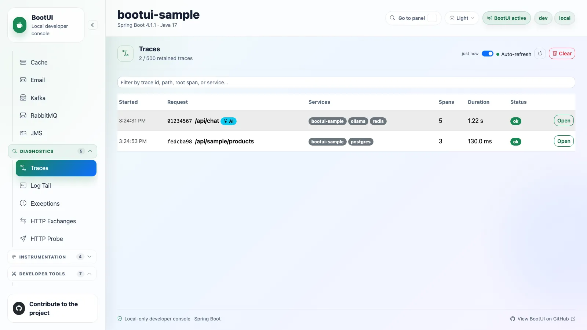
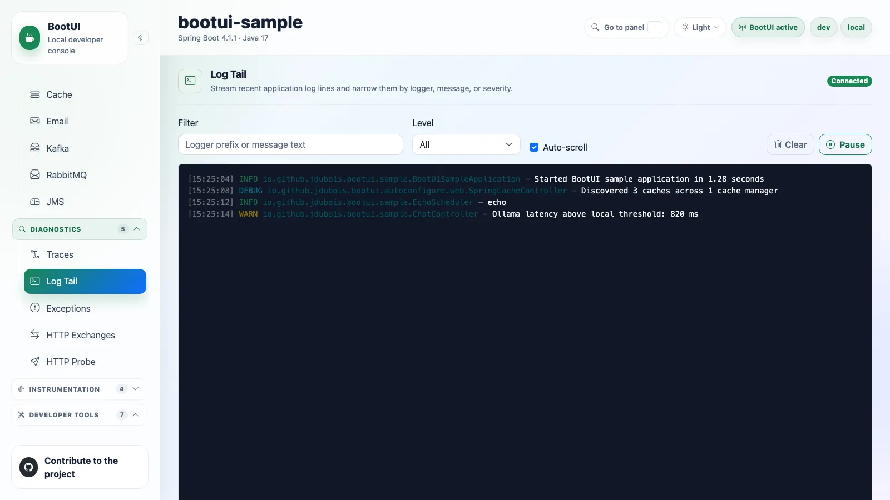
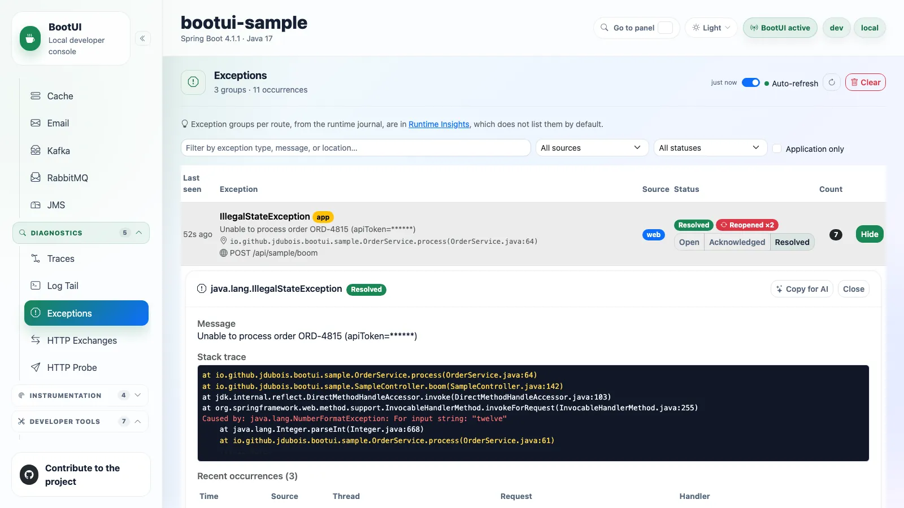
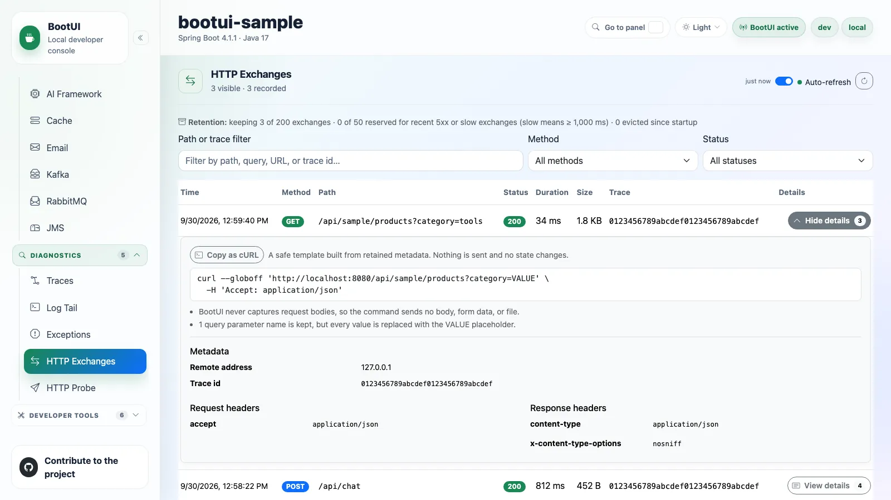
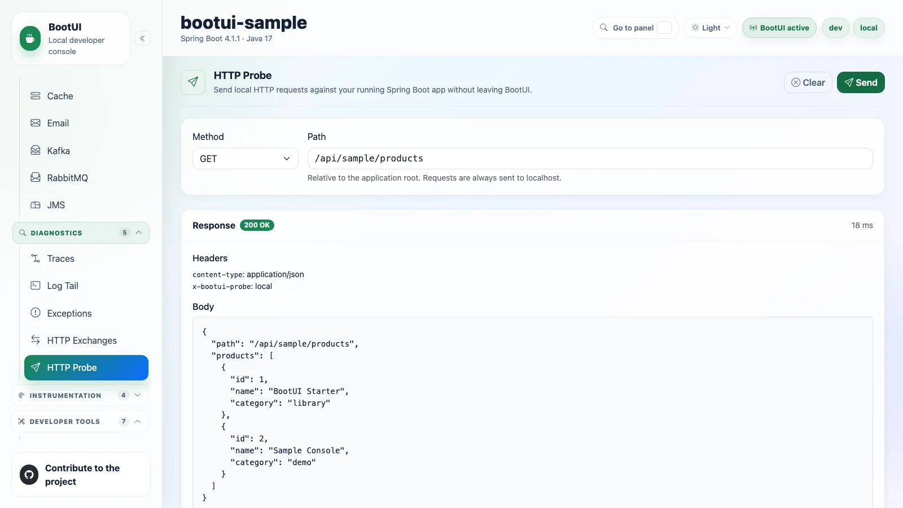

# Diagnostics

## Traces

The Traces panel shows distributed tracing spans captured locally. The starter contributes the tracing dependencies and
the sampling default that local development needs, so your application does not need manual `management.*` tracing
properties.

The list shows the most recent traces with their service name, HTTP path (or the root span name), status, duration, and
span count. Opening a trace renders a waterfall of its spans, so you can see latency contributions, errors, and parent
and child relationships across services.

On Spring Boot, BootUI also runs an embedded OTLP/HTTP receiver at `/bootui/api/otlp/v1/traces`, so cooperating local
services can export spans into the same in-memory store. On Quarkus, spans are captured in-process through an
OpenTelemetry `SpanProcessor` registered only when the application depends on `quarkus-opentelemetry`, and there is no
embedded receiver.

Trace data resets on application restart and through the panel's clear action. When `bootui.telemetry.enabled=false`,
the sidebar dims the panel and the view shows a disabled state.

### Trace value exposure

Every read applies the live `bootui.expose-values` and `bootui.mask-secrets` policy, so a runtime change takes effect
on the next read without a restart. The same rule covers `GET /bootui/api/traces/{id}`, the trace embedded in the
[per-request profile](live-activity.md#the-per-request-profiler), and the `get_request_profile` MCP tool and
`bootui request-profile` command. `MASKED` (default) masks secret-like values, `METADATA_ONLY` omits them, and `FULL`
shows them verbatim.

::: details What each mode changes

- **Status messages and exception events.** A span's status message, its `exception.message` and `exception.stacktrace`
  attributes, `error.message`, and captured generative-AI content (prompts, completions, tool call arguments and
  results, vector query content) follow the [exception message](#exposure-and-bounds) rule.
- **URLs.** `url.full`, `http.url`, `http.target`, `url.query`, and `url.path` are masked like the HTTP Exchanges URI:
  user-info is always removed, sensitive query and matrix parameter values are masked under `MASKED`, and query values
  are dropped under `METADATA_ONLY`.
- **Headers and bound parameters.** Sensitive `http.request.header.*` and `http.response.header.*` values, such as
  `authorization` or `cookie`, are masked under `MASKED`. Under `METADATA_ONLY`, every header and `db.query.parameter.*`
  value is omitted.
- **Other attributes.** A string attribute whose key looks sensitive, such as `app.api_key`, is masked, and any other
  string attribute, such as `db.statement`, has secret-like assignments masked, unless the mode is `FULL`. Numbers and
  booleans are never masked.

Keys, types, names, ids, kinds, and timings are never changed. An omitted value is `null`. Masked text is safer to
show, not guaranteed secret-free: only secrets with a recognizable shape are detected. The
[AI Framework](services.md#ai-framework-value-exposure) chat detail applies the same rule.

:::

::: details Sampling defaults and log-level pins

The starter raises sampling to 100 % (`management.tracing.sampling.probability=1.0`). To keep that from flooding the
console when the root logger is at `DEBUG`, BootUI pins `logging.level.io.opentelemetry` and
`logging.level.io.micrometer.tracing` to `INFO` as overridable defaults. Set either key yourself to opt back in.

:::

Traces from BootUI's own API are dropped on ingestion (`bootui.telemetry.exclude-self-spans`). The buffer is bounded by
`bootui.telemetry.max-traces` and `bootui.telemetry.max-spans-per-trace`.

## Log Tail

The Log Tail panel reads recent local application logs and streams new log events from the running process, for quick
diagnosis without leaving the console.

### Log message exposure

Log messages follow the same exposure rule as [exception messages](#exposure-and-bounds). Under the default
`bootui.expose-values=MASKED`, the value of each secret-like `key=value` or `key: value` assignment is replaced with
`******`, and so is a credential after an authorization scheme or after `Bearer`, `Basic`, `Negotiate`, or `NTLM` when
its shape shows it is one. Under `METADATA_ONLY` the message is omitted while the timestamp, level, logger, and thread
remain, and the panel marks the line **message omitted by policy**. Only under `FULL`, or with
`bootui.mask-secrets=false`, are messages shown verbatim. Treat log output as local diagnostic data.

The rule applies when a line is read, not when it is captured. It covers the recent snapshot
(`GET /bootui/api/log-tail/recent`), the SSE stream including its replayed backlog, the `get_log_tail` MCP tool, and
`bootui logs tail`. Changing the policy at runtime applies to the next snapshot and streamed line without a restart.

::: details Masking details and limits

- Every line of a multi-line message is scanned. After an `authorization` key, the credential that follows an HTTP
  scheme is masked while the key and scheme stay visible, as in `Authorization: Bearer ******`.
- A credential after `Bearer`, `Basic`, `Negotiate`, or `NTLM` is masked even with no key before it, but only when its
  shape fits (for example a `Basic` credential must decode to `user:password`), so prose such as `Basic auth is enabled`
  stays readable.
- Any other assignment has only the first word of its value masked, and a bare token or a credential inside a
  connection string is not detected.
- Each line carries a `messageOmitted` flag that is `true` only when the policy withheld its message.

:::

## Exceptions

The Exceptions panel captures exceptions thrown by the running application and groups repeated failures into one entry
with an occurrence count. Exception groups per route are in [Runtime Insights](runtime-insights.md)
(`exception-hotspots`); the link opens it with every row shown.

Each row shows the type, the latest message, first and last seen times, the originating location, and a total count.
Opening a group shows the representative stack trace with application frames highlighted, the full cause chain, and
the most recent occurrences with thread, source, and request context. Each occurrence carries the `requestId` of the
request that threw it, so the profiler can attribute it exactly. The list updates live, and you can filter by text,
capture source, triage status, or to application-originated exceptions only.

::: details How exceptions are captured and grouped

Grouping uses a stable fingerprint derived from the exception type and the top stack frames. The stack view folds
common frames (`… N more`).

On Spring MVC, BootUI records from a `HandlerExceptionResolver` that observes exceptions escaping request handlers
(with method, path, and handler), and from a logback appender that picks up anything logged with a throwable from
scheduled tasks, async work, or `log.error("…", ex)`. A failure that is both handled and logged is de-duplicated by
throwable identity: distinct instances count separately, the same instance or its cause twice does not.

**Quarkus** uses a `java.util.logging` handler (excluding BootUI's own loggers) and a Vert.x failure handler, wired in
dev and test only. **Spring Boot WebFlux** uses a `WebExceptionHandler` at the highest precedence plus the logback
appender. A `@RestController`'s local `@ExceptionHandler` consumes an exception inside the WebFlux pipeline before any
`WebExceptionHandler` sees it, so those are not captured on WebFlux; unhandled exceptions are captured identically on
all stacks.

:::

### Triage status

Each group carries a triage status, changed inline with a button group:

| Status           | Meaning                        | On a new occurrence                        |
| ---------------- | ------------------------------ | ------------------------------------------ |
| **Open**         | Default for every new group    | Keeps accumulating                         |
| **Acknowledged** | Seen, still being investigated | Keeps accumulating; never auto-transitions |
| **Resolved**     | Believed fixed                 | Regresses: auto-reopens to **Open**        |

When a **Resolved** group throws again, it reopens and a lifetime "Reopened ×N" counter appears next to the badge. A
status filter narrows the list. `POST /bootui/api/exceptions/{id}/status` with `{"status": "..."}` changes a status;
any other value returns `400` and an unknown group returns `404`.

### Caught in application code

With the BootUI agent's opt-in [`caught-exceptions` sensor](java-agent.md#the-caught-exceptions-sensor), the panel adds a
**Caught in application code** section (`GET /bootui/api/exceptions/caught`, and `caughtInCode` in the report and MCP
`get_exceptions`). It groups exceptions that application handlers caught by route, handler, and caught class, and
counts each occurrence under one outcome, from **Rethrown** and **Logged** to **Unknown** (incomplete evidence) and
**Settling** (its request ended less than five seconds ago).

::: details All outcomes

| Outcome                                          | What BootUI saw                                                                                                             |
| ------------------------------------------------ | --------------------------------------------------------------------------------------------------------------------------- |
| **Rethrown**                                     | The exception left the method by a throw, as is or as a cause, or was caught again                                          |
| **Replaced**                                     | The handler's straight-line code throws another exception without it                                                        |
| **Reported**                                     | The exception, or a wrapper of it, reached the framework's error handling                                                   |
| **Logged**                                       | It was logged at `WARN` or above, or a `WARN` was logged on the catching thread right after, before it caught anything else |
| **Handed on**                                    | The handler passed it on as an error value: a failed future, an error signal, a deferred error result                       |
| **Re-interrupted**                               | The handler restored the thread's interrupt                                                                                 |
| **Retried**                                      | A later attempt at the same handler in the same request was rethrown, reported, or logged                                   |
| **Not seen rethrown or logged at WARN or above** | None of these, while the evidence was complete                                                                              |
| **Unknown**                                      | The evidence was incomplete; the row names the most frequent reason                                                         |
| **Settling**                                     | Its request ended less than five seconds ago, or work it handed over still runs                                             |

:::

A row is a finding when occurrences not seen rethrown or logged came from at least three requests, or from one for an
SQL, I/O, or data-access exception. A finding states a fact, never a verdict: BootUI never calls an exception
swallowed.

::: details When an occurrence counts as complete evidence, and known limits

An occurrence is judged only when it was caught under a retained HTTP request that started after the last **Clear
recording**, lost no record in the journal or the agent, did not go asynchronous or get cancelled, and ran no work after
the response, and BootUI's log appender saw every `WARN` log. Otherwise the occurrence is unknown, with the first
missing piece as its reason. With HTTP Exchanges hidden, rows name no route or request; with Log Tail hidden, logs are
not consulted.

Known limits: a task queued longer than the five-second settle window is not yet followed; an exception the panel's
capture ignores or deduplicates carries no identity of its own; and on Spring, `java.util.logging` must be bridged to
Logback, as Spring Boot does, or every occurrence stays unknown.

:::

### Exposure and bounds

Exception messages follow the same exposure policy as the rest of BootUI. Under the default
`bootui.expose-values=MASKED` they are scrubbed of secret-like assignments and authorization credentials exactly as
[log messages](#log-message-exposure) are, under `METADATA_ONLY` they are omitted, and only under `FULL` are they shown
verbatim. Request paths are captured without their query string, and stack frames carry only class, method, file, and
line.

The in-memory store resets on restart and through the panel's clear action, which honors the read-only setting. It is
bounded by three properties:

| Property                                      | Default | Bounds                                            |
| --------------------------------------------- | ------- | ------------------------------------------------- |
| `bootui.exceptions.max-groups`                | `100`   | Groups retained, evicting the least recently seen |
| `bootui.exceptions.max-occurrences-per-group` | `25`    | Occurrences kept per group                        |
| `bootui.exceptions.max-stack-frames`          | `50`    | Frames kept per stack trace                       |

### Copy for AI

An open group offers **Copy for AI**, which turns the detail into one Markdown document to paste into an agent: the
group summary, its exposure-governed message, the stack trace and cause chain with application frames marked, recent
occurrences, and, when Live Activity can still profile the latest request, that request's timing and correlated SQL
with N+1 groups.

The full document is shown before anything is copied, with a list of what it leaves out (masked values, withheld
messages, bounded frames, or why no SQL could be added). Preparing it reads only existing Live Activity endpoints; the
copy itself sends nothing and changes no state. It renders through the same helper as the
[profile drawer's export](live-activity.md#copy-profile-and-copy-for-ai).

## HTTP Exchanges

The HTTP Exchanges panel records recent inbound requests: timestamp, method, path, status, duration, response size
when `Content-Length` is present, and trace identifiers from common propagation headers. Expanding a row shows the
request and response headers, with secret-like headers and query parameters masked unless
`bootui.expose-values=FULL`. Every exchange carries its route, shown under its path when the two differ, and a
**Profile** link that opens the request in [Live Activity](live-activity.md#the-per-request-profiler).

BootUI's own requests are not recorded while `bootui.monitoring.exclude-self` is on (the default). The buffer retains
200 exchanges by default; change it with `bootui.http-exchanges.max-exchanges`, effective on the next restart.

::: details How exchanges are recorded on each stack

On Spring Boot, BootUI contributes its own bounded `HttpExchangeRepository` and the Actuator filter that records into
it when the panel is enabled and the application has not defined a repository. If none is available, the panel says so.
Quarkus has no Actuator repository, so a small Vert.x route filter, wired in dev and test only, samples each completed
request into a bounded buffer sized by the same property. Masking, trace-id extraction, self-exclusion, and paging run
through the shared engine, so the wire format is identical.

Every exchange also carries BootUI's own `requestId`, generated when the request starts, with or without OpenTelemetry.
It follows the request across threads on every stack, is the exchange's `id`, and is matched by the search field. An
exchange recorded without one, for example by an application-provided repository, keeps a hash of the exchange as id.

WebFlux and Quarkus require an exact request id or an unambiguous trace id for a buffer-backed profile and explain when
neither is available.

:::

### Failure-preserving retention

A burst of successful requests would otherwise evict the one failure you came to investigate. Every BootUI-owned
capture buffer, HTTP Exchanges, [SQL Trace](database.md#sql-trace), and [REST Client](services.md#rest-client),
therefore reserves a share of its capacity for failed and slow records:

| Buffer         | Reserved for                                                                               | Slow threshold                                                 |
| -------------- | ------------------------------------------------------------------------------------------ | -------------------------------------------------------------- |
| HTTP Exchanges | `5xx` responses and requests at or above the slow threshold                                | `bootui.activity.request-slow-threshold-ms` (`1000`)           |
| SQL Trace      | Failed statements and statements at or above the slow threshold                            | `bootui.sql-trace.slow-query-threshold-millis` (`100`)         |
| REST Client    | Calls that failed, received a `4xx` or `5xx` response, or took at least the slow threshold | `bootui.rest-client-trace.slow-call-threshold-millis` (`1000`) |

Routine records are evicted first. The share is 25% of each buffer by default and is carved out of the existing
capacity. Set `bootui.http-exchanges.reserved-share-percent`, `bootui.sql-trace.reserved-share-percent`, or
`bootui.rest-client-trace.reserved-share-percent` to change it, or to `0` to evict strictly oldest first. A slow
threshold of `0` disables slow classification, so only failures are reserved.

Each panel states its window above the list: records kept, how many sit in the reserved share, and how many were
evicted since startup. The same counts are in the `retention` object of each report, and so in `get_http_exchanges`,
`get_sql_traces`, and `get_rest_client_traces` for MCP clients and the `bootui` CLI.

::: details Durable history and application-provided repositories

With [Live Activity durable history](live-activity.md#durable-history) on, persistence recognizes a reserved record by
the same rule and slow threshold as its buffer, so a reserved record that reappears after being pushed out of the
stream is not stored twice. Persistence remembers each kind of entry separately, so a burst of another kind cannot make
it forget a reserved request; only more than `bootui.activity.persistence.buffer-max-entries` newer records of the same
kind can.

On Spring Boot these guarantees apply only while BootUI owns recording. When the application defines its own
`HttpExchangeRepository`, BootUI leaves it untouched. When it defines its own `HttpExchangesFilter` or
`HttpExchangesWebFilter`, BootUI keeps every exchange it is given, oldest evicted first, and hides its own requests at
read time. In both cases the panel reports retention as managed by the application.

:::

### Route rankings

Above the exchange list, a route table summarizes the retained window. Each row is one method and route, with its
request count; 2xx, 3xx, 4xx, and 5xx counts; average, p50, p95, p99, and maximum duration; and share of retained
request time. **Rank by** orders the table by requests, total time, p95, slowest request, or errors. **Exchanges**
filters the list below to that route, and **Show every route** clears it.

A route is resolved exactly as [SQL Trace](database.md#rankings) attributes database time, and each row says which
source it came from:

| Source        | Meaning                                                                                        |
| ------------- | ---------------------------------------------------------------------------------------------- |
| `template`    | The handler pattern Spring MVC or Spring WebFlux matched, such as `/api/orders/{id}`.          |
| `declared`    | The single best route the application declares in its mappings. Ties resolve to no template.   |
| `masked path` | No template matched, so every path segment that reads like a value is replaced with `{value}`. |

`GET /bootui/api/http-exchanges/routes` serves the rankings, `?route=<id>` pins one route's row, and
`GET /bootui/api/http-exchanges?route=<id>` lists that route's exchanges. Agents use the `get_http_routes` MCP tool, and
the command line `bootui http routes`.

::: details Route resolution details

- A template is shown the same way whichever source produced it, so `{id:[0-9]+}` reads `{id}` and a route never splits
  in two. Catch-alls such as `/**` stay as declared. Query strings are never part of a route.
- Quarkus has no runtime route template, so routes come from the declared JAX-RS mappings under `quarkus.http.root-path`
  and `quarkus.rest.path`; a prefix contributed only by `@ApplicationPath` falls back to masked paths.
- Spring WebFlux records the matched pattern through the OpenTelemetry integration the starter includes; without it,
  routes fall back to masked paths and the panel says so.
- With Spring for GraphQL, BootUI adds the parsed operation type and name to the route, such as
  `/graphql (query ProductList)`, never its variables or selection. It needs Spring Boot's observation support.
- A masked path masks every segment that a matching declaration marks as a parameter.

:::

::: details How the figures are bounded

- Every figure covers only the retained, visible exchanges, not lifetime metrics; the Metrics panel's
  `http.server.requests` meter covers the application's lifetime. The line above the table states the evidence window.
- Percentiles are exact nearest-rank values, computed by the same helper as SQL Trace and the Live Activity KPIs.
- The response returns each criterion's top 25 routes plus any route a link names, and the panel says how many are not
  shown. Rankings refresh every 30 seconds while the list follows auto-refresh.

:::

### Copy as cURL

Row details offer **Copy as cURL**, which turns the retained metadata into a command _template_, not a byte-for-byte
replay. Copying runs entirely in the browser: no request is sent and nothing is written back. The command is shown in
full before you copy it.

::: details What the command changes, and why

- Query-parameter names are preserved, but every value becomes a `VALUE` placeholder. A masked name, or a segment with
  no `=`, is dropped and reported.
- Only `Accept`, `Accept-Language`, `Cache-Control`, `Content-Type`, and `User-Agent` are copied, and only while
  their values are exposed and unmasked. Authorization, cookies, proxy credentials, API keys, forwarding and tracing
  headers, and unknown custom headers are omitted under every mode, including `FULL`.
- BootUI never captures request bodies; body-carrying methods say a body may have existed and invite you to add your
  own `--data`.
- The URL, method, and headers are POSIX single-quoted, and credentials embedded in a recorded URL are dropped. The
  path is copied as recorded, so a traversal probe such as `/a/%2e%2e/admin` stays visible, and `--globoff` keeps
  brackets literal. `HEAD` uses `-I`.
- With no absolute `http(s)` URL or no recognizable method, the action is deactivated and says why.

:::

## HTTP Probe

The HTTP Probe panel sends local-only requests to the running application and shows the response status, headers,
duration, and body. The probe always targets the application's own loopback address, so it can never reach an external
host, and as a state-changing action it is gated by the same localhost-only safety floor as every other write.

Probe input is bounded, measured in UTF-8 bytes and checked before anything is sent:

| Input        | Ceiling                                                          |
| ------------ | ---------------------------------------------------------------- |
| Request body | 64 KiB                                                           |
| Path         | 2 KiB                                                            |
| Headers      | 50 entries, 256 bytes per name, 8 KiB per value, 32 KiB combined |
| Method       | 32 bytes                                                         |

Exceeding a ceiling is rejected with the canonical `400` and `{"error": ...}` body. A probe that runs and fails, through
a refused connection or a timeout, is reported as a probe outcome, with its response body truncated at the byte budget.

::: details Resolving the port on Quarkus

Quarkus has no config key that always equals the bound port, so the adapter selects `quarkus.http.test-port` or
`quarkus.http.port` by launch mode. A random `=0` port still resolves.

:::

## Diagnostic control outcomes

Logger level changes, configuration override removal, Hibernate runtime activation, and SQL, transaction, REST client,
and WebSocket capture controls report the backend's accepted outcome, not merely the requested change. A policy
refusal shows its specific reason, and unavailable or unchanged capture reports never appear as successful activation.
Configuration writes remain Spring-only.

These controls require their documented JSON response. An empty, malformed, or unrecognized reply, or a lost
connection, reports an **unknown outcome**, keeps the last accepted state, and re-reads once without retrying the
mutation.

::: details Refresh behavior, Profile resources, Flyway and Liquibase

- A refresh started before an accepted Hibernate activation or capture action cannot overwrite its result. If a refresh
  is outstanding, one fresh read follows it even with auto-refresh off.
- **Profile resources** uses the same rule: an older poll cannot replace an accepted start or stop, and an unknown
  acknowledgement re-reads once without starting or stopping another recording. Empty route rows mean no samples were
  attributed to listed routes, not that no request ran. At most 20 routes are listed; `routesOmitted` counts the rest.
- **Flyway and Liquibase** require their native action-result JSON before reporting success. A failed action can still
  have committed earlier migrations, so an HTTP 5xx, lost response, or unknown acknowledgement triggers one history
  read without retrying. A known 4xx refusal or a cancelled confirmation does not.

:::
