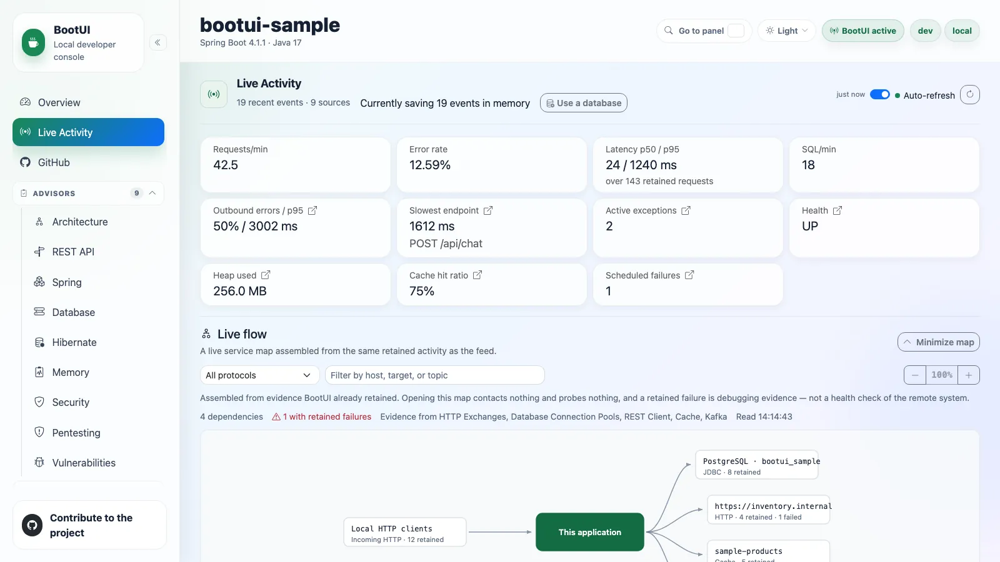

# Live Activity

The diagnostics home base: one reverse-chronological stream of everything the application just did, plus a per-request
profiler for drilling into any single request.

It reuses the existing panel buffers where it can and supplements them with runtime-journal events. Panel-backed values
remain masked, self-filtered, and bounded exactly as they are in their dedicated panels.

## Feed types

The type filter exposes these 17 kinds. Availability depends on the stack, the enabled panels, and the installed
integrations.

| Signal             | Type              | Captured from                                           |
| ------------------ | ----------------- | ------------------------------------------------------- |
| Requests           | `REQUEST`         | HTTP Exchanges                                          |
| SQL                | `SQL`             | SQL Trace                                               |
| Exceptions         | `EXCEPTION`       | Exceptions                                              |
| Security           | `SECURITY`        | Security Logs                                           |
| Cache              | `CACHE`           | Cache activity                                          |
| Scheduled          | `SCHEDULED`       | Scheduled-task execution                                |
| Messaging          | `MESSAGING`       | Kafka, RabbitMQ, or JMS activity                        |
| Emails             | `MAIL`            | Email activity                                          |
| REST client        | `REST_CLIENT`     | REST Client                                             |
| Fault tolerance    | `FAULT_TOLERANCE` | Resilience4j, Spring Retry, or SmallRye Fault Tolerance |
| Transactions       | `TRANSACTION`     | Transaction activity                                    |
| AI                 | `AI`              | AI Framework activity                                   |
| Logs               | `LOG`             | Log Tail                                                |
| Application events | `APP_EVENT`       | Application event publication and listeners             |
| WebSockets         | `WEBSOCKET`       | Inbound WebSocket handlers                              |
| ORM                | `ORM`             | Hibernate sessions                                      |
| Async handoffs     | `ASYNC`           | BootUI agent executor propagation                       |

Each `@Scheduled` execution is recorded with start, success, failure, and duration, without extra proxying. A run gets
its own BootUI execution id, so the SQL, exceptions, and REST client calls it makes nest under it, even on another
thread. Cache rows show the operation and cache name (`MISS orders`) and a short hashed key, never a raw key or value,
even under full value exposure.

::: details Scheduled and cache details

On Quarkus, scheduled capture covers blocking `@Scheduled` methods. A method returning a `Uni` or `CompletionStage`
completes later, and its run carries no execution id.

A cache miss has `WARN` severity; other cache rows are `OK`. The detail shows `key a1b2c3…`.

:::

## Reading the feed

Each row has a timestamp, a type icon, a severity (`OK`, `SLOW`, `WARN`, `ERROR`), a one-line summary, and a duration.
Failed rows are highlighted. Slow requests are tinted on a yellow-to-red scale crossing 100, 200, 500, and 1000 ms,
with a latency badge. A request whose SQL looks like an N+1 pattern carries a red **N+1** badge.

When the feed is unfiltered, signals BootUI can pin to a request are nested chronologically beneath it and expanded by
default. Requests that triggered a security event are flagged **authenticated** with a lock icon and the principal.
Signals that cannot be tied to a request stay top-level. Any filter or search flattens the feed.

- Adjacent identical entries collapse with an occurrence count.
- Filter by type, severity, free text (path, status, SQL, or exception class), and an **errors-only** toggle. Filters
  persist across reloads.
- A requests-over-time sparkline shows spikes and error bursts. With the runtime journal as source, dashed lines mark
  **MARKER** rows: a change made from a BootUI panel, an availability change, a configuration refresh, or shutdown. A
  marker names its target, never a value.
- **Pause** keeps a row you are inspecting from scrolling away.
- Every row deep-links to its dedicated panel with the record pre-filtered. A request row opens its profiler.
- The feed refreshes over Server-Sent Events (`/bootui/api/activity/stream`), not polling.

::: details The KPI strip

Across the top: requests per minute, error rate, p50/p95 latency, SQL rate, the slowest recent endpoint, active
exception count, health status, heap usage, and scheduled-task failure count. On Spring servlet and WebFlux only,
outbound REST-call error rate and p95 latency, plus the cache hit ratio. All are computed from the same buffers, and
sub-millisecond SQL is shown as `<1 ms`.

The p50/p95 latency and the slowest request are computed once, in the shared engine, over every retained request with a
duration, so Spring MVC, Spring WebFlux, and Quarkus report the same figures for the same traffic; the latency card
states how many requests they cover. The slowest request is labelled with its resolved route, such as
`GET /api/orders/{id}`, and a tie goes to the newest request.

Several cards are launchpads: outbound-errors opens **REST Client**, slowest-endpoint opens that route's row in the
[HTTP Exchanges route rankings](diagnostics.md#route-rankings) with its exchanges listed, and the active-exceptions,
health, heap-usage, cache-hit-ratio, and scheduled-failures cards jump to **Exceptions**, **Health**, **Heap Dump**,
**Cache**, and **Scheduled Tasks**.

:::

::: details Row types and details: markers, application events, ORM, WebSocket, async handoffs

**MARKER** rows come from the runtime journal: a logger level, a configuration override, a cache clear, a migration,
**Clear recording**, or a heap dump changed from a BootUI panel, an availability change, a configuration refresh, or
shutdown.

**APP_EVENT** rows list the application events a request published and each listener's run. On Spring, they come
through BootUI's event multicaster, including transactional listeners' deferral, effective execution phase, and skips.
A listener running through `fallbackExecution` without an active transaction is `IMMEDIATE`, regardless of its
annotation's phase. A deferred callback retains its transaction phase, including a reactive transaction carried in the
event's source. When the application defines its own multicaster, as Spring Modulith's event publication registry does,
BootUI keeps it and records no application event. On Quarkus, listener runs are recorded through an interceptor bound at
build time to the application's `@Observes` and `@ObservesAsync` methods. Framework events are left out, and an event's
fields are never recorded. Change impact accepts an event type, such as `OrderPlaced`, and lists the routes that
published or consumed it.

**ORM** rows give each Hibernate session's statements, flushes, the auto-flushes that wrote before a query, and the most
entities its persistence context held, under the request that opened it.

**WEBSOCKET** rows are inbound WebSocket messages, each an execution owning what its handler did.

**ASYNC** rows need the [BootUI agent](java-agent.md). They are the tasks a request handed to a JDK executor, nested
under it: the task's class, the hook that propagated it, its queue time, and its outcome. A task is badged:

- **after response** when it worked once the response started: its body was still running, or, after a body that ended
  before, a dependent stage or `done()` callback ran SQL, a REST call, or a message, failed, or ran 50 ms, after it. A
  task whose handler waited for its result is not badged merely because its run closed just after the response.
- **running** while it still runs.
- **past deadline** when it ended more than `bootui.agent.executors.max-handoff` after it started.

The request's journal profile lists them under **Handoffs**, each with its thread, duration, queue time, what it did
(SQL statements, REST calls, and messages), its outcome, and its allocated bytes. A task that started more than
`max-handoff` after the request ended is only counted, and neither it nor its work is drawn on the timeline.

:::

## The per-request profiler

Clicking a request opens a Symfony-style drawer that correlates that request's SQL, exceptions, security events, REST
client calls, and cache accesses. It never fabricates data. Every section is labelled with the tier that correlated it,
and the whole profile is marked approximate whenever a time-window match was used.

| Tier           | How it matches                                                                                   | Adapters            | Labelled        |
| -------------- | ------------------------------------------------------------------------------------------------ | ------------------- | --------------- |
| Request id     | The BootUI request id stamped on the signal when it was recorded                                 | All                 | **exact**       |
| Propagated     | The request id, on work in a task the [BootUI agent](java-agent.md) propagated to an executor    | All, with the agent | **exact**       |
| Trace id       | A trace id that exactly one captured request carries                                             | All                 | **exact**       |
| Serving thread | The one worker thread that served the request, inside its window                                 | Spring MVC          | **exact**       |
| Time window    | The request's time window, plus method and path for exceptions and principal for security events | Spring MVC          | **approximate** |

Spring WebFlux and Quarkus serve requests on shared event-loop and worker threads, so they correlate by request id and
trace id only and list the other tiers as unavailable rather than guessing.

The drawer also shows the request's timing breakdown (SQL and outbound REST calls versus everything else), its auth
context, and the trace span list. Span status messages, exception events, and attribute values follow the
[trace value exposure](diagnostics.md#trace-value-exposure) rule. **Escape** dismisses it, and focus is trapped while it
is open. Opening a profile only reads evidence BootUI already captured. It captures nothing new, calls no network
service, and changes no state. Open Live Activity with `?request=<exchange id>`, as each HTTP Exchanges row's
**Profile** link does, to open a request's profile directly.

Identical repeated `SELECT`s above `bootui.activity.n-plus-one-threshold` are flagged as a potential N+1. Each flagged
group lists the call sites in your own code that issued it (class, method, and line, from
`bootui.sql-trace.capture-call-site`, on by default), so you know which method to fix.

The drawer's **Performance deep dives** links to the **JFR profile** tab in Runtime Insights and, when the route is
known, to that route in **Code Paths**. Opening the JFR tab does not start a recording; you must choose **Profile
resources**. Code Paths opens the route-level aggregate tree, not an exact replay of the request.

Each section shows at most 200 entries and states how many more were correlated. A section whose source panel is
disabled or not capturing explains why instead of looking empty.

::: details Correlation rules and edge cases

One shared engine assembler builds the profile on every adapter, so identical evidence gives an identical profile. A
servlet request runs on one worker thread that serves one request at a time, so work on that thread is its own.

The **Propagated** tier applies when the task started within `bootui.agent.executors.max-handoff` of the request's end
and the work within `max-handoff` of the task's start. It is unavailable, with the reason, unless the agent's `executors`
sensor propagates for the application.

On WebFlux and Quarkus a request is profileable when it carries a request id or a trace id, so tracing is not required.
For SQL, the time-window fallback applies only when no statement matched a request id, a trace id, or the serving thread.
On Spring MVC, exceptions still match the request's method, path, and window; a trace id or the serving thread then
settles which request threw them. Security events match by time window and principal, but are pinned to the serving
thread when captured there, and an event proven to have fired on another thread is excluded.

A signal attaches to at most one request. A trace id shared by two captured requests (a reused inbound `traceparent`, or
an application calling itself) attaches nothing to either, and a signal two requests could equally claim, such as a
statement inside the overlapping windows of two identical concurrent requests, stays out of both. The notes count every
such signal. When a section mixes tiers, each entry names its tier.

**REST client calls** are shown as the REST Client panel shows them, with values masked by the same policy. **Cache
accesses** carry only the short key hash. Both attach by request id, then a unique trace id, and on MVC by serving
thread, never by time window. Quarkus has no cache-access capture seam, so its cache section says so.

N+1 groups and timing count every correlated statement and call; at most 200 statement groups are listed. When Code Paths
is disabled, unavailable, or has no retained tree for the request, the drawer says why.

:::

::: details Agents and execution profiles

Each correlated exception carries its `exceptionGroupId`, the id of its group in the
[Exceptions panel](diagnostics.md#exceptions). Agents use `get_request_profile` or `bootui request-profile <id>`, which
return a selection with `journal` and `buffers` evidence when retained, preferring the journal in `source` (`"journal"`,
`"buffers"`, or `"none"`). A request's profile is unavailable while the HTTP Exchanges panel is disabled, because it
opens with that request's exchange.

Scheduled runs, consumed messages, and inbound WebSocket handlers can also be opened by execution id when their
completed anchor is retained and its source panel is enabled. WebSocket profiles use the captured destination template,
or the endpoint when none is recorded, and include only retained, enabled-panel work correlated to that execution.
Outbound messages and session open/close events never open an execution profile. Each retained event is selected once,
even when an executor handoff shares its parent's execution id; individual task counts are then qualified as unavailable
rather than claiming nothing was recorded. These executions have no HTTP status, route comparison, or measured CPU,
allocation, and GC pauses. Scheduled runs are not child events in an HTTP request's buffer-backed profile or exports.
See [Investigate one request](../AI-AGENTS.md#investigate-one-request).

The REST Client panel keeps its own "chatty" badge for now.

:::

### Copy profile and Copy for AI

**Copy profile** copies the already-masked profile as Markdown, including REST client calls, cache accesses, tiers, and
truncation, ready for a bug report. **Copy for AI** builds a fuller document for an agent: the same profile plus each
correlated exception's stack trace, with application frames marked, and its recent occurrences with request context.

It first shows the whole document with a list of what the export leaves out. **Copy Markdown** copies exactly that
preview, sends nothing, and changes no state. When the browser denies clipboard access, the document stays selected in
the preview to copy by hand.

::: details Export details

The omitted list covers values BootUI masked, truncated or unavailable sections, exception messages withheld by
`bootui.expose-values=METADATA_ONLY`, and details that could no longer be loaded. Preparing the preview reads each
referenced exception group through the Exceptions panel's existing read endpoint, at most five groups.

Both documents come from one shared helper that works only on DTOs the browser already holds, so the export never
contains anything the panels do not show, and identical evidence produces identical text on every stack. Captured
messages, paths, and SQL are escaped or fenced, so Markdown inside them cannot break the document's structure.

:::

## Messaging capture

Kafka, RabbitMQ, and JMS activity land in the same `MESSAGING` stream. **Payloads are never captured**, only metadata,
because a payload is an arbitrary, potentially sensitive object with no generic masking strategy. Raw exception messages
are not retained either; failed operations carry only generic failure text.

Each consumed message runs as an execution of its own, so the SQL, exceptions, REST client calls, and messages its
listener produces nest under it. An outgoing message nests under the request, scheduled run, or consumed message that
sent it. JMS capture is Spring-only.

::: details How context follows a message

For Kafka on Spring, whose client reports a send on its own I/O thread, BootUI snapshots the sender's context when
`KafkaTemplate` sends the record. On Quarkus, the execution id is attached to the Vert.x context SmallRye Reactive
Messaging processes the message on, so it follows the listener to a worker thread, and a send's context is snapshotted
when the message enters its channel.

:::

::: details Kafka capture

On Spring, BootUI wraps every application-owned `KafkaTemplate` with a `ProducerListener` and every `@KafkaListener`
container factory with a `RecordInterceptor`, composing with whatever the application configured. On Quarkus, it hooks
SmallRye Reactive Messaging's Kafka interceptors.

Each entry records topic, partition, offset (consumed only), a hash of the key, direction, and success or failure, plus
consumer group id, listener identifier, and processing duration for consumed records. A producer send's duration is not
exposed by either framework's callback. The listener identifier is the listener container factory bean name on Spring
(the per-`@KafkaListener` id is not exposed there) and the channel name on Quarkus.

Capture is on by default when the Kafka integration is present and the panel is enabled. Tune it with
`bootui.kafka.enabled`, `bootui.kafka.capture-key`, `bootui.kafka.max-entries`, and `bootui.kafka.max-key-length`.

:::

::: details JMS capture (Spring MVC and WebFlux only)

Requires `spring-jms` and `jakarta.jms` on the classpath. Every `JmsTemplate` bean is wrapped by a CGLIB proxy that
intercepts `send`/`convertAndSend`, and every `AbstractJmsListenerContainerFactory` bean is proxied so each container's
listener is wrapped by a matching plain or session-aware adapter. Both compose with the application's converters,
callbacks, and error handlers. Direct `JMSContext`, `MessageProducer`, or `MessageConsumer` usage is outside this seam.

Each entry records a sanitized destination name (only explicit names and standard `Queue`/`Topic` accessors are trusted),
direction, success or failure, and duration. When a `MessageCreator` or `MessagePostProcessor` exposes the JMS message ID,
only its one-way hash is retained. **Payloads, arbitrary headers and properties, the raw message ID, and exception
messages are never captured.**

JMS has its own recorder, buffer, and mapper, so it cannot evict Kafka history and either can be disabled independently.
Tune it with `bootui.jms.enabled`, `bootui.jms.capture-message-id`, `bootui.jms.max-entries`, and
`bootui.jms.max-message-id-length`. No Quarkus JMS equivalent is claimed.

:::

## Durable history

By default the stream is in-memory only: history is lost on restart and the feed reaches back only as far as its small
buffers. Set `bootui.activity.persistence.enabled=true` to flush captured entries to a SQL database over direct JDBC
every `bootui.activity.persistence.flush-interval` (5 seconds by default).

With persistence on, the panel gains a **Load older** button, the type, severity, and free-text filters become database
queries, and a "· persisted history" note appears next to the subtitle. Persisted rows contain only the
journal-rendered, `MASKED` view: no bind values, principals, exception or log messages, or email subjects. The runtime
journal is the only source of durable history; with `bootui.runtime-journal.enabled=false`, configured startup
persistence logs a warning and writes nothing.

You can also turn it on without editing configuration or restarting. While persistence is inactive, a "Currently saving
N events in memory" tip appears with a **Use a database** button. If the application has a `DataSource`, **Use the
existing datasource** checks it, creates the table, and hot-switches the running instance. The action is
confirmation-gated and **runtime-only**: nothing is written to disk, so a restart reverts to in-memory unless the
property is also set. With no `DataSource`, the button links to the setup documentation.

::: details Storage, paging, and sharing a table

The table (`bootui.activity.persistence.table-name`, default `bootui_activity`) is created on first use. Several
instances can share one table: each tags its rows with an `instanceId` (defaulting to `HOSTNAME`) and never reads or
prunes another instance's rows. Reads merge the in-memory buffer with the durable store, and a failed flush returns its
entries to the buffer.

Changing a query or feed source discards its older pages, and a late page from a previous query cannot add rows or replace
the cursor. Switching between durable and in-memory storage also resets history. A disabled source panel hides its older
rows; a history page scans past them within a bounded read budget and keeps a continuation cursor, so a page can be empty
while **Load older** is still available.

Each journal batch is rendered as the journal feed renders it and stored once, so a burst is not lost between reads of the
panel buffers. Failed and slow entries are remembered longer, in one window per kind,
`bootui.activity.persistence.buffer-max-entries` wide, recognized by the rule and threshold of the
[failure-preserving buffer](diagnostics.md#failure-preserving-retention). This replaces the 1.x buffer-polling path;
applications that relied on the omitted details must read the bounded live panel evidence.

With persistence off, no subscriber, flush scheduler, or database connection is created.

:::

::: details The datasource switch and Clear recording

The switch starts the journal subscriber against the new store, then hot-switches without losing events dispatched in
between. Concurrent requests start one capture; repeats are no-ops. If capture cannot start after schema verification,
HTTP `500` says the table may already exist but in-memory storage remains active; BootUI never deletes a host table to
undo it. Journal shutdown during the switch also rejects it and closes the unused capture and store.

The action rejects an unavailable, disabled, or closed journal with HTTP `409` before creating a table, and never
silently enables capture. Opening the database disclosure checks journal status on demand; the switch stays disabled with
an explanation while capture is disabled, unavailable, or unverifiable, since datasource presence alone does not prove
events can be saved.

The switch and **Clear recording** report success only after a valid JSON acknowledgement. Otherwise they report an
unknown outcome and re-read the feed or journal status, keeping prior local evidence if that fails. The browser never
repeats either action automatically.

:::

## Runtime journal

BootUI 2.0 records every runtime event once in a bounded, in-memory runtime journal: requests, SQL statements,
exceptions, security events, REST client calls, cache accesses, messages, scheduled runs, transactions on Spring, logical
database connections, and application `WARN` and `ERROR` log events, each with the request or execution it belongs to.
Aggregates per route, statement, exception group, and thread family count every event even after the journal evicts it.

The journal is enabled by default and sized by the `bootui.runtime-journal.*` [properties](../PROPERTIES.md#runtime-journal).
A request does not wait for the journal's dispatcher: when it cannot keep up, it drops events, counts them per source,
and drops routine events before failed or slow ones. BootUI's own requests, and the SQL its panels run while serving
them, are never recorded.

**Recording** in the panel header opens the journal's status, read only when you open it: the events and memory it
retains against its bounds, when its oldest event happened, how many events each source recorded in this run, and how
many were evicted or dropped. **Clear recording** drops the events and aggregates of this run, after a confirmation, and
keeps the counts so drops and evictions stay visible.

**Recorded by** chooses where the feed comes from:

- **Default** follows `bootui.activity.feed-source`, which is the runtime journal. The panel buffers serve it only while
  the journal does not record.
- **Runtime journal** renders the feed from the journal: every child nests under its request, scheduled run, or consumed
  message by id, and transactions, log events, and **AI** calls appear as rows. Four more filters apply on the server:
  **Route**, **Request id**, **Run id**, and **No request**.
- **Panel buffers** merges each panel's own buffer, as BootUI 1.x does.

The selector is a per-request override (`?source=buffers`), not a second configuration mode. `bootui.activity.feed-source`
accepts only `journal` in 2.0; an old `buffers` value fails startup with migration guidance. Disabling the journal
automatically uses the panel buffers for the live feed, but cannot write durable history.

A request's profile drawer also shows **Recorded by the runtime journal**: where the request stands against its route's
median and 95th percentile (once the route has 5 requests), its CPU time, memory, and GC pauses, a timeline of its
statements, connections, transactions, cache accesses, messages, log events, REST client calls, AI calls, and Hibernate
flushes, and what it touched (tables, data sources, caches, destinations, hosts, log templates, AI models).

**Resources** in the panel header opens **Work outside requests**: where this run's CPU time went, as the share credited
to requests, each thread family's work outside them, BootUI's own threads, and an **Unclassified** remainder. A resource
lane shows heap used and process CPU over the last 15 minutes. It is read only when you open it, and sized by the
`bootui.resources.*` [properties](../PROPERTIES.md#resource-correlation).

::: details What the journal records and how it follows work

A log event keeps its unformatted template, never its arguments. SQL statements, REST client calls, and cache accesses
keep up to four frames of your own code that issued them, skipping framework classes and generated proxies. A message
consumed with a `traceparent` header keeps the trace that sent it. SQL events from named JDBC pools retain the pool name
even when connection recording is disabled.

A task a request hands to a framework-managed executor (an `@Async` method on Spring Boot's auto-configured executor or
scheduler, or a Quarkus `ManagedExecutor` task) runs as an execution of that request. On Spring, the application's own
`ThreadPoolTaskExecutor`, `ThreadPoolTaskScheduler`, and `SimpleAsyncTaskExecutor` beans get the same, including one
wrapped by another executor bean, as JHipster's `AsyncConfigurer` wraps its pool. An executor with its own task decorator
keeps it, with BootUI's composed inside. An executor that is not a bean keeps no request link. A periodic or cron task
belongs to the request that scheduled it on its first run only. Without the BootUI agent, raw executors and
`CompletableFuture` are not followed; with it attached, they are propagated too ([Java Agent](java-agent.md)).

Pausing a panel's recording, or BootUI releasing its buffers while the console is idle (`bootui.free-on-idle`), stops
only what that panel keeps: the journal keeps recording SQL statements, connections, transactions, REST client calls, AI
calls, and security events.

:::

::: details Recording status, agent evidence, and previous runs

With the [BootUI agent](java-agent.md) attached, the status also reports, as **Agent evidence**, the memory its evidence
kept outside the journal uses against `bootui.runtime-journal.agent-evidence-max-bytes`. Clear recording, and **Free
BootUI memory**, drop that evidence too: Code Paths' request and route trees, Code Inventory's first requests and routes,
and Side Effects rows. The status counts Side Effects as `sideEffectRows` and `sideEffectsWaiting`.

When the application restarts in the same JVM (a DevTools restart or Quarkus live reload), BootUI keeps a summary of the
run that ended, at most 256 KB each, for the 5 most recent runs. Each run carries its application (name and whether it is
a test), so when several applications share the JVM, as Spring test contexts do, a run is compared only with its own
application's runs, and each application keeps its last run. **Previous runs** lists them with requests, failures, and
events, or says why none can be kept when BootUI itself is reloaded with the application.

A summary keeps per-route, per-statement-fingerprint, and per-exception-group counts and histograms, and the edges its
requests, jobs, and listeners observed (such as a route reading a table or calling a host). It also keeps what the run
recorded at start: time to ready and slowest bean instantiations (Spring), active profiles, data source URL shapes, cache,
and whether tracing was on, which decide whether two runs can be compared. To keep the last run across a full JVM
restart, set `bootui.runtime-journal.baseline-file`, for example `target/bootui-baseline.bin`: the summary is written
there when the run ends and read back at the next start.

:::

## Safety and limits

The panel inherits BootUI's safety model: loopback filter, Host allow-list, cross-site write defenses, and value masking.
Its reads are read-only. Its two state-changing actions, **Use the existing datasource** and **Clear recording**, are
confirmation-gated and blocked whenever the app or panel is read-only.

The stream is capped by `bootui.activity.max-entries`. The slow-request threshold,
`bootui.activity.request-slow-threshold-ms` (1,000 ms by default, `0` to disable), applies on every stack. It sets the
`SLOW` severity of request and scheduled-task entries, and decides which HTTP exchanges the
[failure-preserving retention](diagnostics.md#failure-preserving-retention) keeps longer, and so which requests durable
history remembers as kept. Turn individual sources off through their own `bootui.panels.*` toggles; a disabled source
drops out of the stream.

Text rendered from the runtime journal follows the live `bootui.expose-values` and `bootui.mask-secrets` policy at every
read, so a change of mode applies to the next read. Under the default `MASKED`, SQL is shown as its literal-free shape
(`where name = ?`), and log messages and `;name=value` path parameters are masked as in the
[Logs panel](diagnostics.md#log-message-exposure). `FULL` shows them as recorded. `METADATA_ONLY` keeps the SQL shape and
omits log messages. [Durable history](#durable-history) is never written less masked than `MASKED`.

::: details Masking details

The live policy applies in the panel, `get_live_activity`, `bootui activity`, request journal profiles, and the KPI
strip. Under `MASKED`, double-quoted runs and an unterminated dollar quote of a truncated statement are replaced too.
`FULL`, or `MASKED` with `bootui.mask-secrets=false`, shows SQL and log text as recorded.

Each stored row is masked again under the live mode when it is read: never shown less masked than `MASKED`, and under
`METADATA_ONLY` with its free text (log messages, exception messages, principals, email subjects and recipients)
dropped while its structural label, such as `GET /orders → 200` or a SQL shape, stays. A stored row is also read only
while the panel that owns it is enabled: disabling SQL Trace, Logs, or any other source panel hides its rows already
written to durable history, as it does for live rows. A search of durable history matches only the text each row shows,
so it never finds a row by text masked or withheld on read.

A SQL statement that mixes a quote with a backslash or a `#`, which MySQL and MariaDB may read as an escaped quote or a
comment, is cut at its first quote rather than guessed at.

:::

## Per-stack behavior

Durable persistence, the datasource hot-switch, N+1 detection and its badge, and call-site capture are shared engine code
on every adapter. What differs is how signals correlate to a request, because only the servlet model gives a request its
own thread.

- **Every stack:** SQL statements, exceptions, security events, cache accesses, REST client calls, emails, and
  fault-tolerance events first match BootUI's own request id, so they nest exactly, with or without tracing, even when
  identical requests overlap. An exception group nests under the request its latest occurrence came from.
- **Spring MVC** then uses the full tiered join: trace id, then serving thread, then time window.
- **Spring WebFlux** and **Quarkus** then correlate by trace id only. A signal with neither id shows flat rather than
  nested, and without a request id or a usable trace id the buffer-backed profiler drawer reports itself unavailable
  rather than fabricating a partial profile.

On Quarkus, SQL trace contributes only when a JDBC datasource is configured (the recorder is gated on Agroal), and the
**Panel buffers** fallback has no server-side `type`/`severity`/`since` filtering. The default journal feed and durable
history do apply those filters. Quarkus's own security layer authenticating the caller takes precedence over a correlated
audit event when both are known.

For per-panel detail see [Framework support](../FRAMEWORK-SUPPORT.md).

## Live flow (service map)

A compact service map sits between the KPI summary and the feed controls, served by
`GET /bootui/api/activity/service-map` on every adapter. Where the feed answers "what just happened, in order?", the map
answers "what does this application actually talk to?": the application at the centre, a **Local HTTP clients** lane
feeding in, and one node per outbound dependency.

**Nothing is instrumented and nothing is contacted.** Opening the map performs no network call, probe, DNS lookup,
connection attempt, or scan. It is assembled from buffers other panels already fill: inbound requests, outbound HTTP
calls grouped to a `scheme://host[:port]` origin, configured JDBC pools, retained SQL statements, cache accesses, Kafka
**producer** topics, and RabbitMQ **publisher** destinations. Consumed Kafka records and AMQP messages are inbound work,
so they are never drawn as outbound dependencies.

The map separates what is **configured** from what has been **observed**. A declared datasource with no traffic is drawn
with a dashed outline reading "configured, no recent evidence". Selecting a node opens an evidence panel with retained
interaction and failure counts, when it was last seen, a note on what the node does and does not prove, recent
interactions, and a deep link into the source panel. A retained failure is debugging evidence, never a health check of the
remote system, because BootUI has not contacted it.

The map is keyboard navigable (arrows move between nodes, Enter or Space selects) and supports protocol and free-text
filters plus zoom. You can minimize it for a denser event-first view; the preference is remembered in the browser.
