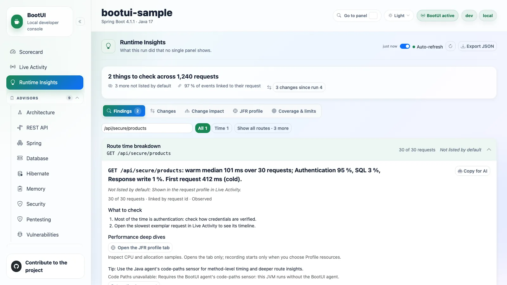
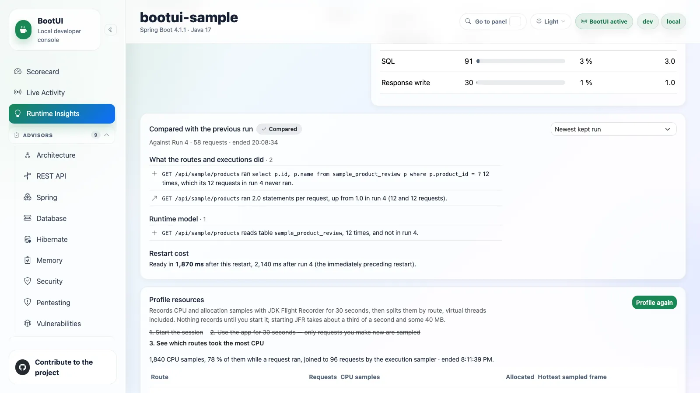

# Runtime Insights

**Runtime Insights** answers what this run did that no single panel shows. It reads the
[runtime journal](live-activity.md#runtime-journal) and projects its retained events into observations. Each one names
what was counted on a route, never a cause, a severity, or a score.

Opening the panel starts no capture, scan, database read, or network call. It re-reads what the journal already
recorded and caches the result until the journal records more or the live exposure policy changes. Sentences and
evidence that quote recorded text, such as a framework warning's message or a request path, follow the same rule as
[Live Activity](live-activity.md#safety-and-limits).

The panel is available while the runtime journal is enabled (`bootui.runtime-journal.enabled`), on Spring MVC, Spring
WebFlux, and Quarkus. Where a stack lacks a fact, the observations that need it say so: WebFlux marks no request phases,
Quarkus records no transactions and intercepts self-invocation, and Spring MVC has no event loop.

The panel leads with a **verdict** on the run: how many things it lists to check across how many requests, how many rows
the default list leaves out, the share of events linked to their request, and the comparison with the previous run.
Five tabs follow:

| Tab                   | What it holds                                                               | Deep link                         |
| --------------------- | --------------------------------------------------------------------------- | --------------------------------- |
| **Findings**          | One searchable list of observations, filtered by theme                      | (default)                         |
| **Changes**           | The comparison with the previous run                                        | `?tab=changes`                    |
| **Change impact**     | What a changed route, bean, class, table, cache, or host reaches            | `?tab=impact`, `?impact=<symbol>` |
| **JFR profile**       | The on-demand resource profiler                                             | `?tab=profile`                    |
| **Coverage & limits** | How events were linked, checks that did not fully run, routes not exercised | `?tab=coverage`                   |

Nothing opens on its own: a deep link opens the row, theme, tab, or change impact it names. Agents read the same facts
through the `get_runtime_insights`, `get_runtime_insight`, `get_runtime_impact`, and `get_runtime_run_comparison` MCP
tools and the `bootui insights` CLI commands ([AI agents](../AI-AGENTS.md#runtime-insights-for-agents)).

Live Activity links here in two places. Under its KPIs, **Why is … slow?** opens the slowest route's time breakdown. In a
request's drawer, **Why this route is slow** loads that route's breakdown on demand and links to it.

## Findings

Each theme counts its rows. A row opens in place on its sentence, what to check, the requests to open, its evidence, and
its limits. Each finding has a stable id that survives refreshes and restarts, one to three conditional checks, up to
three exemplar request ids to open in Live Activity, and at most 20 evidence rows. A breakdown's evidence draws each
phase's share as a bar, with the largest phase emphasized and every number kept beside it.

**Copy for AI** on an open observation previews it as one Markdown document (its sentence, the checks to run, the
requests to open, and its evidence), built from what the panel already shows. Copying sends nothing. **Export JSON**
saves the report as the panel received it, with no new request.

The header states the window the journal retains, and a coverage strip shows how each source's events are linked to a
request: by request id, by execution id, by trace id, or not at all. `bootui.runtime-insights.ai-token-threshold` sets
the tokens of one model call above which AI usage reports its route from that call alone.

### Performance deep dives

Opening a `route-time-breakdown` observation adds **Performance deep dives** actions:

- **Open the JFR profile tab** opens the profiler without starting a recording. A recording starts only when **Profile
  resources** is explicitly selected.
- When Code Paths is available and enabled, its action opens the observed route's retained method timings and calls,
  preserving the route's HTTP method and path.

::: details Deep dive availability

This is route-level evidence, not an exact request replay; an available sensor does not guarantee a retained tree for
that route. Without the agent or its `code-paths` sensor, a tip explains how the Java agent adds deeper insights, shows
the runtime's actual reason, and links to agent setup when that panel is usable. Disabled, missing, or otherwise
unavailable Code Paths panels show their reason instead of an unusable action; an observation without a known route
offers only the JFR action.

:::

### The observations

Twenty-three observations examine the journal's retained completed work and garbage collections, plus Code Inventory's
changed-method evidence. The table says what each counts; the drawers below hold the qualifications.

| Observation                             | What it counts                                                                            |
| --------------------------------------- | ----------------------------------------------------------------------------------------- |
| `route-time-breakdown`                  | Where a route's warm requests spend their time, by phase                                  |
| `exception-hotspots`                    | Exception groups per route                                                                |
| `errors-behind-2xx`                     | 2xx responses that hid a rollback, exception, failed task, `ERROR` log, or downstream 5xx |
| `repeated-selects`                      | The same SELECT run repeatedly in one request (N+1)                                       |
| `connections-per-request`               | Requests holding two or more connections of one data source at once                       |
| `safe-method-dml`                       | GET or HEAD requests that wrote                                                           |
| `proxy-bypass`                          | Spring only: annotated methods whose proxy was bypassed                                   |
| `anonymous-data-reach`                  | Anonymous successful requests that wrote a table                                          |
| `anonymous-success-on-restricted-route` | 2xx answers to anonymous requests on a restricted route                                   |
| `split-transaction-writes`              | Requests whose writes committed in two or more transactions                               |
| `transaction-across-remote-call`        | Transactions still open during a slow REST client or AI call                              |
| `lazy-sql-after-handler`                | SQL run while the response was written, outside every transaction                         |
| `event-loop-blocking`                   | JDBC statements started on an event-loop thread                                           |
| `orm-auto-flush`                        | Requests where Hibernate flushed before queries often                                     |
| `large-persistence-context`             | Requests whose Hibernate session held 500 entities or more at a flush                     |
| `gc-inflated-latency`                   | Slowest requests that overlapped a stop-the-world GC pause                                |
| `transactional-listener-skipped`        | Spring: a `@TransactionalEventListener` that never ran                                    |
| `after-commit-writes`                   | Spring: JDBC writes run by an after-commit, after-rollback, or after-completion listener  |
| `heap-growth-after-gc`                  | Old-generation occupancy rising across the run after collections                          |
| `ai-usage-by-route`                     | AI operations per route, job, or listener: calls, tokens, growth, truncation              |
| `framework-warnings-by-route`           | `WARN` and `ERROR` events from framework loggers, grouped by route                        |
| `work-after-response`                   | Executor work still running after the response started                                    |
| `changed-code-not-executed`             | Changed or added methods that nothing executed in this run                                |

::: details Observation details: timing, errors, and exceptions

- `route-time-breakdown`: where a route's warm requests spend their time: authentication, authorization (Spring, from the `authorization` source: a request's checks out of the filters, a method's out of the handler), other filters, connection wait, SQL, REST client calls, AI calls, synchronous message sends (RabbitMQ and JMS), other handler work, and the response write. Overlapping calls count once, and each route's first request is reported apart as cold.
  - A model call reported by Spring AI or Quarkus LangChain4j is placed over the HTTP call that carried it, so that time counts once, as AI. One known only from a GenAI span is placed by its wall-clock start, to the millisecond, and adds only its time inside the handler that no placed call covers. Tool and retrieval operations stay in the handler they wrap.
  - A Kafka send is timed until the broker's asynchronous acknowledgement, so it stays in the handler's time and the row says so.
  - On Spring MVC and Quarkus, a request that reached no handler BootUI marks, such as an Actuator or `/q/` endpoint or a request the security filters answered with 401 or 403, is never split as handler work: it is left out of its route's phases, and a route whose requests mostly did is reported insufficient with its recorded calls.
  - On WebFlux, which marks no handler or response phase, a route whose requests named nothing at all, neither a recorded call nor authentication time, is insufficient, since its breakdown would be one unattributed span.
  - With the [BootUI agent](java-agent.md)'s `code-paths` sensor, a route whose tree is not assembly only has its other handler work split into its top five application methods by own time (their self time minus the recorded calls stamped to them), named `Handler: Class.method`, with the rest as **Other handler time**. The parts never exceed the handler's work, and a recorded call without a stamp, as one recorded on another thread, stays in its method's own time, which the observation says. The handler is not split when none of its calls carried a stamp, or when calls without one take 10 % of its handler phase or more ([Code Paths](java-agent.md#code-paths)).
- `exception-hotspots`: exception groups per route, by a signature that survives line shifts, marked when the previous run served the route without them. Specific checks follow captured exception subclasses and causes, preferring the deepest cause over a serialization wrapper.
- `errors-behind-2xx`: 2xx responses whose own request rolled back its transaction, recorded an exception, had one of its own tasks fail, wrote an `ERROR` log, or received a downstream 5xx. Matching exceptions a retry or fallback recovered are listed apart, without hiding other errors in the same request.
  - A task is work the request handed to an executor BootUI decorates or the BootUI agent follows. Its exception, `ERROR` log, `WARN` log carrying an exception (as JHipster's `@Async` mail sender logs a failed send), or a task the agent saw fail after the response started counts as the task's failure, never the request thread's. A failed task the request joined is not counted from the agent's outcome alone.
  - On Quarkus, a `ManagedExecutor` task that runs where its request's context is already current keeps the request's execution, so its failures count as the request's own.
- `framework-warnings-by-route`: `WARN` and `ERROR` events grouped by logger, template, and route. Messages that differ only by an id (a UUID, a long hexadecimal id) or by a numeric path segment are one group, quoted with `<id>` and `<n>`.
  - One row of its own holds the framework `ERROR` events that carried no request or execution id, such as a container's errors while parsing requests or a failure at startup. An error written on the thread of a request that failed, within a second after it ended, as Tomcat logs an exception a servlet threw once the request's filters returned, is taken as that request's and left out of that count, which a limitation says. That row's affected count is its error events, so it ranks among the kind's other rows.

:::

::: details Observation details: database, transactions, and ORM

- `repeated-selects`: the same SELECT run five or more times in a request after another statement, from three requests. With the [BootUI agent](java-agent.md)'s `code-paths` sensor, it names the application method that issued the repeats, such as a service method looping over a repository. For a repository or DAO class of the application's own, which the sensor instruments, it names the first method above it that is not one, through the repository method ([Code Paths](java-agent.md#code-paths)).
- `connections-per-request`: requests that held two or more connections of one data source at the same time, with the known pool maximum and a hold-and-wait concurrency estimate: floor((pool − 1) ÷ (held − 1)) + 1. The estimate assumes nested hold-and-wait checkouts rather than parallel independent work; other pool users can exhaust the pool at lower concurrency. Neither overlapping connections nor the estimate proves a deadlock.
- `safe-method-dml`: GET or HEAD requests with executed writes, or on Quarkus with unverified Hibernate write preparations. These are separate findings, worded as questions rather than proof that a prepared statement ran.
- `split-transaction-writes`: requests whose writes committed in two or more independent transactions or autocommit statements.
- `transaction-across-remote-call`: transactions still open when a timed REST client or AI call starts, with the connection they held. A REST call nested inside a measured AI call counts once. A method is reported once one of its calls took 20 ms or more, and its median and slowest call are named; a method whose calls were all faster is not reported, and the check's reason counts it.
- `lazy-sql-after-handler`: SQL run while the response was written, outside every transaction (open session in view). When the statement's frames show a template engine rendering the view, such as Thymeleaf calling a Spring `Formatter`, it says the view ran the query, advises loading that data in the handler into the model, and names the application frame the view called as the call site. A request whose statements or transactions have no monotonic time is counted apart, as a limitation and in the check's reason.
- `event-loop-blocking`: JDBC statements started on an event-loop thread.
- `orm-auto-flush`: requests in which Hibernate wrote pending changes before a query three times or more, or for at least a fifth of their ORM time. The threshold is per request, so one such request reports its route.
- `large-persistence-context`: requests whose Hibernate session held 500 entities or more at a flush, in three requests of a route or more.

:::

::: details Observation details: anonymous access

- `anonymous-data-reach`: successful requests an authorization decision proved anonymous that wrote a table, per route and table, including every captured statement of a JDBC batch. A confidently identified INSERT INTO, UPDATE, DELETE FROM, or MERGE INTO target excludes SELECT, subquery, and FROM source tables. Ambiguous dialect forms such as multi-table writes retain lexical candidates, not proven writes; CTE-headed statements are not parsed. Quarkus Hibernate statements are captured on preparation, so their targets are named as unverified preparations, never proven writes; with Hibernate evidence hidden, they are omitted and timed JDBC writes remain. Anonymous reads and authenticated writes produce no finding; requests whose anonymity is unproven are outside the eligible count. Intended public writes such as sign-up or contact forms still produce a fact to verify, and each row says not to add authorization from it alone.
- `anonymous-success-on-restricted-route`: 2xx answers to proven-anonymous requests on a route whose rules this run saw deny another anonymous caller or require an authority: "a successful anonymous response, not proof that the rule is wrong".
- Both checks use only proven anonymity on every stack. With the required sources recorded and visible but no request proving anonymity, they report an **INSUFFICIENT** check with zero eligible requests, not invented anonymous requests or per-route findings. A missing required source makes the check **NOT_APPLICABLE**.
- Anonymous-write evidence counts **captured DML texts**, not affected rows or prepared-batch executions. Plain JDBC statement batches retain at most five previews, each truncated at 256 characters; prepared batches retain one SQL text. A truncation may hide targets, so every finding states the capture limits and the check explicitly flags requests with possibly truncated SQL. Truncation-marked captures yield candidates only, including later previews recovered after a truncated literal. Unparsed hash syntax, nested or executable block comments, and DELETE … USING also prevent exact write claims. Proven targets and ambiguous lexical candidates stay in separate findings.

:::

### The default list

The panel lists fewer rows than the report holds, so the rows worth reading first are not buried. A row it leaves out
stays in the report and its JSON, marked `listed: false` with an `unlistedReason`. **Show all routes**, any search, a
deep link to the row (such as **Why this route is slow** in a request's drawer), and an agent query naming its kind or
route, or `all`, reach it. The panel counts what it left out under the list.

Each kind's place in the default list is recorded once in the engine, so every stack, the panel, and the agent tools
list the same rows:

- **Listed:** `errors-behind-2xx`, `changed-code-not-executed`, `safe-method-dml`, `transaction-across-remote-call`, `after-commit-writes`, `transactional-listener-skipped`, `proxy-bypass`, `event-loop-blocking`, `anonymous-success-on-restricted-route`, `orm-auto-flush`, `large-persistence-context`, `work-after-response`.
- **Not listed; the named panel shows the same evidence and links to its rows:** `route-time-breakdown` (a request's **Why this route is slow** in Live Activity), `exception-hotspots` (Exceptions), `connections-per-request` (Database Connection Pools), `ai-usage-by-route` (AI).
- **Not listed; reached with Show all routes, a search, or a query naming it:** `repeated-selects`, `lazy-sql-after-handler`, `split-transaction-writes`, `framework-warnings-by-route`, `anonymous-data-reach`.
- **Not listed; reached from the Memory panel:** `gc-inflated-latency`, `heap-growth-after-gc`.

The observations of the BootUI agent's own panels, such as Side Effects, are shown there rather than in this list. When
nothing is reported, or no request was recorded yet, the findings say that some checks show their findings in other
panels, with links to Live Activity, Exceptions, Database Connection Pools, AI Framework, and Memory.

::: details Default list rules and how a hidden row is shown

The panel keeps the open row in view when a refresh leaves it out, marks such a row **Not listed by default**, and says
why in its detail and in **Copy for AI**. A row of a kind that is not listed gives where its evidence is shown as the
reason: the panel it is folded into, the Memory panel, its own panel, or the full list. Within the kinds, these rules
also apply, and are what **Show all routes** orders by:

- A `route-time-breakdown` that is not prominent is left out. One is prominent when its warm median is 20 ms or more, when authorization takes 20 % or more of its warm requests' time, or when its requests make a median of 50 authorization decisions or more. Five warm requests are needed to split a route into phases; a route with fewer is reported as not enough evidence. A route whose requests reached no handler BootUI marks, such as a form login the security filters answered, says how much of its time authentication took whenever its evidence names authentication.
- `exception-hotspots` collapses the groups seen only behind 4xx responses, usually intended, into one counted row, **Behind 4xx responses**, unless (nearly) every request to their route, at least three, recorded them: such a route may never succeed, so its group is its own row. Groups caught in scheduled runs or messages that completed are counted in **Caught in completed runs or messages**; Errors behind 2xx responses reports the 2xx ones.
- `repeated-selects` does not report a statement that `lazy-sql-after-handler` reports on the same route, at least as sufficiently, when every affected request repeated it after the handler returned (five times or more there, fewer before) and the lazy row names the call site of each of its rows, since that row names its cause. The check's reason counts them. A handler's own N+1 stays reported even when the view repeats the same statement elsewhere. A statement run after the handler returned, while a view rendered, takes its render-time call site, such as the formatter a template called.
- A `framework-warnings-by-route` `WARN` message without a specific check, and Spring MVC's `Resolved [...]` note when every request it was written in answered 4xx, are left out.
- The Memory panel counts the `gc-inflated-latency` and `heap-growth-after-gc` rows beside its link, which opens this panel on the **Memory** theme with every row shown.

:::

### Jobs, listeners, and messages

Scheduled runs and consumed messages are projected like requests, named `@Scheduled OrderJob.run` or
`consume kafka:orders`. So is each WebSocket message an application handler runs, named by its mapping, such as
`consume websocket:/app/chat/{room}` for a STOMP `@MessageMapping`, a WebFlux handler's pattern, or a Quarkus WebSockets
Next endpoint's path. Observations that read a unit of work's own SQL, transactions, calls, exceptions, and logs also
cover jobs and listeners, counted in runs or messages. Those that read what only a request has (its status, method,
phases, authorization, or measured resources) stay on HTTP requests.

### When an observation did not run

Every observation reports whether it ran. With no eligible work, a check reports **Not enough evidence**, not that it
ran. One whose journal source is not recorded, whose panel is disabled, or which does not apply to this stack says so
with its reason, so an empty list never reads as healthy. Findings below their minimum are shown as **insufficient**,
naming what is missing, and a source that dropped events marks its findings **partial**.

::: details Limits: unrecordable sources, drops, and eviction

- Eligibility follows the evidence's unit: `heap-growth-after-gc` examines collections, so it can run with zero requests; a stable heap names the collections examined without inventing a request count or a finding.
- What the journal cannot record at all comes first among the report's limitations: R2DBC statements, which BootUI does not record (it records JDBC), and Kafka Streams processing when Kafka Streams is on the classpath, since the records a topology consumes and produces are neither executions nor messages here.
- An observation that reads SQL is **unavailable** when this application's SQL cannot be recorded: BootUI records JDBC statements through a traced `DataSource` (and, on Quarkus, Hibernate ORM's statements), never R2DBC or a reactive SQL client, so an R2DBC application's SQL checks say so instead of finding nothing. An observation that only optionally reads SQL, such as `route-time-breakdown`, runs and names what it could not count.
- An observation that reads application events, such as `transactional-listener-skipped` or `after-commit-writes`, is **unavailable** on Spring when the application defines its own application event multicaster, as Spring Modulith's event publication registry does. BootUI then backs off from installing its own, records no application event, and says so in the report's limitations and in change impact and run comparison rather than reading the absence as healthy.
- **partial** includes dropped completion events for the visible requests, scheduled runs, consumed messages, and WebSocket handlers that an observation examines, but not optional evidence hidden by a disabled panel. Messaging drops are counted per source, not per broker or message direction: when any broker is visible, they conservatively mark checks that examine consumed messages partial. Collection checks and `changed-code-not-executed`, which reads Code Inventory rather than the journal, do not read execution completion events and are not made partial by their drops.
- A new drop refreshes the report, coverage, and observation details even before another event is dispatched. A drop can hide a finding or make one appear, such as a statement whose transaction or cache access was dropped, so a partial finding is never read as a floor.
- A request or execution that started before an event the journal evicted or **Clear recording** removed may be missing some of its own events, so it is left out whole, with a limitation counting it, rather than judged on what was left of it. This includes a failed or slow request the journal kept in its reserved share after its routine events were evicted: its exception and response stay in Live Activity, but Runtime Insights no longer judges it.
- When BootUI changed something during the window, the report names it among its limitations, and a finding whose evidence names the logger, cache, or key that a change targeted says so.

:::

::: details Try it with the sample application

The sample apps seed one case for each observation beside the counterexample it must not report, and
`e2e/scripts/insights-demo.mjs` sends that traffic to a running sample, so the panel can be explored without tracing.

Open the Spring sample's welcome page (`http://localhost:8080/`) and use its **Runtime Insights** section: one button
per finding, such as **N+1 selects**, **Error behind a 200**, or **Proxy bypass**, sends the requests that produce it
and links to the finding, saying whether the panel lists it by default or only with **Show all routes**.
**Generate all findings** runs them all. Findings this application cannot produce are disabled with BootUI's reason,
such as **Work after the response** without the BootUI agent. The sample's README, under _Runtime Insights demo_, lists
what each finding needs.

:::

## Changes

**Compared with the previous run** compares this run with the newest run whose summary is kept, including runs without
HTTP requests, after a DevTools restart, a Quarkus live reload, or, with `bootui.runtime-journal.baseline-file`, a full
JVM restart. An idle previous run reports insufficient evidence rather than being silently skipped. A picker chooses
another kept run.

On a laptop, warmup and noise dominate latency while the work identical requests do is stable, so the comparison leads
with behavior. In order, it shows:

1. **Code changes** (with the BootUI agent): the methods [Code Inventory](java-agent.md#code-inventory) found changed or
   added since the application's previous run in this JVM, not run yet first, each with whether it ran in this run and
   the routes whose requests' call trees ran it, plus the count of removed methods. Each offers **See its impact**.
2. **Outside the JVM**: the hosts and ports, file patterns, process file names, and environment variable or system
   property names a route, a job, or startup uses now and did not before, or no longer uses.
3. **Behavior** per route or execution (scheduled jobs and consumed messages): statements, REST calls, AI calls, cache
   misses, and tokens per request or execution, plus Hibernate flushes and entities, 4xx and 5xx share, allocation, new
   exceptions, and new routes.
4. **Runtime model edges**, such as "`GET /api/orders` calls host `pay.internal:8443`, 15 times, and not in run 4".
5. **Restart cost**: the time to ready and the beans whose initialization moved by 200 ms and 50 %.
6. **Latency**, last and labelled noisy: the warm median, leaving out each route's first request, with 10 warm requests
   on each side and a move of 50 % and 20 ms.

Runs on another database, profile, or cache are **not comparable**, with the difference first. Too little traffic is
**needs more traffic**, never "no change".

::: details Code changes and Outside the JVM

Code changes are listed against the previous run only, and need the Code Inventory panel, else the section says why.
The previous run keeps removed methods only as hashes. Without the agent the comparison is unchanged.

**Outside the JVM** reads the [Side Effects](java-agent.md#side-effects) sensors `network`, `files`, `processes`, and
`environment`, for example "`GET /orders` now connects to `api.example.com:443`". Each run keeps at most 250 such keys
per sensor in its summary, names and masked patterns only, never a value, an argument, or a file's contents.

- A sensor is compared only when it recorded the whole of both runs. One that was off, not claimed in `bootui.agent.sensors`, switched, paused while the agent reinstalled its hooks for a runtime switch of `files` or `environment`, cleared by **Clear recording**, or lost records (a full ring, its quota of distinct targets) in either run reads **not compared**, with the reason, and lists nothing.
- Startup's keys also need the sensor to have been recording when the application started, which a JVM's first run, whose hooks the agent installs while it starts, may not have. They come from the thread that finished starting only.
- A key is **new** only when the previous run exercised its owner, and **gone** only when this run did (its route served a request, its job ran, or it did something else outside the JVM); otherwise its owner was **not exercised** in one of the runs.
- A run that kept only part of a sensor's keys marks it **partly compared** and withholds the rows that part could make wrong.
- Work on a thread no request or execution owns is not compared.
- The keys travel in the run summary, so in the baseline file too. The run-summary link counts framework behavior and runtime-model changes separately from outside-JVM evidence. Recorded outside-JVM additions or removals remain visible in that summary, and partial, unavailable, truncated, or not-exercised evidence is qualified rather than presented as a complete zero.

:::

::: details Baseline file

The optional baseline file is best-effort: malformed collection counts, string lengths, references, or histogram
buckets are rejected before allocation. A small corrupted file cannot request an unbounded collection or fail startup
with an oversized-array allocation; it is ignored with a reason. Existing versioned summaries remain readable under their
documented compatibility limits. If a reloadable run-history holder cannot keep history and no usable baseline is
available, comparison reports **Unavailable**, with the baseline file as the remedy, rather than **No previous run**.

:::

::: details Comparison rules: statements, drops, scopes, and clearing

- Statement groups are compared and displayed only as literal-free shapes, in the browser, MCP and CLI under every exposure mode. Summary format v10 persists these shapes too and sanitizes v8/v9 fingerprints on read. Shapes made indistinguishable by masking share their counts and histograms; quoted identifiers cannot always be distinguished from dialect-specific literals, so comparison does not claim their separate identities.
- New statement fingerprints are listed from their first occurrence; gone fingerprints need 3 current samples, and capped fingerprint maps cannot prove that a statement disappeared.
- Source-specific counters and edges are compared only when both runs recorded their sources and their owning panels remain enabled and available.
- Admission drops are distinct from evidence eviction: an evicted event still reached the incremental aggregates, but an event refused by the journal did not. A source that dropped events withholds its affected counters and absence claims, without hiding reliable HTTP, REST-client, cache, or unrelated execution evidence. Such a comparison is **Partly compared** (`PARTIAL`), with its limits, never an empty successful "no change." Genuine older summaries without completeness metadata remain readable, but unknown completeness cannot supply verified zero counts.
- SQL rates, statement novelty and absence, and table-edge comparisons also require matching, qualified traced-JDBC capture scopes in both runs. Preparation-only or unknown captures, confirmed executions outside the declared scope, or legacy summaries missing SQL execution qualification yield `PARTIAL` instead of inferred zero or no change. Confirmed executions and unaffected comparisons remain available. A qualified scope describes only its traced JDBC feeders, never complete database coverage of the application.
- After **Clear recording**, only complete requests and executions that started after the clear supply per-unit statistics. A crossing completion, or a message whose start is unknown, cannot turn cleared SQL into a reduction; fresh requests on the same route and fresh executions of the same job remain comparable. The remaining window cannot prove whole-run absence. Summary format v14 persists source-drop counts, explicit completeness presence, and clear boundaries, including when aggregate entries are trimmed.
- Disabled panels' facts, fingerprints, exception classes, execution names, and edges are omitted, with an explicit "not compared because &lt;panel&gt; is disabled" limitation. Messaging follows each broker's panel independently. Disabling HTTP Exchanges also hides the request totals in all run references: the JSON retains `requests: 0` for compatibility, but the UI labels them **request count hidden**, never zero traffic. Configuration comparability facts and restart/bean timings are not journal-source evidence and remain available. If every observed root is hidden, comparison is **Unavailable**, not a suggestion to send more traffic.

:::

## Change impact

**Change impact** answers "what does my change reach?" for a route, a bean, a class, a repository, a table, a cache, or an
outbound host, named in its field and checked only when you ask. As you type, the field suggests the matching routes,
beans, repositories, tables, caches, hosts, and events of the run's model, each labelled with its kind. Picking one
checks exactly that node. The tab opens on its search field, offering the methods changed since the previous run as the
first things to check. `?impact=<symbol>` opens the panel on a symbol.

The name resolves to exactly one node of the run's model, or the candidates are listed when it names several. The result
has eight rows, each with totals:

- the routes that reach that code through the bean graph and ran in this run, with their requests, anonymous and failed requests, the tables and caches they read and wrote, and requests to open;
- **Reaches it, but didn't run**: the mapped routes that reach it and did not run, each with a reminder to exercise it and a link to the app-wide **Not exercised in this run** list in **Coverage & limits**;
- the routes outside its reach that use a table, cache, or host the routes through it touched.

The structural reach is a count, kept apart from what ran, since a route's traffic does not prove that a request went
through the changed code. Spring MVC and WebFlux read the bean graph and Quarkus its ArC injection edges; when the beans
cannot be read, the impact says so rather than listing nothing.

::: details What can be named, and how a method is resolved

- A route is its own impact, listed with the routes that share what it touched.
- A handler method, such as `ProductController#list` or `com.example.ProductController#list`, narrows the impact to the routes mapped to it, so the class's other routes appear only when they share what it touched. A method no route is mapped to is reported not found rather than widened to its class, and the class name alone still checks the whole bean.
- With the BootUI agent's `code-paths` sensor, any application method can be named, as `OrderService#total`, `OrderService.total(long)`, or `OrderService#total(J)J` for one overload (without parameters, every overload counts as one method). Its observed routes become those whose requests' own call trees ran it, read from each route's tree at any depth, the first request, executor work the agent followed, and fragments that arrived after their tree settled included, or the route of the first request Code Inventory saw run it. They are never composed from the calls observed across requests, and each lists how many of its requests ran the method, marked **partial** when its trees folded methods away or a late fragment arrived after its tree was forgotten.
- The routes that reach its bean are then split: those with no traffic are listed as **Reaches it, but didn't run it**. Those that ran without their call trees showing it are listed apart, **ran without showing it**, with why that proves nothing (a private, static, or lambda method the sensor does not time, a method it excluded, trees still settling, requests without a tree, an assembly-only handler). A route that ran joins them only when Code Inventory saw the method never run in this run.

:::

## JFR profile

**Profile resources** measures what scope readings cannot, such as CPU on virtual threads. Only when you click it, it
records a JDK Flight Recorder session of `bootui.resources.jfr.max-duration` (30 seconds by default; **Stop now** ends
it early), then joins each CPU and allocation sample to the request that ran on the sampled thread at that moment, in
JFR's own clock, virtual threads included.

The results list, per route, the requests sampled, the CPU samples with a bar for each route's share, JFR's estimate of
the bytes allocated, and the hottest application frames. CPU is counted in samples, never as a measured time.

A runtime without JFR, or a journal that does not record the `resources` source, reports why no session can run.
`bootui.panels.runtime-insights.read-only` or `bootui.read-only` blocks starting one.

::: details JFR internals and limits

- JFR's CPU-time sampler is used on Linux with JDK 25 and later, and its execution sampler elsewhere; the results say which ran.
- Starting JFR takes about a third of a second and some 40 MB, and writes a temporary recording that is deleted once read.
- While the HTTP Exchanges panel is disabled, the results keep their totals but list no route, and say so; re-enabling the panel shows the routes again.
- The regular CPU ledger accounts for a closing request segment once, even when its sampler reads concurrently with closure. Request completion also releases the measured segments on Quarkus connection cancellation; a response that closed without ending is retained with status `0`, not a fabricated successful response.

:::

## Coverage & limits

This tab shows how the run's events were linked to requests, the checks that did not fully run, and **Not exercised in
this run**: the application's declared routes that no request of this run reached, so nothing in the panel is mistaken
for a verdict on a route that never ran.
