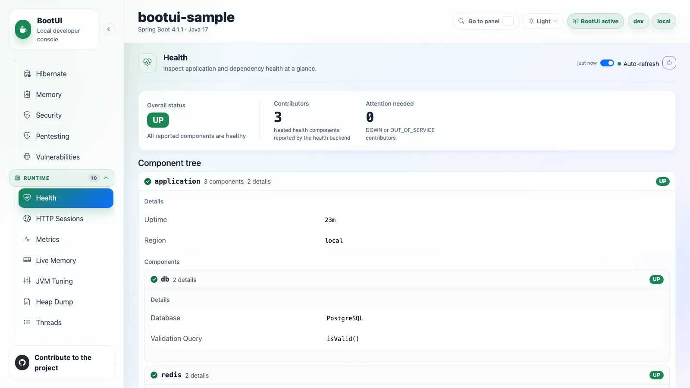
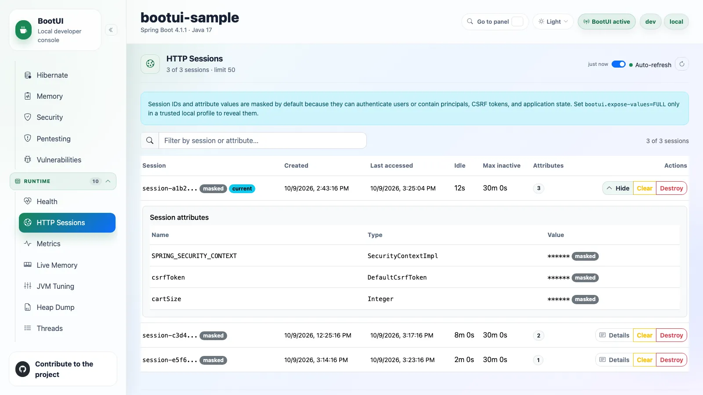
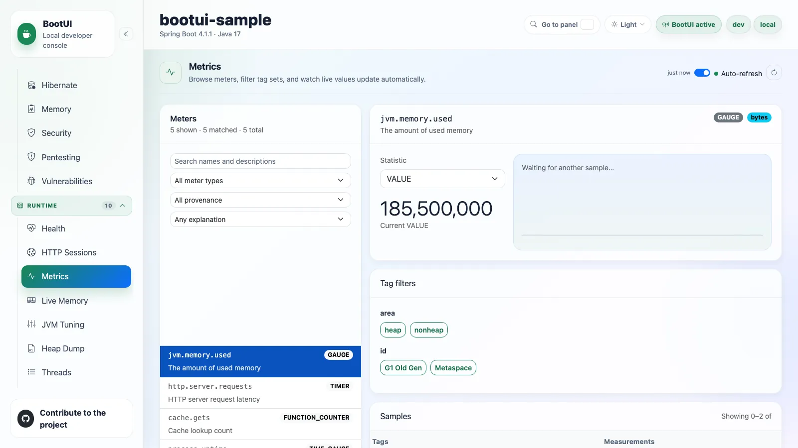
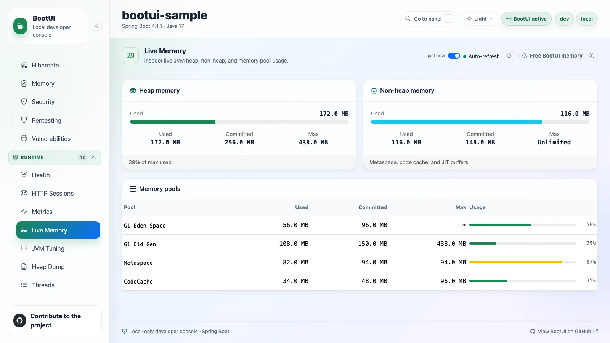
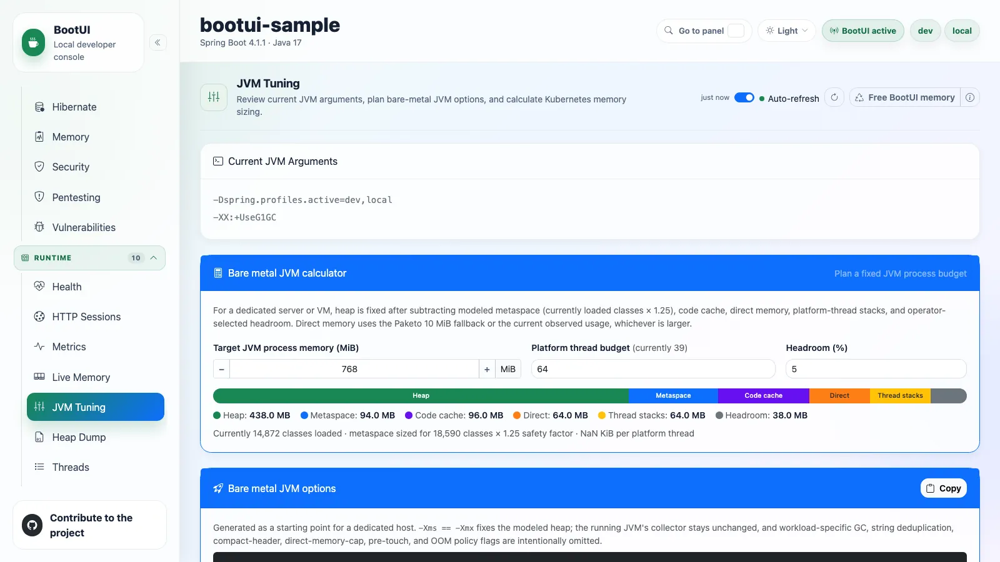
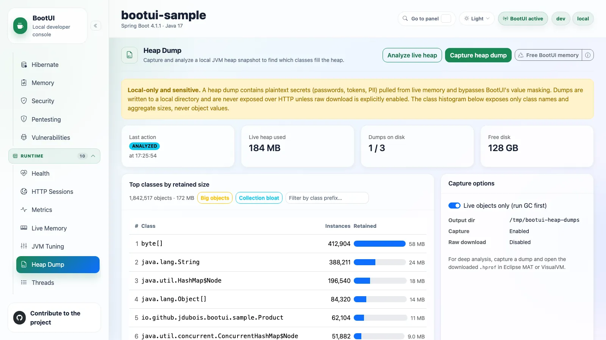
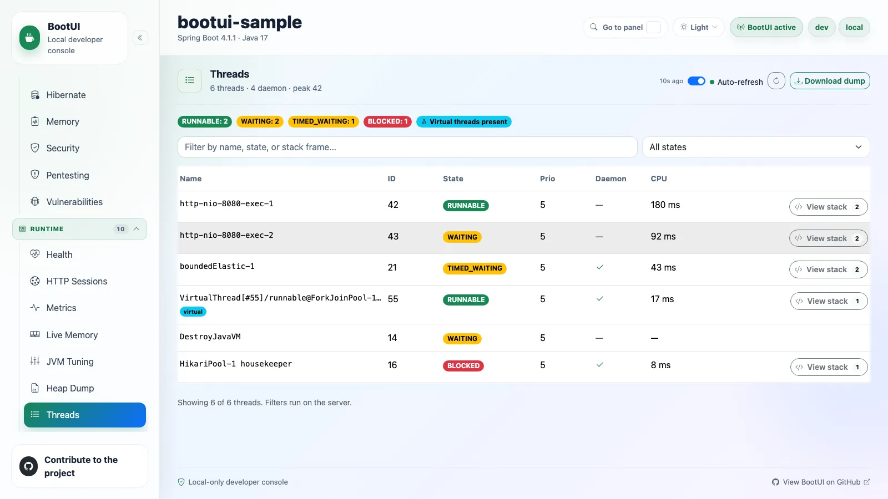
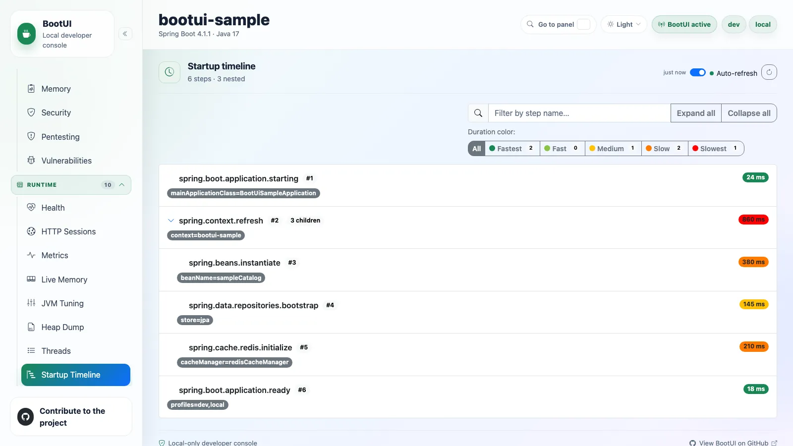
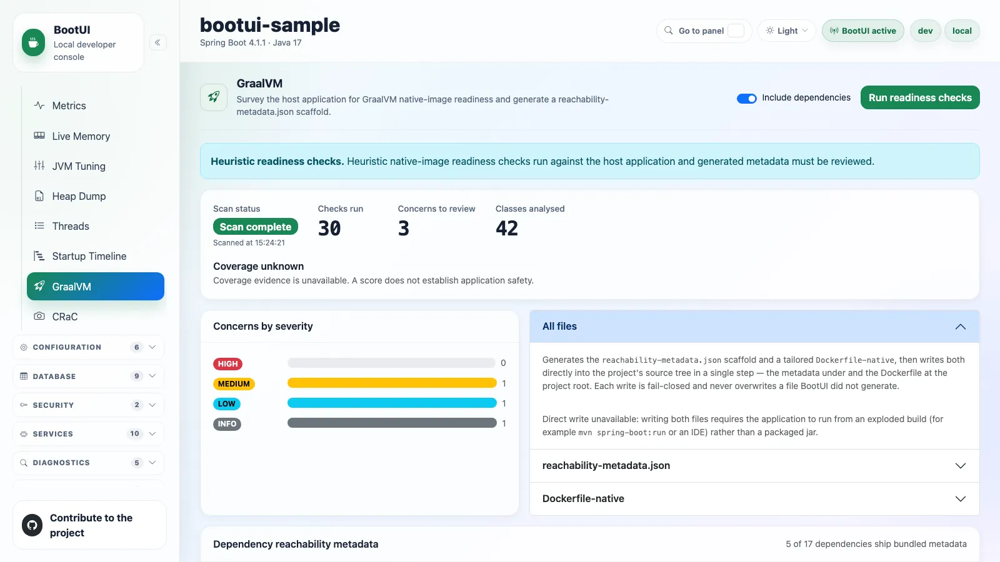
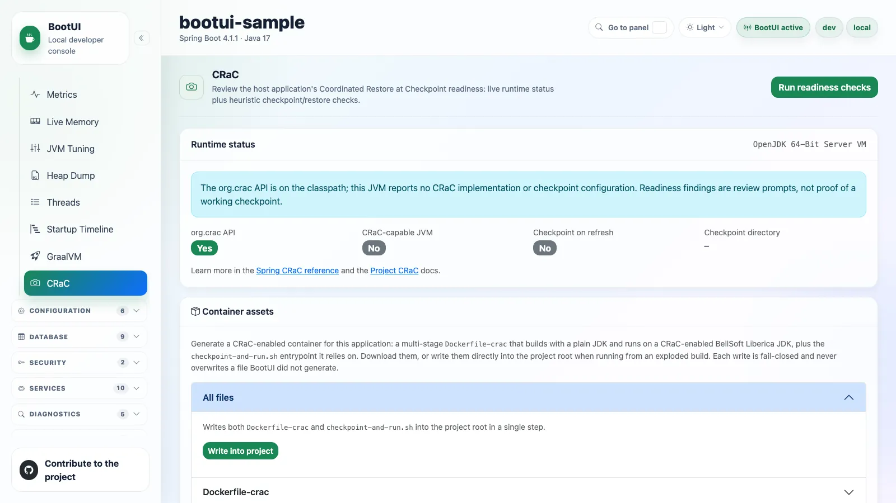

# Runtime

## Health

The Health panel displays the Actuator health tree, including nested contributors and detail when the application
exposes it.

Unavailable health data is kept separate from unhealthy application state, so missing Actuator infrastructure is never
presented as a healthy status: the panel shows setup guidance instead. When Actuator health reports only Spring Boot's
default indicators, the panel keeps the live statuses visible and suggests adding application or dependency
contributors.

On Quarkus the panel reads SmallRye Health in-process and maps the liveness and readiness report onto the same status
tree. When `quarkus-smallrye-health` is absent, the panel shows setup guidance.

## HTTP Sessions

The HTTP Sessions panel lists local embedded Tomcat sessions with their creation time, last access time, idle duration,
and attribute count, highlighting your current session. It returns at most 50 sessions; raise
`bootui.http-sessions.max-sessions` for a larger bounded view.

Session identifiers are bearer credentials, so the UI receives only an opaque action key and a masked display id, and
every attribute value is masked. `bootui.expose-values=METADATA_ONLY` keeps attribute names and types without values.
`FULL` reveals display ids and values for local troubleshooting, with an explicit exposure warning.

Clear and destroy are confirmation-gated and disabled by read-only mode. Clear removes every attribute while keeping the
session valid; destroy invalidates it. When the application is not on embedded Tomcat, the panel shows an unavailable
state.

This panel is not applicable on WebFlux, where `WebSession` is a different, non-container-managed model.

## Metrics

The Metrics panel browses the Micrometer meters exposed by Actuator. You can search meter names and descriptions and
filter by meter type on the server, inspect descriptions, base units, tags, and measurements, and render a live chart
for a selected metric and tag combination. Meters are paged, and tag-value choices are bounded to the first 100 sorted
values per key with an explicit truncation badge.

Quarkus has no Actuator, so the panel reads the live composite `MeterRegistry` directly when the application adds a
`quarkus-micrometer` registry, such as `quarkus-micrometer-registry-prometheus`. Without one it renders as unavailable.
On both stacks, meters describing BootUI's own `/bootui/**` traffic are hidden.

::: details Provenance grouping and honest explanations

Meters are grouped by the integration family that registered them: JVM binders, process and system binders, HTTP server
and client instrumentation, datasource pools, caches, messaging clients, resilience libraries, gRPC, and framework
internals, with anything unrecognized under **Application / unclassified**. Selecting a group filters the list on the
server.

Explanations say where they come from: a meter's own registry description wins and is marked **Native description**,
a curated, versioned catalogue of well-known families is marked **BootUI catalogue**, and anything else is marked
**Not documented**. Classification matches meter names only, never tag values, so an application meter such as
`orders.processed` is never absorbed into a curated family.

:::

## Live Memory

The Live Memory panel summarizes current heap and non-heap usage and memory pool utilization, so you can spot heap
pressure, non-heap growth, and pool-level saturation. Sizing controls live in the JVM Tuning panel instead.

### Free BootUI memory

BootUI keeps its diagnostics (the runtime journal, Live Activity, HTTP exchanges, traces, SQL statements, exceptions,
and more) in your application's heap, so they inflate the numbers every memory panel analyzes. Live Memory, JVM Tuning,
Heap Dump, and the Memory advisor therefore share a **Low-footprint mode** toggle in the panel header. Its info button
explains what is cleared and what is kept.

After you confirm, `POST /bootui/api/live-memory/offload` empties every BootUI capture buffer, requests a garbage
collection, and shows heap used before and after, the reclaimed estimate, and the number of buffered entries cleared.
The toggle then stays on: BootUI stops recording until you turn it off, and Exceptions, Log Tail, Live Activity,
Runtime Insights, and the Scorecard show a "Paused by low-footprint mode" banner. Settings, configuration overrides,
dismissed rules, cached scan reports, and persisted Live Activity history are kept.

::: warning Cleared data is gone
The discarded journal, traces, and captures cannot be recovered, and exception triage statuses are dropped with their
groups. The garbage collection request is only a hint: the JVM may defer it, and ignores it under
`-XX:+DisableExplicitGC`. The action is refused when `bootui.read-only=true` or
`bootui.panels.live-memory.read-only=true`, and hidden when the Live Memory panel is disabled.
:::

### Low-footprint mode

Low-footprint mode turns freeing memory into a switch: `POST /bootui/api/live-memory/footprint` with
`{"enabled": true}` pauses BootUI's recording, empties its buffers, and requests a garbage collection, and
`{"enabled": false}` resumes recording. `GET /bootui/api/live-memory/footprint` reports the state without changing
anything. The mode lives in memory only: it is off after a restart and never expires by itself. It follows the same
read-only rules as freeing memory.

The BootUI Java agent is **not** paused. When it is attached, the response sets `agentAttached` and adds a warning,
because these panels give better results without the agent.

::: details What stops recording

While the mode is on, the runtime journal (with its GC event listener and resource sampler), Exceptions, Log Tail, Live
Activity, Kafka, RabbitMQ, JMS, cache, fault-tolerance, scheduled-task, email, and telemetry capture, and (on Spring)
the HTTP exchange, SQL, transaction, REST client, security, and WebSocket buffers record nothing. The response lists
every component with `suspended` and an optional `failure`, `since` as `sinceEpochMillis`, and the offload report.
Panels show what was captured before the pause, or nothing. Quarkus pauses the components it has already created and
never creates a lazy one. On Spring it coexists with [`bootui.free-on-idle`](../PROPERTIES.md): the idle tracker never
resumes buffers while the mode is on.

:::

## JVM Tuning

The JVM Tuning panel reviews the current JVM input arguments, explains `spring.threads.virtual.enabled=true`, and runs
sizing calculators for dedicated hosts and for Kubernetes. It detects whether Spring virtual threads are enabled and
shows an information or warning bubble.

JVM input arguments go through the same secret masking and `bootui.expose-values` / `bootui.mask-secrets` policy as
configuration values, in the panel, the REST API, the `get_jvm_tuning` MCP tool, and the CLI. Keys stay visible and only
values are replaced. Under the default `MASKED` mode a secret-named or secret-looking value is shown as `******`,
including options of `-javaagent:`, `-agentlib:`, and `-agentpath:`, and the shell commands of `-XX:OnError` and
`-XX:OnOutOfMemoryError` are always masked. Only `FULL`, or `MASKED` with `bootui.mask-secrets=false`, shows the raw
arguments.

The bare-metal calculator partitions a target process memory budget into heap, metaspace, code cache, direct memory,
thread stacks, and headroom, then produces copyable JVM options with fixed `-Xms` and `-Xmx`. The Kubernetes calculator
uses `-XX:MaxRAMPercentage`, `-XX:MinRAMPercentage`, and `-XX:InitialRAMPercentage` in `JAVA_TOOL_OPTIONS` instead of
fixed heap sizes, and a health-probes toggle adds framework-default probe paths on the named container port `http`.
Verify those paths and that port name against your deployment.

::: details Calculator details and masking under METADATA_ONLY

- `METADATA_ONLY` masks every `-D` system property value and every agent option string. It keeps `-X` and `-XX` flags
  visible for tuning, with plain values such as `75`, `512m`, or `summary`, but masks free-text values such as paths,
  commands, and `-Xlog` selections.
- The bare-metal calculator keeps the current collector and omits workload-specific GC, direct-memory-cap, pre-touch,
  compact-header, string-deduplication, and out-of-memory policy flags.
- The Kubernetes calculator sets equal memory request and limit by default but labels Pod QoS `Depends on CPU`, because
  Guaranteed QoS also needs matching non-zero CPU resources on every container. You can attempt a lower, snapshot-based
  Burstable request instead.
- On Spring the startup probe reuses `/actuator/health/liveness`, while Quarkus has a dedicated `/q/health/started`.

The full model is recorded in
[`JVM-TUNING-CHECKS.md`](https://github.com/jdubois/boot-ui/blob/main/docs/JVM-TUNING-CHECKS.md).

:::

::: warning Not available in GraalVM native images
Heap, GC, and flag tuning does not apply to a native executable. When BootUI detects one, the panel moves to the
sidebar's *Disabled / unavailable* group and explains why.
:::

## Heap Dump

The Heap Dump panel captures local heap dumps on demand and analyzes them through a value-free class histogram, for
investigating suspected leaks or unexpected retention. A confirmed capture triggers a full GC and writes an `.hprof`
file under the configured output directory. The panel then shows live heap usage, the top retaining classes by instance
count and shallow size, and the captured dumps with retention-based eviction.

Capture, live analysis, and delete share one single-flight admission; a conflicting action receives the canonical `409`
busy response, while report reads remain available. Use [Free BootUI memory](#free-bootui-memory) first, so BootUI's own
buffers do not crowd the histogram.

::: warning Treat every dump as sensitive
Heap dumps can contain plaintext secrets, credentials, and personal data. The panel only ever summarizes class names
and sizes, never object values. Capture, analyze, and delete are mutating `POST` requests blocked in read-only mode,
and downloading the raw `.hprof` file is disabled unless explicitly enabled. Use this on a local JVM only.
:::

## Threads

The Threads panel shows a live snapshot of the JVM's threads, read in-process through `ThreadMXBean`, so the
application does not need to expose the Actuator `threaddump` endpoint. It presents counts per thread state, a flag when
a deadlock is detected, and virtual-thread context on a supporting JDK. The list filters by name and state on the server
with paging, and each row expands to its stack trace.

Stack frames and thread names can incidentally contain sensitive values, so names that look like secrets are masked and
stack traces are omitted under metadata-only exposure. The raw text thread dump is a confirmation-gated `POST` download,
blocked when the panel is read-only.

## Startup Timeline

The Startup Timeline panel visualizes Spring Boot startup steps from Actuator startup data, which is how you find
expensive startup phases and slow bean initialization.

When BootUI is active, the starter installs a `BufferingApplicationStartup` so the panel has data with no setup on your
side. Disable that with `bootui.startup.enabled=false`, or tune the retained step count with `bootui.startup.capacity`.
If startup data is still unavailable, the panel shows an empty state.

## GraalVM

The GraalVM panel surveys the application for
[native-image](https://www.graalvm.org/latest/reference-manual/native-image/) readiness. On demand it imports the
application's own classes, bounded to the detected base packages, and runs 30 curated checks: 22 GraalVM checks and 8
Spring AOT checks. After a scan you can filter the concerns by severity, category, or free text without rerunning it.
The checks are heuristic review aids that complement the GraalVM tracing agent and an actual native build. See
[GraalVM readiness checks](../GRAALVM-READINESS-CHECKS.md) for the full catalogue.

This panel is unavailable when the application already runs as a native image, and not applicable on Quarkus, which
compiles native images itself.

### Dependency reachability metadata

With **Include dependencies** on (the default), the panel also reports which third-party libraries already ship
reachability metadata under `META-INF/native-image/`. For libraries that do not, it consults Oracle's
[reachability metadata repository](https://github.com/oracle/graalvm-reachability-metadata) and reports the detected
version as `covered`, `partial`, or `none`, with links to the matching entry.

That lookup is the panel's only outbound network call. It is user-initiated and time-bounded, can be aborted from the
panel, and is disabled with `bootui.graalvm.repository-lookup-enabled=false`.

### Generated project assets

The same scan generates a downloadable `reachability-metadata.json` scaffold in the unified schema, with
`condition.typeReached` guards, plus a tailored multi-stage `Dockerfile-native`. Both can be downloaded, or written
straight into the project with **Write into project** when BootUI detects an exploded build rather than a packaged jar.
The top drawer, **All files**, generates and writes both in one step. Writes are fail-closed: confined under the
project tree, and never overwriting a file that BootUI did not generate.

::: details Where the scaffold is written, and how the Dockerfile-native is built

**Write into project** writes the metadata to
`src/main/resources/META-INF/native-image/<groupId>/<artifactId>-additional-hints/reachability-metadata.json`, resolving
coordinates from `build-info.properties` or the project `pom.xml`. The suffix keeps it from clashing with the
`<groupId>/<artifactId>/` directory where Spring AOT writes its hints.

BootUI detects Maven or Gradle, with or without a wrapper, and uses the matching native build command, such as
`./mvnw -Pnative -DskipTests clean native:compile` or `./gradlew nativeCompile`. The executable is packaged into a
distroless, non-root runtime image (`gcr.io/distroless/base-debian12:nonroot`). Some workloads still need `libstdc++`
or other native libraries, so test it in the exact runtime image.

:::

## CRaC

The CRaC panel reviews the application's
[Coordinated Restore at Checkpoint](https://docs.spring.io/spring-framework/reference/integration/checkpoint-restore.html)
readiness, combining live runtime status with a heuristic advisor. On demand the advisor imports the application's own
classes, bounded to the detected base packages, and runs 19 curated `CRaC-*` checks, which you can then filter in place
by severity, category, or free text. They complement an actual checkpoint and restore run on a CRaC-enabled JDK. See
[CRaC readiness checks](../CRAC-READINESS-CHECKS.md) for the catalogue.

The panel also generates a multi-stage `Dockerfile-crac` that builds with a plain JDK and runs on a CRaC-enabled
BellSoft Liberica JDK, plus the `checkpoint-and-run.sh` entrypoint, which takes a checkpoint on the first start through
`spring.context.checkpoint=onRefresh` and restores it afterwards. Each file can be downloaded, or written into the
project root from an exploded build, through the same fail-closed writer the GraalVM panel uses.

::: warning The generated run command is a local CRIU recipe
It includes CRIU's `CHECKPOINT_RESTORE`, `SYS_PTRACE`, `SYS_ADMIN`, and `NET_ADMIN` capabilities, which is a
privileged, local recipe rather than a universal requirement for every CRaC engine. The on-refresh checkpoint precedes
lifecycle startup, so it is not a fully warmed application. No generated fixture replaces a real checkpoint and restore
test on the exact deployment environment.
:::

::: details What the runtime-status card and the checks cover

The runtime-status card is read-only. It shows whether the `org.crac` API is on the classpath and an implementation is
detected, separately from whether the selected engine and host can create a real image, and the exact Spring
checkpoint-on-refresh setting with bounded, exposure-aware CRaC JVM arguments. `spring.context.exit=onRefresh` halts the
JVM before lifecycle start, so it is not a safe cleanup or restore test.

Independent runtime checks still run when application bytecode is unavailable; missing observations and failed
collection are explicit, never clean results, and lazy resources are not initialized for inspection.

:::

This panel is unavailable in GraalVM native images, since CRaC is a JVM-only feature, and not applicable on Quarkus.
