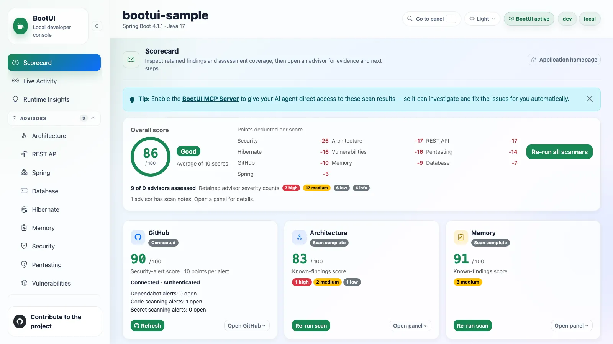

# Scorecard

The Scorecard panel is BootUI's landing page. It opens with the standard panel header and a link to the running
application's homepage, and its centrepiece is an on-demand findings and coverage summary. It lives at `#/scorecard`,
and the former `#/overview` route redirects there. Its panel id stays `overview`, so `bootui.panels.overview.enabled`
still controls it.

Nothing is scanned on load. The Scorecard reads the existing cached reports on first navigation and when you return from
another panel, including scans started in an advisor panel or by a local agent. Those GET requests never start a scan,
a probe, or an external query. Before any scan has run, the summary reports how many visible advisors have been
assessed and prompts you to run them.

**Run all scanners** triggers every available scanner, or you can run each card on its own. After a run-all, a
dismissible tip points at the MCP Server panel, since enabling it lets an AI agent read these same results and fix the
findings for you.

## Overall score

The overall score is the rounded arithmetic mean of the eligible, available, visible advisor scores, plus the GitHub
security-alert score when that is eligible. **Average of N scores** names the contributing count, and the **Where the
points went** list names the contributors scoring below 100, worst first, each with a bar and its deduction (its own
score minus 100); contributors at 100 are named on one **No deductions** line. Those deductions are not summed to
produce the overall score.

The gauge bands are **Good** (80–100), **Needs attention** (50–79), and **At risk** (0–49). They describe the scored
results and help prioritize review. They do not measure application safety or assessment completeness, and running one
more clean scanner can raise the average without fixing a single finding. Numeric scores and retained severity labels
stay visible, so meaning never depends on color alone.

With no eligible scores the summary reads **Not scored** and prompts an explicit scan. Unscanned, invalid, missing, and
confirmed-empty assessments contribute neither 0 nor 100, and GraalVM and CRaC readiness scans never contribute at all,
so running only those leaves the Scorecard **Not scored** rather than at zero. A genuine eligible score of zero does
contribute. Usable partial reports contribute their known-findings score unchanged, with no penalty for missing checks.

## Scanner cards

Each card leads with a 0–100 known-findings score for an eligible assessment, followed by its retained severity counts.
The severity-based scanners are Architecture, Memory, REST API, Spring, Database, Hibernate, Security, Pentesting, and
Vulnerabilities. Each starts at 100 and subtracts a fixed weighted penalty per finding, so a complete clean scan stays
at 100:

| Severity | Penalty |
| -------- | ------- |
| Critical | 25      |
| High     | 10      |
| Medium   | 3       |
| Low      | 1       |
| Info     | 0       |

Limited coverage never changes those penalties, even at 100.

A card shows its scan status as a badge — `Not scanned yet`, `Scan complete`, `Incomplete`, `Scan failed`, or
`Scan disabled` — and, next to it, how the report was assessed:

| Assessment         | Meaning                                                                                                         |
| ------------------ | --------------------------------------------------------------------------------------------------------------- |
| A score            | The report is eligible. **Scan complete** means the scan finished, not that it assessed every applicable check. |
| **Not scored**     | No eligible score. **Open panel** shows the full reason.                                                        |
| **Not applicable** | Confirmed empty scope: `usable: false`, `coverageComplete: true`, and no limitations.                           |

A card that has never been scanned keeps its **Run scan** action.

Secondary diagnostics stay in each advisor's collapsed **Scan notes**, reachable through **Open panel**. The Scorecard
summarizes how many advisors have scan notes instead of repeating each explanation, counting partial scans and
completed scans whose coverage is incomplete or unknown. Unscanned, failed, disabled, and unavailable scanners never
inflate that count, and neither does confirmed-empty scope.

::: details What can and cannot establish a score

`SCANNED` and `PARTIAL` reports can score known findings or completed applicable evidence. Skipped, failed, vacuous,
and unknown-only evidence cannot, and `ERROR`, `DISABLED`, and `NOT_SCANNED` never score.

A report counts as assessed when it is an accepted `SCANNED` or `PARTIAL` report with valid explicit evidence, even if
that evidence cannot support a number. Confirmed-empty scope counts as assessed too. Missing legacy evidence, unscanned
reports, and failed reports do not, and request failures are reported separately while preserving the last report.

Vulnerabilities can score known findings despite inventory, query, or detail gaps. UNKNOWN carries no penalty but
cannot establish eligibility, even after dismissal. A clean dependency needs completed query and detail evidence and a
genuinely empty retained advisory list. See [score eligibility](advisors.md#score-eligibility).

:::

Dismissals remove penalties, not safety concerns or evidence gaps. No coverage percentage or application-wide
completeness claim is inferred.

## GitHub card

GitHub is not a severity scanner, so it is excluded from the advisor counts and severity totals. Its card shows
connection and authentication state, reading **Connected** when connected, plus the reported Dependabot,
secret-scanning, and code-scanning signals. Only
available numeric counts are shown as open alerts, because an unavailable count is not a zero.

Its security-alert score subtracts 10 points per reported alert from 100, counting at most 10 alerts per signal, then
clamps the result to 0–100. Three saturated signals therefore reach 0, and further alerts on one signal do not lower it
again. That is an alert-count heuristic, not an assignment of HIGH severity. Eligibility requires an available, connected, authenticated report with
exactly one `AVAILABLE` signal carrying a nonnegative safe integer count for each of `Dependabot alerts`,
`Code scanning alerts`, and `Secret scanning alerts`, matched exactly. Confirmed zeros score 100. Missing, empty,
malformed, duplicate, and unavailable signals leave GitHub **Not scored**, even when another signal reports known alerts, and an unscored GitHub is excluded
from the overall average. The actual counts stay visible either way.

Connecting and refreshing are always user-triggered, including through **Run all scanners** when GitHub is the only
available card. Refreshing or a failed request preserves the last accepted report and its score, while a newly received
unavailable report clears that score.

## Refresh behavior

Disabled and unavailable panels are excluded, and automatic reads wait for the panel manifest and use only supported,
enabled advisor endpoints. Returning from a panel refreshes the cached reports with GET requests, including
Vulnerabilities after a dismissal or restoration.

A busy or failed request keeps the last accepted report and adds a warning or an error. An authoritative new report
replaces the old assessment, scoring usable partial evidence and excluding failed or unusable reports. A `NOT_SCANNED`
response, such as after an application restart, replaces the old findings and returns the card to **Run scan**. A scan
already in progress finishes before the return-navigation refresh reads its updated report.

The panel is available on every adapter. The scoring dashboard is rendered entirely in the browser: the shell reads
each advisor's own reports and displays its independent score, so no backend dashboard service is involved. The shell
chrome around every panel — application name, framework and version, Java version, active profiles, and active or
disabled status — comes from the framework-neutral `GET /bootui/api/overview` endpoint every adapter exposes.

That endpoint also reports the current **run** in its `run` object: a random `instanceId` for this JVM's BootUI
instance, and a random `runId`, an `ordinal`, and a `startedAt` time for the current application start. A Spring
DevTools restart or a Quarkus live reload starts a new run with the next ordinal inside the same instance. The ids carry
no host, user, or application data.

## Buttons and links across the console

Across the console, standalone navigation and secondary actions use compact, theme-aware buttons, including setup,
advisor references, request details, filters, and disclosures. Navigation remains a link: it keeps its destination and
supports opening in another tab. Inline explanatory references, sidebar navigation, tabs, and interactive summary cards
keep their distinct presentation. All seven styles share the same controls and keyboard behavior.
