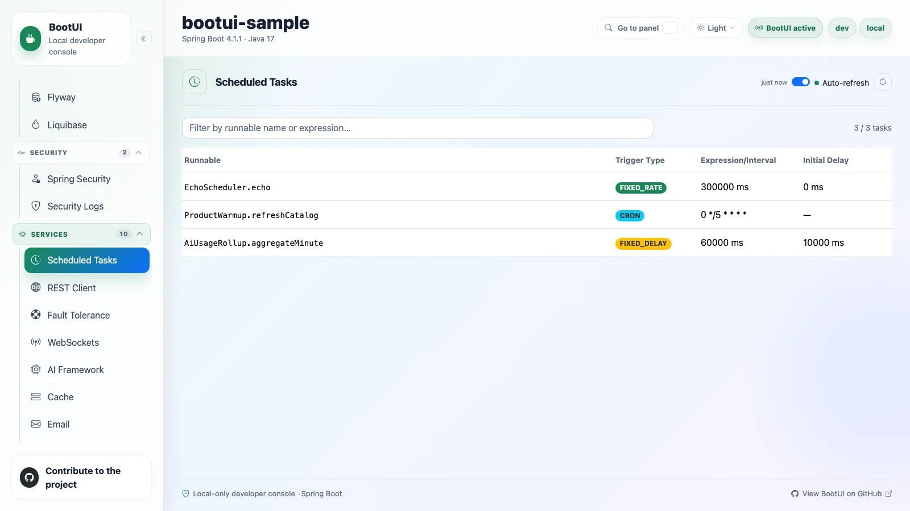
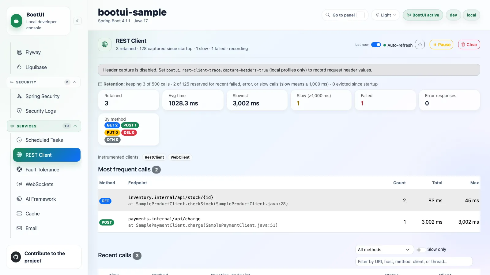
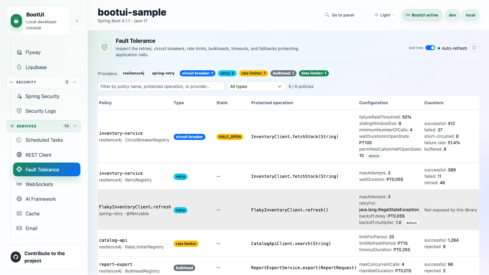
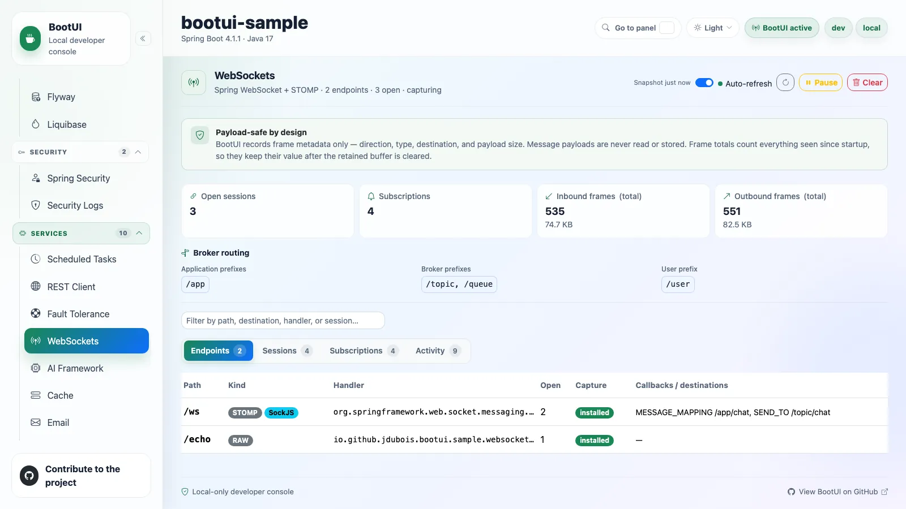
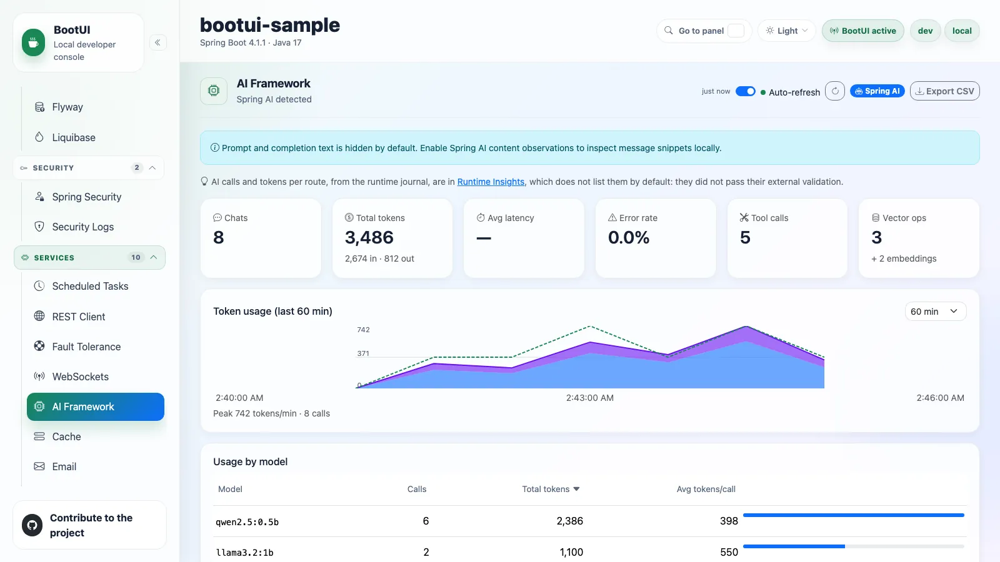
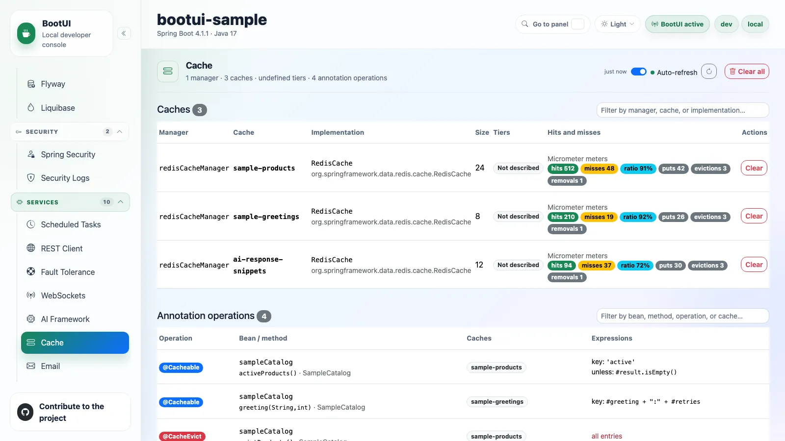
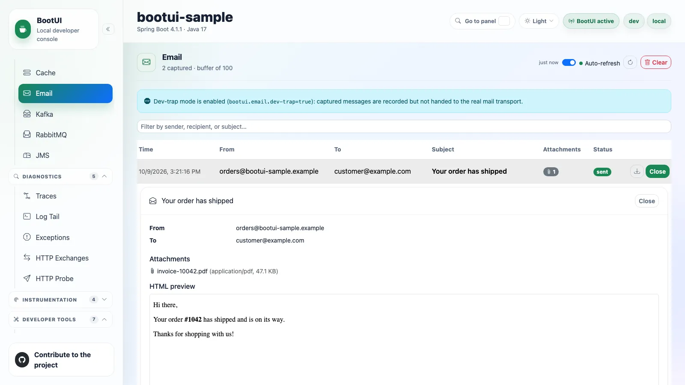
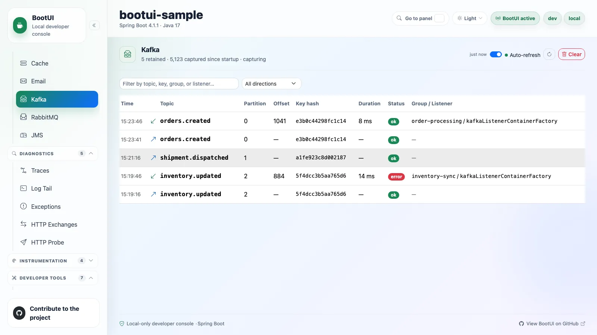
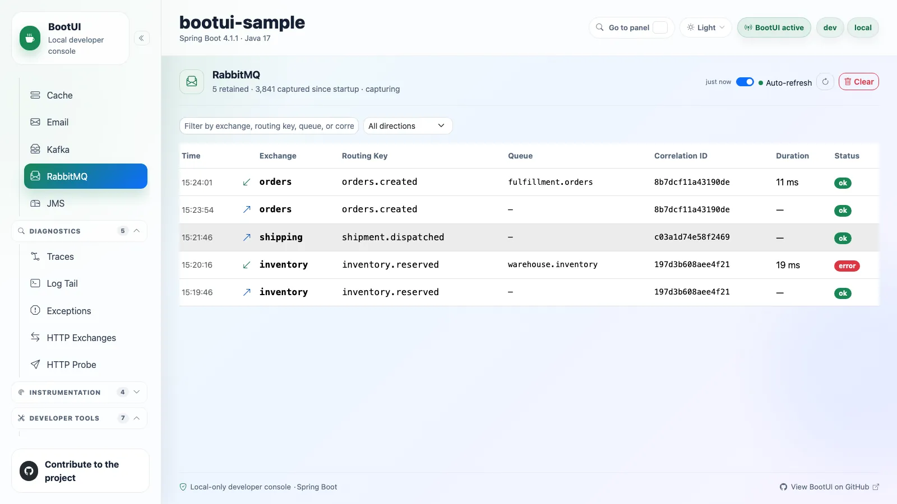
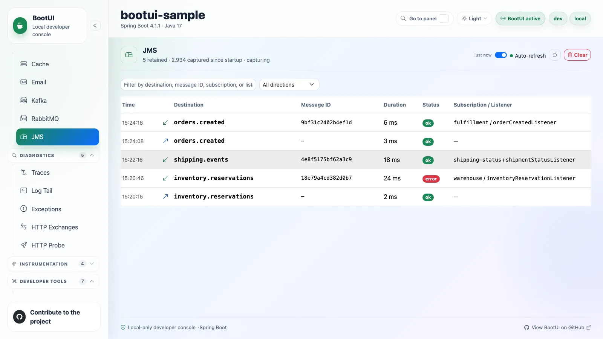

# Services

## Scheduled Tasks

The Scheduled Tasks panel lists the jobs registered with Spring's scheduling infrastructure, with their task type and
trigger metadata, so background activity is visible during local development.

Quarkus serves the same `/bootui/api/scheduled` contract from `@Scheduled` methods captured at build time. Only
annotation-discovered tasks are captured there.

::: details Quarkus capture and worker correlation

The runtime `io.quarkus.scheduler.Scheduler` exposes only trigger ids and next-fire times, so the Quarkus adapter reads
every `@Scheduled` method from the Jandex index at build time. A `cron` member becomes a `CRON` row, an `every` member
a `FIXED_RATE` row, and an initial delay is carried through. The panel needs the `quarkus-scheduler` extension;
programmatic `Scheduler.newJob()` jobs are not captured.

Scheduled observations restore the worker's previous correlation when their scopes close, so a completed job's
execution id is never left on a pooled worker to attribute unrelated later work.

:::

## REST Client

The REST Client panel shows the outbound HTTP calls your application recently made, through Spring's `RestClient`,
`RestTemplate`, and `WebClient`, or Quarkus REST Client Reactive proxies. A capture failure never disrupts the call.

Each call records its method, host, path, sanitized query string, response status, duration, success or failure, client
type, trace id, executing thread, and, with call-site capture enabled, the call site in your own code.

### Reading the panel

Calls are kept in a bounded, most-recent-first buffer with aggregate stats: retained count, average and slowest
duration, and slow-call count. A share of the buffer, 25% by default (`bootui.rest-client-trace.reserved-share-percent`),
is reserved for the most recent failed, error-response, and slow calls; see
[Failure-preserving retention](diagnostics.md#failure-preserving-retention). An outbound call can fail two ways, so
there are two counters:

| Counter | Counts |
| ------- | ------ |
| **Failed** | Transport-level failures with no response: connection refused, timeout, DNS failure. |
| **Error responses** | Calls that completed with a `4xx` or `5xx` status. |

A **Most frequent calls** table groups calls by method, host, and normalized path (numeric and UUID segments collapse to
`{id}`) and flags groups at or above `bootui.rest-client-trace.chatty-call-threshold` as _chatty_, for any HTTP method.
Rows filter by method, slow-only, or free text and expand to full detail. Local-only **Pause**, **Resume**, and **Clear** actions stop recording or empty the buffer; pausing
stops only this panel's buffer, and the [runtime journal](live-activity.md#runtime-journal) keeps recording. Over MCP and
the CLI, the controls answer with a
[compact acknowledgement](../AI-AGENTS.md#compact-answers-from-scans-and-capture-controls).

### Privacy

Spring retains the URI and masks query values by name. Quarkus is strictly metadata-only and never reads bodies,
headers, or credentials. Call sites are your own code (class, method, line), never a value, so
`bootui.rest-client-trace.capture-call-site` (default `true`) is not privacy-gated.

::: details Exact redaction rules

- **Spring** masks query values by name with the same `SecretMasker` rules as Config and HTTP Exchanges, matched
  percent-decoded. URI credentials such as `user:secret@host` are removed before buffering, and the client error
  message is flattened, credential-redacted, and truncated. Request headers are withheld by default;
  `bootui.rest-client-trace.capture-headers=true` opts into bounded, exposure-aware header capture.
- **Quarkus** is always metadata-only: it ignores the header property, never reads bodies, headers, authorization,
  cookies, or tokens, and strips URI user-info and fragments and masks sensitive path and query values before storage.
  Call-site attribution is best-effort there, because a reactive callback can run after the issuing stack unwound.

:::

### Availability and streaming

The panel is available on all three stacks, and refreshes over Server-Sent Events from
`/bootui/api/rest-client-trace/stream`. Recent calls also appear in Live Activity, nested under the request that made
them, with a deep link back here. Capture, buffer size, and thresholds are configurable under
`bootui.rest-client-trace.*`.

::: details Interception, availability, and Quarkus wiring

| Adapter | Instrumentation | When the panel becomes available |
| ------- | --------------- | -------------------------------- |
| Spring MVC | `RestClientCustomizer` and `RestTemplateCustomizer` hooks | Once the recorder has instrumented anything |
| Spring WebFlux | `ExchangeFilterFunction` on the auto-configured `WebClient.Builder` | After that builder has customized a client |
| Quarkus | `RestClientListener` SPI attaching a filter on every proxy | When `quarkus-rest-client` is present |

Spring customizes every auto-configured `RestClient` and `RestTemplate` with a shared interceptor, and skips a client
type whose Spring Boot module is not on the classpath. Quarkus attaches a filter to every `@RegisterRestClient` proxy
through the MicroProfile `RestClientListener` SPI. Both let the request through and record around it, so an
instrumentation error never breaks the call.

Quarkus builds proxies lazily, so the panel stays visible and says no proxy has been initialized until the first call.
A pre-response transport failure is recorded as a failed call with no invented HTTP status, while a real `4xx` or `5xx`
stays a transport-successful error response.

Live Activity nesting uses BootUI's request id first on every stack, then the trace id and serving thread on Spring MVC,
and the trace id alone on WebFlux and Quarkus. The chatty grouping is visible only in this panel.

:::

## Fault Tolerance

The Fault Tolerance panel makes the application's protective policies visible. It lists every circuit breaker, retry,
rate limiter, bulkhead, time limiter, and fallback the application declares, with the settings that apply, the protected
operation, live circuit breaker state, and call counters where the library exposes them. A bounded event feed below
shows retried calls, exhausted retries, rejected calls, timeouts, short circuits, and state transitions.

Resilience4j and Spring Retry are supported on Spring MVC and WebFlux, and SmallRye Fault Tolerance on Quarkus; several
can be active at once.

The panel is capture-only: BootUI never opens, closes, resets, or forces a policy, and never triggers a protected call.
Events also appear in Live Activity as `FAULT_TOLERANCE` entries, correlated with their request, and clicking one opens
this panel filtered to that policy. Set `bootui.fault-tolerance.enabled=false` to keep the inventory while recording no
events.

::: details Per-provider sources and capture scope

- **Resilience4j** reads the circuit breaker, retry, rate limiter, bulkhead, thread-pool bulkhead, and time limiter
  registries live, including entries created at runtime. Its own event publishers feed the event feed, with no wrapping
  by BootUI. A first retry delay that needs a call result to calculate is omitted rather than guessed.
- **Spring Retry** reads `@Retryable` metadata plus an additive `RetryListener` that records attempts and exhaustion.
- **SmallRye Fault Tolerance** reads `@CircuitBreaker`, `@Retry`, `@Timeout`, `@Bulkhead`, `@RateLimit`, and
  `@Fallback` from the Jandex index at build time, with MicroProfile configuration overrides resolved at runtime. A
  policy disabled through configuration is listed with `enabled` = `false`. Circuit breaker state and transitions come
  from `CircuitBreakerMaintenance` for breakers carrying `@CircuitBreakerName`; there is no per-call event stream, so
  retries and rejections are not individually captured.

Events are metadata only: policy name, outcome, attempt number, duration, the simple name of the exception class, and
circuit breaker state. Arguments, return values, payloads, and exception messages are never recorded.

:::

## WebSockets

The WebSockets panel shows the endpoints your application declares, the connections open against them, the STOMP
destinations those connections subscribed to, and a bounded log of recent frame metadata. It never records a message
payload.

### The four tabs

- **Endpoints**: each endpoint with its path, kind (`STOMP`, `HANDLER`, or `ENDPOINT`), handler, open connections,
  whether frame capture is installed, and the destinations and STOMP prefixes it serves.
- **Sessions**: live connections with an opaque session id, state, frame and byte counters, and remote address.
- **Subscriptions**: each STOMP subscription mapped to its session and destination.
- **Activity**: the recent frame log, with direction, frame type, destination, payload **size**, and outcome.

### Capture-only and metadata-only

BootUI never reads, decodes, buffers, or stores a message payload on any stack; frame size comes from the transport's own
counters. Raw session ids are replaced by a salted, one-way hash and destinations are redacted. BootUI never opens,
closes, or writes to a connection.

Frame capture is installed only where the framework offers a sanctioned seam: Spring MVC with
`@EnableWebSocketMessageBroker`. Spring WebFlux reports endpoint topology, and Quarkus reports endpoints and live
connections, but neither supports frame capture; the panel shows the reason. Local-only **Pause/Resume** and **Clear**
actions honor `bootui.panels.websockets.read-only`. Capture and caps are configurable under `bootui.websockets.*`.

::: details Per-stack capture, journal, and gating

On Spring MVC, BootUI registers a `WebSocketHandlerDecoratorFactory` and `ChannelInterceptor`s through the public
`WebSocketMessageBrokerConfigurer` contract, so STOMP endpoints are badged **installed**. Native `WebSocketHandler`
endpoints without the broker report topology and are badged **metadata**. On WebFlux, `@EnableWebSocketMessageBroker` is
servlet-only; on Quarkus, WebSockets Next has no message-interception SPI. Spring MVC and Quarkus observe connection
lifecycle; WebFlux has no session registry, so its Sessions table says so (`sessionTrackingSupported`).

Separately, each inbound application message is an execution in the runtime journal on all three stacks: the SQL,
exceptions, and calls its handler makes nest under a `WEBSOCKET` row in Live Activity, and a completed handler can be
opened in a [journal-backed profile](live-activity.md#the-per-request-profiler). That covers the `@MessageMapping` or
`@SubscribeMapping` method on Spring MVC, the synchronous work of a `WebSocketHandler` on WebFlux, and each
`@OnTextMessage` or `@OnBinaryMessage` call on Quarkus. `bootui.websockets.enabled=false` turns it off.

Spring gates the panel on `spring-websocket` and `spring-messaging`. Quarkus gates it on `quarkus-websockets-next` and
at least one `@WebSocket` endpoint, captured from the Jandex index.

:::

## AI Framework

The AI Framework panel summarizes Spring AI and LangChain4j activity from the OpenTelemetry spans their observability
emits. It groups chat client and chat model spans by conversation, showing request count, token usage, latency, model,
and the prompt and response snippet when content capture is configured. An inline chart shows token usage over recent
calls, and vector store and embedding spans appear alongside. Data lives in memory only.

AI calls and tokens per route are in [Runtime Insights](runtime-insights.md) (`ai-usage-by-route`); this panel links to
them, and the link opens Runtime Insights with every row shown.

The sidebar dims the panel when telemetry is disabled or neither framework is on the classpath, and the view shows a
setup checklist. On Quarkus the panel is identical and needs `quarkus-opentelemetry`.

::: details Setup and content capture

Recent chats, token windows, spans, and attributes are bounded. With no framework detected, the checklist shows a Spring
AI guide and a LangChain4j guide; on Quarkus it shows a single `quarkus-langchain4j` plus `quarkus-opentelemetry` guide
with no embedded OTLP receiver. When prerequisites are ready but no chat spans have arrived, the panel shows a ready
empty state.

Prompt and response snippets appear only when the framework captures content. For Spring AI, set
`spring.ai.chat.client.observations.log-prompt`, `spring.ai.chat.observations.log-prompt`, and
`spring.ai.chat.observations.log-completion`. For LangChain4j, enable GenAI message-content capture on the OpenTelemetry
instrumentation.

:::

### AI Framework value exposure

The chat detail (`GET /bootui/api/ai/chats/{spanId}`) applies the live `bootui.expose-values` and
`bootui.mask-secrets` policy on every read, using the [trace value exposure](diagnostics.md#trace-value-exposure) rule.
Under the default `MASKED`, prompts, completions, and exception text have secret-like assignments and credentials
masked. Under `METADATA_ONLY`, that text is omitted. Only `FULL` shows it verbatim. Token counts, models, finish
reasons, and timings are never masked.

## Cache

The Cache panel inspects the application's cache infrastructure through one shared contract: Spring's cache abstraction
on Spring Boot, and `quarkus-cache` on Quarkus.

On Spring Boot it lists cache managers, caches, safe local sizes, Micrometer cache metrics when registered, and the
discovered `@Cacheable`, `@CachePut`, and `@CacheEvict` operations. Clear actions need explicit confirmation; disable
them with `bootui.cache.clear-enabled=false`.

### Tiering and hit ratios

Each row discloses the backing tiers the cache describes through its own public API, and the native counters it
records. BootUI never fabricates a value: an unavailable counter is omitted rather than shown as zero, and reading tiers
never contacts anything over the network.

::: details What a tier carries and how honesty is preserved

A tier carries its level (`L0` is consulted first), implementation type, locality (this JVM or remote), configured
maximum entries, and configured expiry, plus a short **policy note** when a bare number would mislead (a
weight-bounded Caffeine cache states its bound is a total weight).

- A cache that does not describe its storage is marked _Not described_ with a reason; no tier is inferred.
- Caffeine without `recordStats()` and Spring Data Redis without `enableStatistics()` report unavailable with the fix,
  not an all-zero series.
- A **hit ratio** is derived only from a hit and a miss counter the adapter declared comparable, when their sum is
  positive. An idle cache shows _ratio unknown_, never "0%".
- No Redis entry count is reported, because counting keys would be a network round trip. The Quarkus adapter reads a
  Caffeine cache's entry count through `keySet()`, which copies the key set, so a very large cache pays a local cost
  when opened.
- Topologies are bounded (100 managers, 500 caches per manager, 20 tiers per cache), and truncation is stated in the
  report's warnings.

For example, a `RedisCache` shows a remote tier with its time-to-live and, once
`spring.cache.redis.enable-statistics=true`, the locally recorded gets, hits, misses, puts, and deletes. A
`spring.cache.type=simple` cache shows one local map tier and reports that it records nothing.

:::

::: details On Quarkus

The same panel is served over `quarkus-cache`, reading the topology from the application's `CacheManager` and
overlaying Micrometer metrics when a `quarkus-micrometer` registry is present. Clear uses `cache.invalidateAll()`. Tier
metadata is one local Caffeine tier per cache, with limits from `quarkus.cache.caffeine."<name>".*`. Quarkus's public
`CaffeineCache` exposes no statistics accessor, so hit and miss counters are unavailable and the panel points at
Micrometer. Because `@CacheResult` and related annotations are woven at build time, there is no runtime registry of
cached operations, so the operations table is replaced by a note. The panel is unavailable without `quarkus-cache`.

:::

## Email

The Email panel captures outgoing application mail. It intercepts the application's `JavaMailSender` so every `send(...)`
call is recorded into a bounded buffer before delegating to the real sender, so application behaviour is unchanged.

Messages are listed newest first. Opening one shows the parsed addresses, a sandboxed HTML preview, the plain-text
alternative, and attachment metadata (never contents). Each message downloads as an `.eml` file.

Recipients, subjects, and bodies are revealed by default, consistent with HTTP Exchanges and SQL Trace. Opt into masking
with `bootui.email.mask-content=true`. The opt-in `bootui.email.dev-trap=true` records messages without sending them; it
is off by default, so BootUI never silently swallows mail. The panel needs a `JavaMailSender` bean, for example from
`spring-boot-starter-mail`, and otherwise reports an unavailable reason.

::: details Masking, preview, and truncation

The HTML preview renders in a sandboxed iframe with scripts and same-origin access disabled. Email content is not a
config secret, so the global `bootui.expose-values` flag does not mask it. `bootui.email.mask-content=true` reuses the
name-based `SecretMasker` heuristic and is lifted only under `bootui.expose-values=FULL`. Each body is truncated at
`bootui.email.max-body-length` characters (default 200,000) before the `bootui.email.max-entries` cap evicts entries.
Attachment content is never captured.

:::

::: details On Quarkus

The panel is identical over `/bootui/api/email` and available when `quarkus-mailer` is on the classpath. Quarkus fires
its capture event after the send, so the recorded-but-not-sent state reflects Quarkus's mock-mail mode
(`quarkus.mailer.mock=true`, the default in dev and test), and such messages are labelled **mock** instead of
**dev-trap**. One `@Observes SentMail` observer captures every send style. Attachment sizes are unknown there.

:::

## Kafka

The Kafka panel is a filterable view over the producer and consumer capture that also feeds `MESSAGING` entries into
Live Activity. Every application-owned `KafkaTemplate` send and `@KafkaListener` consume is recorded into a bounded
buffer, newest first, without altering delivery.

Each row shows the direction, topic, partition, offset, a short hash of the key, processing duration, outcome, and for
consumes the group id and listener. Message values and raw exception messages are never captured.

Filter by topic, key, group, listener, or direction, and clear the buffer. The panel needs a `KafkaTemplate` bean, for
example from `spring-boot-starter-kafka`, and otherwise reports an unavailable reason. On Quarkus the same contract runs
over SmallRye Reactive Messaging with reduced metadata: the listener identifier is the channel name, and the group id
and producer duration are unavailable. It needs `quarkus-messaging-kafka` in a non-production launch.

::: details Configuration and Quarkus specifics

Capture is on whenever a Kafka integration is present and the panel is enabled, tuned through the `bootui.kafka.*`
properties shared with Live Activity (`enabled`, `capture-key`, `max-entries`, `max-key-length`); see
`docs/PROPERTIES.md`. A produced record's offset and a send's duration are not known at send time. Turning off key
capture or capture entirely shows a notice, and already-captured messages stay visible.

On Quarkus, incoming deliveries carry connector metadata automatically, while outgoing messages are captured only when
they already carry `OutgoingKafkaRecordMetadata`.

:::

## RabbitMQ

The RabbitMQ panel is a filterable view over the AMQP publish and consume capture that also feeds `MESSAGING` entries
into Live Activity.

Each row shows the direction (`PUBLISH` or `CONSUME`), exchange, routing key, queue, processing duration, and outcome.
With `bootui.rabbitmq.capture-correlation-id` enabled (default
`false`), a truncated SHA-256 hash of the correlation ID is shown too. Message bodies and arbitrary headers are never
captured, and failure text is generic so an exception cannot leak payload or credentials.

Capture is tuned under `bootui.rabbitmq.*`. The panel needs a `RabbitTemplate` bean, for example from
`spring-boot-starter-amqp`, and otherwise reports an unavailable reason. On Quarkus the same contract runs over
SmallRye Reactive Messaging with no producer exchange, consumer queue, or producer duration, while the routing key,
outcome, and correlation-ID hash remain. It needs `quarkus-messaging-rabbitmq` in a non-production launch.

::: details How interception works

On Spring, BootUI adds a `MessagePostProcessor` to every `RabbitTemplate` through `addBeforePublishPostProcessors` and
prepends a `MethodInterceptor` to every listener container factory's advice chain, composing with existing ones. Spring
publishes represent a publish attempt; Quarkus acks and nacks and both consumer paths represent terminal outcomes. On
Quarkus, outgoing messages are captured only when they already carry `OutgoingRabbitMQMetadata`. The properties are
`bootui.rabbitmq.enabled`, `capture-correlation-id`, `max-entries`, and `max-correlation-id-length`.

:::

## JMS

The JMS panel is a filterable view over the Spring JMS producer and consumer capture that also feeds `MESSAGING`
entries into Live Activity.

Rows show the direction, sanitized destination, processing duration, outcome, subscription and listener, and, when
enabled, a SHA-256 hash of the message ID. Payloads, headers, raw message IDs, and exception messages are never
captured.

Filter by destination, message-ID hash, subscription, listener, or failure type, narrow to produced or consumed, and
reset the buffer with the confirmation-gated clear action. The panel needs a `JmsTemplate` bean and otherwise stays
visible with an unavailable reason. JMS capture is Spring-only: on Quarkus the route reports the panel as not yet
available and points at the Kafka and RabbitMQ panels.

::: details Configuration and native-image support

The panel shares `JmsActivityRecorder` with Live Activity, so clearing it also clears retained JMS entries from the merged
feed. `bootui.jms.enabled`, `capture-message-id`, `max-entries`, and `max-message-id-length` configure both surfaces. The
Spring interception uses runtime class proxies, so the panel reports unavailable in a GraalVM native image.

:::
