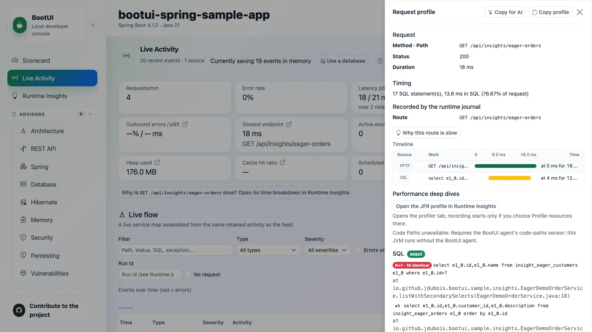

# 00 - Runtime understanding

**Time:** 10 minutes. **Question:** Can we remove unnecessary database work without changing what the user receives?

An agent can read a loop in your source, but it cannot infer which request reached it, which configuration selected
it, or whether the new method ran after an edit. BootUI supplies bounded evidence from the application while it runs.

## Your mission

You are maintaining an order service. `GET /api/insights/eager-orders` returns correct-looking summaries, but
there is a report of repeated database work. Your job is to investigate that report, explain its cause, and fix
only what the evidence supports. A second endpoint returns the same summaries and provides a control.

The facilitator sends one request and opens it in **Live Activity**. Before looking for a recommendation, ask:
how many database statements did this request need, and which application code caused them?
Do not assume the endpoint's name, an annotation, or an advisor finding proves the answer.

You will first identify the running code and measure the original/control requests. Then you will use repeated
samples to test a hypothesis, let the coding agent propose one change, and protect the response with a regression
test. Finally, you will prove the changed method executed in the live application and compare its database work.

Success needs all three: **the same response, less captured SQL, and proof the live process ran the changed code**.
A saved file, passing test in another process, or higher score alone is not enough. This local exercise does not
promise a particular response-time improvement.

Two short side investigations cover an import that rolls back but answers 200 and a task that runs after the
response. They help you question incomplete evidence, not expand the order-query fix. The sample contains
intentional teaching fixtures, not examples to copy into your own application.

*Illustrative reference: HTTP 200 and a correct response do not explain why this request issued 17 SELECTs.*

## Two agents, two jobs

The **BootUI Java agent** is JVM instrumentation attached with `-javaagent`. It records method/side-effect metadata
and follows raw executor work. It stays local and is optional for BootUI itself.

The **AI coding agent** is your CLI/IDE assistant. It reads BootUI through MCP or the CLI, proposes a plan, and edits
code only within an approved scope. Its model may be remote.

The first half works without Java instrumentation. You attach it explicitly in Chapter 05. You connect the coding
agent during setup and use it for assessment and the capstone.

## Observations are not advisor scores

An **advisor** evaluates a rule, such as an eager mapping, and reports severity and evidence. The **Scorecard**
summarizes eligible known-findings scores.

A **runtime observation** counts actual behavior: repeated SELECTs on a route, for example. It has samples,
exemplars, verification guidance, and limits, but no severity or Scorecard penalty.

The existence of an eager mapping does not prove every request has an N+1 problem. A repeated-query observation does
not prove every eager mapping should become lazy. You will join runtime evidence with source and intended behavior.

## Checkpoint

In your worksheet, write one sentence for each:

- What you are trying to improve, what must stay unchanged, and what would prove success.
- Why an edited file does not prove the local application ran the new method.
- The difference between the Java agent and coding agent.
- The difference between an advisor finding and runtime observation.

Next, establish that your tools are connected to the right local application before trusting their evidence.

**Next:** [01 - Setup and tooling](01-setup-and-tooling.md).
