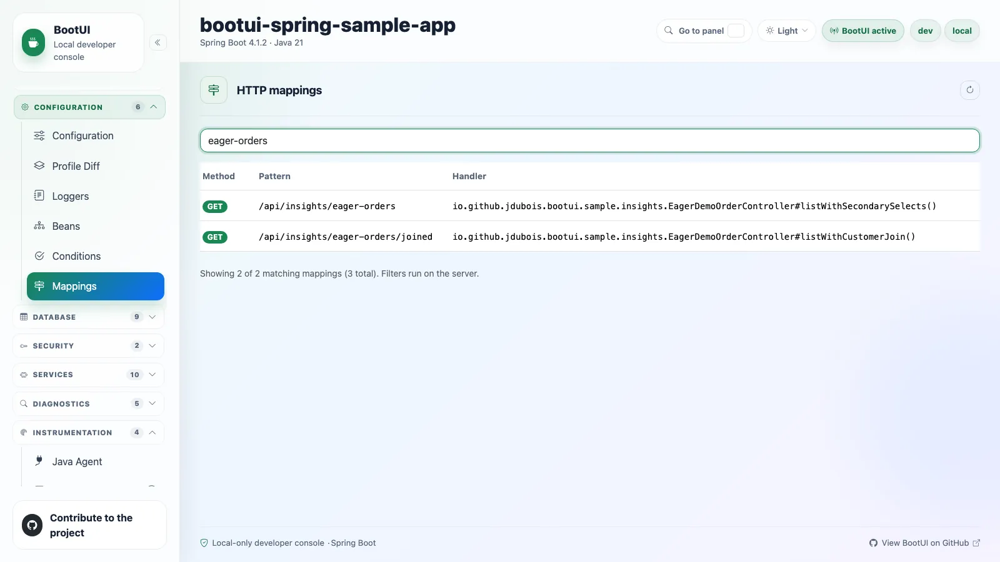

# 02 - Configuration and wiring

**Time:** 15 minutes. **Goal:** Find the code that owns the order request and predict its database work.

You have connected to the right process. Before counting SQL or accepting a fix, establish which handler, service,
repository, and datasource are actually in use. Your prediction is a hypothesis, not a diagnosis.

## Follow the order route

In **Mappings**, search `eager-orders`. Locate both:

- `GET /api/insights/eager-orders`
- `GET /api/insights/eager-orders/joined`

Open their handler details. In your editor follow the controller to `EagerDemoOrderService`, then
`EagerDemoOrderRepository`, under `bootui-spring-sample-app/src/main/java/io/github/jdubois/bootui/sample/insights/`.

Open only the original route's `findWithSecondarySelects` query without changing anything.
Leave the other finder for Chapter 06:

```java
@Query("select o from EagerDemoOrder o order by o.id")
List<EagerDemoOrder> findWithSecondarySelects();
```

Find the eager `customer` relationship in the entity and the `OrderSummary` mapping in the service. Which data
must Hibernate load to build a response? Does this query explicitly retrieve all of it? Record your prediction.
An eager relationship requires the associated data to be loaded; it does not guarantee one joined SQL statement.

Locate the control route's handler, but save its query implementation for Chapter 06, after you have measured both
routes and written your own explanation. Both routes are intended to return the same summaries; runtime evidence
will tell you whether their database work differs.

In **Beans**, search `EagerDemoOrderService`. Inspect its dependencies and proxy information. Use **Transactions**
to see transaction metadata and the runtime capture state. A `@Transactional` annotation is not a captured
transaction; self-invocation and proxy boundaries matter.



*Illustrative reference: identify both entry points before predicting their database work.*

## Confirm which database you are measuring

In **Configuration**, search `spring.datasource.url`. Record the effective datasource and property source, not
just the string in a file. Open **Database Connection Pools** to identify the live datasource. Your before/after
comparison must use the same fixture and database.

Find the active profiles and a property whose command-line value overrides the file, such as your alternate
`server.port`. Use **Profile Diff** to distinguish different property sources where available.
Keep values masked and do not use a secret as your override demonstration.

**Optional configuration check:** The dev fixture uses H2 and an in-memory Caffeine cache. Search `spring.cache.type`
and `spring.cache.caffeine.spec` to confirm:

```properties
spring.cache.type=caffeine
spring.cache.caffeine.spec=maximumSize=500,expireAfterWrite=5m,recordStats
```

Open **Cache** if time remains. Do not execute SQL or clear a cache just to make a panel look populated.
Cache tuning is not part of this investigation. Absent access capture is different from zero misses.

## Run one advisor, not every scan

Explicitly run **Hibernate**'s advisor scan. Inspect `HIB-FETCH-001` and `HIB-QUERY-005` if reported. Record the rule id,
severity, and affected sample. Follow the reference explanation before accepting a fix.

An annotation/query advisor can report a risk before you send traffic. You have not yet demonstrated the route's
runtime query count. A cached report read is not a fresh scan, and **Scorecard** is not runtime coverage.

Do not “fix all” the sample. It intentionally contains counterexamples across many advisors.

## Checkpoint

Record the target handler/service/repository, eager relationship, effective datasource source, one advisor finding,
and cache provider if you inspected it. State your prediction and what runtime evidence would confirm or
disprove it. You have found a possible risk; next you will measure an actual request.

**Optional:** Inspect **Architecture**, **REST API**, or **Spring** advisor descriptions without starting an additional
scan. Identify a rule that would need intent/context before changing code.

**Previous:** [01 - Setup and tooling](01-setup-and-tooling.md).
**Next:** [03 - Runtime journal](03-runtime-journal.md).
