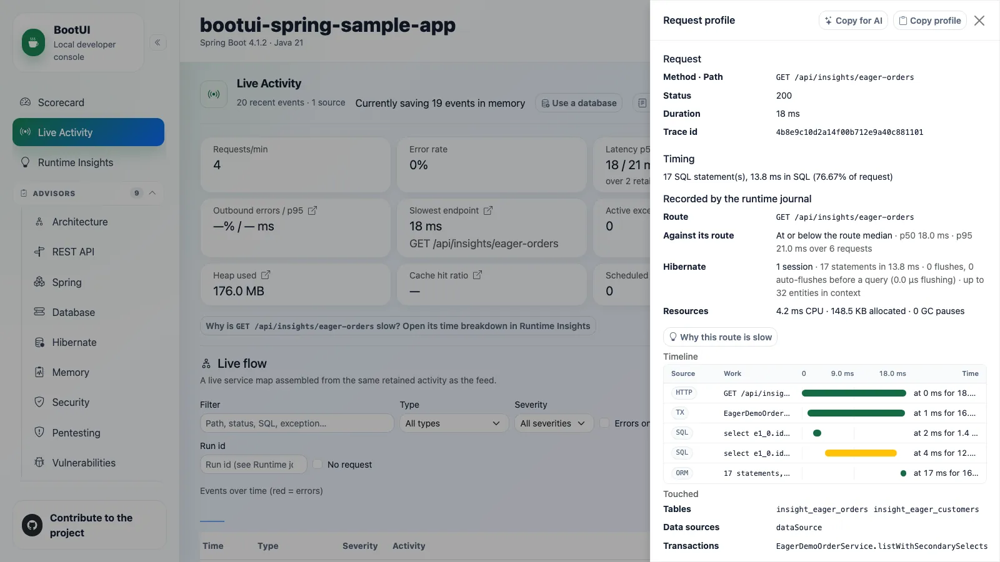

# 03 - Runtime journal

**Time:** 25 minutes. **Goal:** Measure the database work behind a correct order response.

Your source-level prediction now needs runtime evidence. Compare one original request with one control request
before deciding whether the database work is necessary.

## Generate a bounded workload

Use terminal 2 and the `BOOTUI_URL` established in Chapter 01, including any alternate port. Commands below use a
POSIX shell:

```bash
printf 'Workshop application: %s\n' "$BOOTUI_URL"
curl -fsS "$BOOTUI_URL/api/insights/eager-orders"
curl -fsS "$BOOTUI_URL/api/insights/eager-orders/joined"
```

PowerShell equivalent:

```powershell
Write-Output "Workshop application: $env:BOOTUI_URL"
Invoke-RestMethod "$env:BOOTUI_URL/api/insights/eager-orders" -ErrorAction Stop
Invoke-RestMethod "$env:BOOTUI_URL/api/insights/eager-orders/joined" -ErrorAction Stop
```

Prefer `curl.exe` on Windows if you want curl's flags; Windows PowerShell's `curl` alias can mean something else.
Chapter 01's launch binds the sample to loopback. BootUI's guards alone would not restrict application fixture
routes. These two requests read synthetic data and need no authentication.

## Investigate one request

In **Live Activity**, select the journal source and filter to `GET /api/insights/eager-orders`. Open a profileable
request. Record its request id, run id, duration, SQL count/groups, and correlation tiers.

Follow the SQL evidence into **SQL Trace**, **Transactions**, and any retained **Exceptions** or **Log Tail**. The original
route normally prepares **17 SELECTs** for 16 orders/customers; the joined control normally prepares **one**.
The repository acceptance test allows small framework variation. Count the request's SELECTs, not all startup SQL.

### Explain the 1 + N



*Illustrative reference: inspect one request's SQL, transaction, and ORM evidence together, not all startup SQL.*

The fixture has 16 orders with 16 distinct customers. The original request first loads the orders, then issues
one secondary customer SELECT per order: **1 + 16 = 17 SELECTs**. This is the N+1 pattern in this fixture.
The response can still be correct; the problem is how much database work produces it.

Use the SQL shapes and Chapter 02's mapping/query to explain that extra work in your own words. The control's
one SELECT and equivalent response are evidence that this response can be produced with fewer queries.
This does not mean every eager relationship causes N+1, or that changing every relationship to lazy is a fix.
You still need repeated samples and a safe change boundary.

BootUI assigns execution identities even when distributed tracing is unavailable. `REQUEST_ID` is a direct match;
`PROPAGATED` will require the Java agent's executor sensor later. A heuristic fallback is not equally strong.
Copying a trace id from unrelated work is not correlation.

Use the equivalent read-only CLI:

```bash
bootui activity --limit 50 --json
bootui request-profile '<actual-request-id>' --json
```

Replace the placeholder with a current `REQUEST` entry whose `profileable` is true. If no profile remains, pick a
current request and read the retention reason; do not repeatedly retry an evicted id.

## Side investigation: a failure behind HTTP 200

Spend at most five minutes on this separate fixture. Its lesson is that the HTTP result is only part of the
evidence, just as a correct order response says nothing about its SQL cost. Do not add an import fix to your mission.

Send one deliberate synthetic mutation:

```bash
curl -fsS -X POST "$BOOTUI_URL/api/insights/orders/6/import"
```

PowerShell:

```powershell
Invoke-RestMethod -Method Post "$env:BOOTUI_URL/api/insights/orders/6/import" -ErrorAction Stop
```

This fixture begins a transaction, writes, throws `InsightImportException`, rolls back, and is caught by the
controller, which logs an ERROR and returns an accepted body with status 200. It is intentionally repeatable.
The sample's `/api/insights/**` security configuration explicitly exempts this fixture from CSRF; this command is
**not** a recipe for bypassing another application's authentication or CSRF.

Select the import request in Live Activity. Compare the response to transaction rollback and ERROR evidence.
Follow an exception group when retained; its cause/detail can be in a shorter-lived panel buffer than the journal
row. Explain why a successful curl exit does not mean a successful business operation.

## Distinguish three retention windows

| Evidence | Lifetime/limit |
| --- | --- |
| Runtime journal | Bounded events and profiles; status exposes backlog, drops, and eviction |
| Panel buffers | Rich SQL/log/exception details can expire independently |
| Application run summary | Prior-run aggregate for comparison, not a full archive of every profile |

Open **Recording** and record queue/dropped/evicted information. Do not clear the recording now: clearing also
removes retained agent evidence and can invalidate later comparisons. Disabling a source panel hides its evidence.
Persistence is optional and does not make the stream a production monitoring guarantee.

## Checkpoint

Save two request ids and the import's HTTP/transaction/log result. Explain the strongest correlation tier and
which information could disappear first. For the main investigation, write the original/control SQL counts and
your explanation of the 1 + N. Next, check whether that pattern survives repeated requests.

**Optional:** Use **Copy for AI** in a profile drawer, review the preview/omissions, and keep it locally. The button
copies evidence; it does not send anything to a model.

**Previous:** [02 - Configuration and wiring](02-configuration-and-wiring.md).
**Next:** [04 - Runtime Insights](04-runtime-insights.md).
