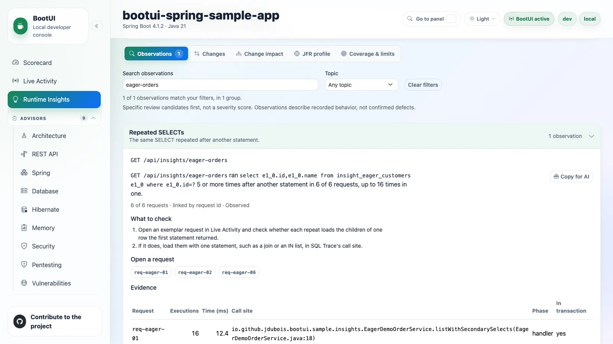

# 04 - Runtime Insights

**Time:** 25 minutes. **Goal:** Test whether the repeated order queries are a reproducible pattern.

One request suggested N+1 database work. Now test that explanation against repeated requests and the control.
Do not turn an isolated trace or an advisor warning into an application-wide performance claim.

## Collect comparable samples

Send six requests to each route, sequentially. The first can be cold; five more provide warm samples.

```bash
for i in 1 2 3 4 5 6; do
  curl -fsS "$BOOTUI_URL/api/insights/eager-orders" > /dev/null &&
  curl -fsS "$BOOTUI_URL/api/insights/eager-orders/joined" > /dev/null || break
done
```

PowerShell:

```powershell
1..6 | ForEach-Object {
  Invoke-RestMethod "$env:BOOTUI_URL/api/insights/eager-orders" -ErrorAction Stop | Out-Null
  Invoke-RestMethod "$env:BOOTUI_URL/api/insights/eager-orders/joined" -ErrorAction Stop | Out-Null
}
```

If a request fails, stop and resolve the displayed error; an incomplete loop is not six samples. Wait briefly for
journal processing, then open **Runtime Insights**, search for the original route, expand the **Repeated SELECTs**
group, and select the route in **Observation**. Search reveals observations that may be omitted from the default
list. The CLI's compact default also omits repeated SELECTs, so request the kind explicitly:

```bash
bootui insights list --query repeated-selects --json
```

## Explain repeated SELECTs

Open the original route's `repeated-selects` observation. Record status, sample count, route, exemplar request,
repeated SQL shape, and verification guidance.

The observation requires the same SELECT to repeat at least five times after another statement, across at least
three requests. One request alone cannot establish it. Literal values stay masked.

The joined control returns the same summaries but should not meet that repetition pattern. Absence of a
recommendation alone is not proof: open its request SQL, check coverage, and compare counts.

**SQL Trace** gives request detail; the **Hibernate** advisor explains a mapping/query risk; **Runtime Insights**
aggregates observed behavior across requests. They are complementary, not three independent proofs of root cause.



*Illustrative reference: six requests reproduce the same customer SELECT pattern; explain it before accepting a recommendation.*

## Side investigation: what transaction evidence adds

Keep this short and separate from the query fix. These fixtures practice the same habit: compare observed behavior
with intended behavior instead of treating a label or annotation as the answer.

Find the import observation after Chapter 03's request. Inspect its HTTP success and failure evidence. Follow its
exemplar rather than guessing from a title.

Now send these two bounded synthetic mutations:

```bash
curl -fsS -X POST "$BOOTUI_URL/api/insights/orders/2/confirm"
curl -fsS -X POST "$BOOTUI_URL/api/insights/orders/3/ship"
```

Use `Invoke-RestMethod -Method Post ... -ErrorAction Stop` on PowerShell. The confirm fixture uses an audit `REQUIRES_NEW` transaction;
the ship control writes its audit in the same transaction. Compare transaction identities/relationships. These
are demonstration updates to seeded rows, not production operations.

For the audit, inspect the request's journal/activity transaction detail (`REQUIRES_NEW`) and separate connection
ids. In corrected builds, compact `bootui tx list` also identifies the independent audit child.

::: details Boundary labels in corrected builds
Builds containing the correction use `REQUIRES_NEW` for confirm's audit child. `NEW` means a physical begin without a
known parent, not a declared annotation. The journal keeps its historical root `REQUIRED` label. Savepoints are
`NESTED`, not independent commits.
:::

::: details Legacy compact transaction labels
<!-- bootui-workshop:history:start -->
Servers through 2.3.0 can label this child `PARTICIPATING`. Do not use the compact label alone to contradict the
journal and source or change the sample to hide the mismatch; this summary limitation is not evidence that Spring
executed the transactions incorrectly.
<!-- bootui-workshop:history:end -->
:::

If time remains, compare `/api/insights/orders/5/recalculate` with `/5/recalculate-through-bean` using POST.
Read the self-invocation evidence; an annotation bypass is a proxy-boundary question, not proof a write failed.

## Read route-time breakdown honestly

Open an eager-order route's timing breakdown after warm samples. It requires at least five warm requests.
Separate captured SQL time from handler time and other/unknown time. A large unknown component is a coverage gap,
not “business logic must be slow.” Local timings are noisy, so query-count reduction is the capstone's primary
observable, not an absolute millisecond promise.

Read these states as evidence:

| State | Meaning for this workshop |
| --- | --- |
| `OBSERVED` | Enough captured evidence supports the stated observation |
| `INSUFFICIENT` | More qualifying work is needed |
| `PARTIAL` | Some required evidence is missing |
| `NOT_APPLICABLE` | The condition does not apply to this stack/work |
| `UNAVAILABLE` | A source/capability was not installed or enabled |
| `NOT_COMPARABLE` | The two evidence windows cannot support that comparison |

None of the last five is a passing assessment. These observations do not subtract Scorecard points.

## Checkpoint and break

Record one observation, its positive route and counterexample, sample size, source limits, and verification task.
For the eager-order investigation, state whether your original hypothesis survived the control and repeated samples.
You now have a reproducible problem; after the break you will attribute its work to an executed method and save the
baseline needed to verify a fix. Do not approve code changes yet.

**Take the scheduled ten-minute break.** If setup is behind, pair with a working participant rather than skipping
the later verification steps.

**Previous:** [03 - Runtime journal](03-runtime-journal.md).
**Next:** [05 - Java instrumentation](05-java-instrumentation.md).
