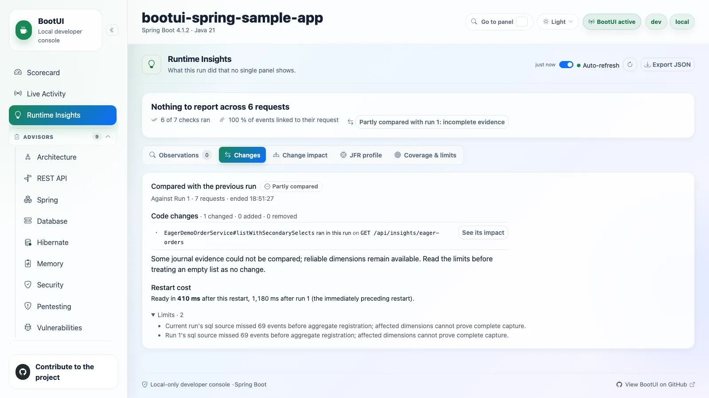

# 08 - Going further

**Time:** 5 minutes. **Goal:** Explain your result and transfer the method without assuming framework parity.

Return to the mission: an order endpoint returned correct data but did unnecessary database work. Your handoff
must explain the cause and the measured result, not list the panels you opened or repeat the agent's conclusion.

## Give a one-minute handoff

Use your worksheet to say:

```text
On GET /api/insights/eager-orders, run <before> observed <sample count> requests
with <SQL count> SELECTs per request. The extra queries came from <cause supported by SQL and source>.
Action <id>, plan <version>, changed only <method>.
The acceptance test passed and the live changed method executed in run <after>.
The response stayed equal and <sample count> requests now showed <SQL count> SELECTs.
Comparison coverage was <coverage>; we cannot conclude <unmeasured claim>.
```

Have a partner identify one unsupported claim. A good answer can include “not measured.”
If your test passed but live execution or the before/after comparison was missing, report that part as incomplete.
Do not turn a query-count improvement into an unmeasured latency or whole-application health claim.



*Illustrative reference: report the comparison's limitation even when separate request profiles and execution evidence support the fix.*

## Take the workflow to your application

Start with local activation, masked values, one real route, and its owning code. Read availability before adding
optional dependencies. Build a reproducible workload and a real regression test, then use a bounded coding-agent
assessment.

Do not copy intentionally unsafe fixtures or expose the developer console to production. Keep diagnostics
separate from the application's own authentication/CSRF policy.

MVC supplies the full reference exercise. WebFlux has reactive/SQL timing limits; Quarkus uses native integration
points and has no transaction capture. See [Appendix C](appendix-c-frameworks.md) before translating an exercise.
The outcome is the same evidence discipline, not identical panel counts.

## Pick a take-home lab

[Appendix D](appendix-d-extensions.md) covers durable history, JFR, optional sensors, services, and application AI.
Choose one question to investigate, record the separate action approval, and keep its bounds explicit.

Clean up by stopping the local application and coding-agent session. Keep your worksheet and the exercise branch
if useful. Remove only your own generated report/capture files; do not run a destructive repository reset.

**Previous:** [07 - Agent change loop](07-agent-change-loop.md).
**Reference:** [Workshop overview](README.md) and [participant worksheet](participant-worksheet.md).
