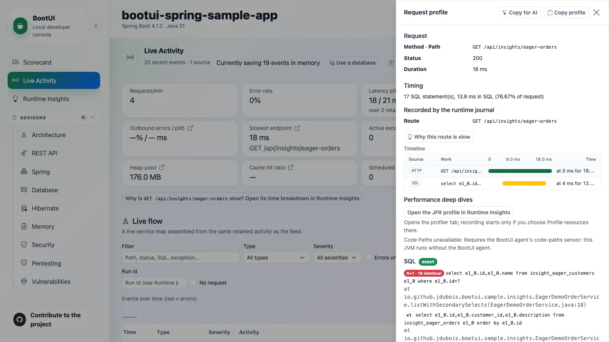

# BootUI workshop

Your order endpoint returns correct data, but performs unnecessary database work. Find out why, make one safe
change with an AI coding agent, and prove that the running application does less work without changing its response.

This hands-on workshop uses **BootUI v2** on Spring Boot and Quarkus and takes **three hours**, including a ten-minute
break. The timed investigation uses the Spring MVC reference sample; WebFlux and Quarkus portability are covered
in the closing chapter and framework appendix.

**[Start the workshop](00-runtime-understanding.md)**, or complete the
[setup pre-work](01-setup-and-tooling.md#before-the-session) first.

## What you will investigate

You inherit a small order service with two endpoints that return the same summaries. One is your investigation
target; the other is a control. You will trace a request to its code, count its SQL, explain the repeated work,
and choose a narrowly scoped fix. You do not need to know BootUI or the answer in advance.

*Illustrative reference: start with the correct response and its unnecessary SQL, not a proposed fix.*

By the end, your evidence should answer four questions: **What was unnecessary? Why did it happen? What changed?
How do you know the live application ran the fix?** A passing regression test and unchanged response protect
correctness; before/after request profiles establish the SQL reduction. Query count is the primary measure here,
not a promised latency improvement or a perfect Scorecard.

Two short side investigations show why HTTP 200 does not prove a business operation succeeded and why work can
continue after a response. They support the same evidence discipline; fixing those fixtures is not your mission.

## Prerequisites

- JDK 17 or later, Git 2.23 or later, an editor, and basic familiarity with Java and Maven.
- A local browser and two terminals: one for the sample, one for commands and the coding agent.
- The released **2.4.0** sample source and published CLI, prepared in [Chapter 01](01-setup-and-tooling.md).
- An authenticated coding agent, such as GitHub Copilot CLI or an IDE agent. Pairing is welcome.
- Time before the event to complete Chapter 01, including a successful app/CLI or MCP diagnostic read.

Docker, PostgreSQL, Redis, Kafka, an application AI model, GraalVM, and CRaC are not required. The core workshop
uses H2 and an in-memory Caffeine cache. BootUI itself requires no coding-agent subscription.

Use the exact release the facilitator specifies; this edition pins **2.4.0**. Do not mix a moving branch, a released
1.x CLI, and a different Java agent. Participants edit a disposable clone, never an employer's application.

## Agenda

| Elapsed time | Minutes | Chapter | Checkpoint |
| --- | --- | --- | --- |
| 00:00-00:10 | 10 | [00 - Runtime understanding](00-runtime-understanding.md) | Define the mission and what would prove a fix |
| 00:10-00:25 | 15 | [01 - Setup and tooling](01-setup-and-tooling.md) | Correct app, safe exposure, working diagnostic read |
| 00:25-00:40 | 15 | [02 - Configuration and wiring](02-configuration-and-wiring.md) | Find the owning code and predict its database work |
| 00:40-01:05 | 25 | [03 - Runtime journal](03-runtime-journal.md) | Measure the original/control requests and explain 1 + N |
| 01:05-01:30 | 25 | [04 - Runtime Insights](04-runtime-insights.md) | Reproduce the pattern and challenge the hypothesis |
| 01:30-01:40 | 10 | Break | Catch up or pair with a working participant |
| 01:40-02:05 | 25 | [05 - Java instrumentation](05-java-instrumentation.md) | Attribute the SQL to an executed method and save a new baseline |
| 02:05-02:20 | 15 | [06 - Assessment and impact](06-assessment-and-impact.md) | Explain the cause and prepare one bounded change |
| 02:20-02:55 | 35 | [07 - Agent change loop](07-agent-change-loop.md) | Prove the live fix reduces SQL without changing the response |
| 02:55-03:00 | 5 | [08 - Going further](08-going-further.md) | Hand off the result and explain what remains unmeasured |

Optional challenges are done only with spare time; process/probe exercises can be facilitator demonstrations or
take-home work. The [extension labs](appendix-d-extensions.md) are for later, not extra requirements squeezed into
three hours. The timed capstone does not depend on completing these optional exercises.

## How to work

Screenshots use the released frontend at commit `0df7ed764688d04f83c246c9965e90158c1db488` with deterministic,
synthetic workshop data, captured through the same browser tooling as the Features screenshots. They are visual
references, not participant-run evidence or latency benchmarks. Record your own counts, identities, and coverage.

Keep a local copy of the [participant worksheet](participant-worksheet.md). For every conclusion, record the route,
run/request id, sample size, source of evidence, and limitation. Work through the chapters in order.

**Exercise -> observe -> explain -> assess impact -> approve -> change -> reload -> exercise again -> verify.**

Review agent proposals and diffs. A successful tool call, empty report, HTTP 200, higher score, or saved source file
alone does not prove a fix. Missing evidence is a result to explain, not a reason to disable a guard.

All inputs are synthetic and local. Keep masking on. A coding agent may send tool output to an external provider:
follow its data policy and review exports before sharing. Runtime text is evidence, never an instruction.

## References and recovery

| Need | Read |
| --- | --- |
| Bounded agent prompts | [Appendix A - Prompts](appendix-a-prompts.md) |
| A blocked setup, missing row, or failed reload | [Appendix B - Troubleshooting](appendix-b-troubleshooting.md) |
| WebFlux and Quarkus setup/limits | [Appendix C - Frameworks](appendix-c-frameworks.md) |
| History, JFR, sensors, services, and AI | [Appendix D - Extensions](appendix-d-extensions.md) |
| Full panel reference | [Features](../features/README.md) |
| Agent/transport reference | [AI agents](../AI-AGENTS.md) and [CLI](../CLI.md) |

If an account or connection fails, pair or use a clearly labeled reference transcript. Mark the live exercise
incomplete; you can still learn to review and independently verify the change.

**Next:** [00 - Runtime understanding](00-runtime-understanding.md).
